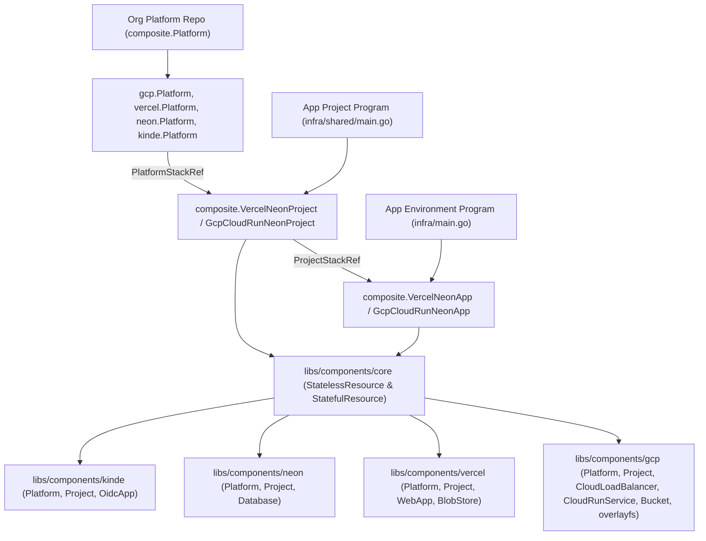

# OpenBase

OpenBase is a Go Pulumi component library (`github.com/cloudvoyant/openbase/libs/components`) for declaring stateless and stateful cloud infrastructure across **Google Cloud Platform**, **Vercel**, **Neon**, and **Kinde** using a three-tier **Platform -> Project -> Environment** convention aligned with Premise (`infra/shared` + `infra`).



## Install

```sh
go get github.com/cloudvoyant/openbase/libs/components@latest
```

## Packages

| Import Path | Purpose | Declarative Specs |
| :--- | :--- | :--- |
| `github.com/cloudvoyant/openbase/libs/components/core` | `PlatformResource` vs `Resource` (`StatelessResource`, `StatefulResource`) contracts, `shared`/`dev`/`stage`/`prod`/`preview-<slug>` rules (`shared` omits `env` from naming), domain formulas, tags, and `Links` | `PlatformResource`, `StatelessResource`, `StatefulResource`, `Stateless`, `Stateful`, `ResolveLinks` |
| `github.com/cloudvoyant/openbase/libs/components/gcp` | Org-wide WIF/APIs/KMS/wildcard HTTPS Load Balancers (`*.gcp.cloudvoyant.io`), per-app Artifact Registry projects, Cloud Run v2 services, and GCS buckets with zero-copy preview overlays | `Platform`, `Project`, `CloudLoadBalancer`, `CloudRunService`, `Bucket`, `overlayfs.Store` |
| `github.com/cloudvoyant/openbase/libs/components/vercel` | Team-level settings, per-app Vercel Projects (`staging` CustomEnvironment, domains, bypass, shared Blob store), WebApp deployments/aliases, and keyless GCP OIDC federation | `Platform`, `Project`, `WebApp`, `BlobStore`, `BlobOverlayClient` |
| `github.com/cloudvoyant/openbase/libs/components/neon` | Org defaults, per-app Neon Project clusters, and copy-on-write branched serverless PostgreSQL over `kislerdm/neon` | `Platform`, `Project`, `Database` |
| `github.com/cloudvoyant/openbase/libs/components/kinde` | Org two-tenant (`dev` + `prod`) connections, per-app OIDC `Application` pairs, and per-environment tier routing over `kinde-oss/kinde` | `Platform`, `Project`, `OidcApp` |
| `github.com/cloudvoyant/openbase/libs/components/composite` | Turnkey org `Platform`, Premise `infra/shared` `*Project`, and `infra/` per-environment `*App` blueprints wired via `StackReference` | `Platform`, `VercelNeonProject`, `VercelNeonApp`, `GcpCloudRunNeonProject`, `GcpCloudRunNeonApp` |
| `github.com/cloudvoyant/openbase/libs/components/synthetic` | Offline deterministic doubles for `< 2s` unit tests | `Service`, `Storage` |

## Development

```sh
mise run install          # Install pinned Go, Pulumi, golangci-lint, and mmdc tools
mise run generate:check   # Verify bridged Go SDKs (internal/providers/{neon,kinde}) have zero drift
mise run format:check     # Verify Go formatting
mise run lint             # Run golangci-lint across libs/components and e2e/components
mise run test             # Run fast offline WithMocks + synthetic tests
mise run e2e -- core      # Run offline standalone Go consumer fixture preview test
```

### Live Cloud E2E Tests

Every module is verified against dedicated OpenBase cloud sandboxes (see [e2e/README.md](./e2e/README.md)):

```sh
mise run e2e:gcp
mise run e2e:neon
mise run e2e:kinde
mise run e2e:vercel
mise run e2e:live
```

## Publishing & Releases

`libs/components` is configured with `package.public: true` in `premise.yaml` (`package_managers: [go]`) and publishes directly from the repository's shared `vX.Y.Z` Git tag:

- Include `[publish-rc]` in a commit message on a pull request branch to publish a release-candidate tag (`vX.Y.Z-rc.N`) via `.github/workflows/on-commit.yml`.
- Merging to `main` runs `.github/workflows/on-merge.yml` (`pm release publish`), tagging the next semantic version so Go consumers resolve `github.com/cloudvoyant/openbase@vX.Y.Z` immediately.

## Documentation

- [User Guide](./docs/user-guide.md)
- [Architecture Overview](./docs/architecture/index.md)
- [Resource Contracts & Links](./docs/architecture/resources.md)
- [GCP Provider](./docs/architecture/providers/gcp/index.md)
- [Vercel Provider](./docs/architecture/providers/vercel/index.md)
- [Neon Provider](./docs/architecture/providers/neon/index.md)
- [Kinde Provider](./docs/architecture/providers/kinde/index.md)
- [Composite Blueprints](./docs/architecture/providers/composite/index.md)
- [End-to-End Test Suite](./e2e/README.md)
