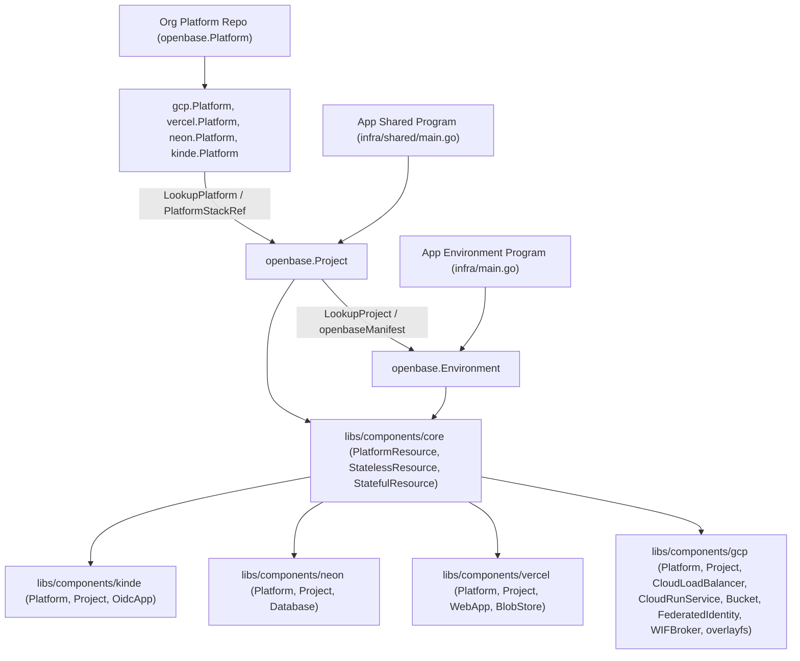

# OpenBase

OpenBase is a Go Pulumi component library (`github.com/cloudvoyant/openbase/libs/components`) that declares stateless and stateful cloud infrastructure across Google Cloud Platform, Vercel, Neon, and Kinde. It models infrastructure as three scopes (`openbase.Platform`, `openbase.Project`, and `openbase.Environment`) aligned with Premise (`infra/shared` and `infra`).



## Install

```sh
go get github.com/cloudvoyant/openbase/libs/components@latest
```

## Packages

| Import Path | Purpose | Declarative Specs |
| :--- | :--- | :--- |
| `github.com/cloudvoyant/openbase/libs/components` | Unified `Platform`, `Project`, and `Environment` scopes, typed `Add`, cross-stack `LookupPlatform` and `LookupProject`, and `openbaseManifest` exports | `Platform`, `Project`, `Environment`, `NewProject`, `NewEnvironment`, `Add`, `LookupPlatform`, `LookupProject` |
| `github.com/cloudvoyant/openbase/libs/components/core` | `PlatformResource` and `Resource` (`StatelessResource`, `StatefulResource`) contracts, environment rules, domain formulas, tags, `Links`, and `IdentityBroker` | `PlatformResource`, `StatelessResource`, `StatefulResource`, `Platform`, `Stateless`, `Stateful`, `ResolveLinks`, `IdentityBroker` |
| `github.com/cloudvoyant/openbase/libs/components/gcp` | Org WIF, APIs, KMS, and wildcard HTTPS Load Balancers, per-app Artifact Registry projects, Cloud Run v2 services, `FederatedIdentity` and `WIFBroker` OIDC brokers, and GCS buckets with preview overlays | `Platform`, `Project`, `CloudLoadBalancer`, `CloudRunService`, `Bucket`, `FederatedIdentity`, `WIFBroker`, `overlayfs.Store` |
| `github.com/cloudvoyant/openbase/libs/components/vercel` | Team configuration, per-app Vercel Projects (`staging` CustomEnvironment, domains, bypass, shared Blob store), WebApp deployments, and OIDC subject claims | `Platform`, `Project`, `WebApp`, `BlobStore`, `BlobOverlayClient` |
| `github.com/cloudvoyant/openbase/libs/components/neon` | Org defaults, per-app Neon Project clusters, and copy-on-write branched serverless PostgreSQL over `neondatabase/neon` | `Platform`, `Project`, `Database` |
| `github.com/cloudvoyant/openbase/libs/components/kinde` | Org two-tenant (`NonProd` and `Prod`) connections, per-app OIDC `Application` pairs, and per-environment tier routing over `kinde-oss/kinde` | `Platform`, `Project`, `OidcApp` |
| `github.com/cloudvoyant/openbase/libs/components/synthetic` | Offline deterministic doubles for fast unit tests | `Service`, `Storage` |

## Development

```sh
mise run install          # Install pinned Go, Pulumi, and golangci-lint tools
mise run generate:check   # Make sure that bridged Go SDKs have zero drift
mise run format:check     # Make sure that Go formatting matches golangci-lint
mise run lint             # Run golangci-lint across libs/components and e2e/components
mise run test             # Run fast offline WithMocks and synthetic tests
mise run e2e -- core      # Run offline standalone Go consumer fixture preview test
```

### Live Cloud E2E Tests

Run live end-to-end suites against dedicated OpenBase cloud sandboxes (see [e2e/README.md](./e2e/README.md)):

```sh
mise run e2e:gcp
mise run e2e:neon
mise run e2e:kinde
mise run e2e:vercel
mise run e2e:apps
mise run e2e:live
```

## Publishing and Releases

`libs/components` sets `package.public: true` in `premise.yaml` (`package_managers: [go]`) and publishes from the shared `vX.Y.Z` Git tag:

- Include `[publish-rc]` in a commit message on a pull request branch to publish a release-candidate tag (`vX.Y.Z-rc.N`) through `.github/workflows/on-commit.yml`.
- Merge to `main` to run `.github/workflows/on-merge.yml` (`pm release publish`), which tags the next semantic version so Go consumers resolve `github.com/cloudvoyant/openbase@vX.Y.Z`.

## Documentation

- [User Guide](./docs/user-guide.md)
- [Architecture Overview](./docs/architecture/index.md)
- [Unified Scopes and Manifests](./docs/architecture/scopes.md)
- [Resource Contracts and Links](./docs/architecture/resources.md)
- [GCP Provider](./docs/architecture/providers/gcp/index.md)
- [Vercel Provider](./docs/architecture/providers/vercel/index.md)
- [Neon Provider](./docs/architecture/providers/neon/index.md)
- [Kinde Provider](./docs/architecture/providers/kinde/index.md)
- [End-to-End Test Suite](./e2e/README.md)
