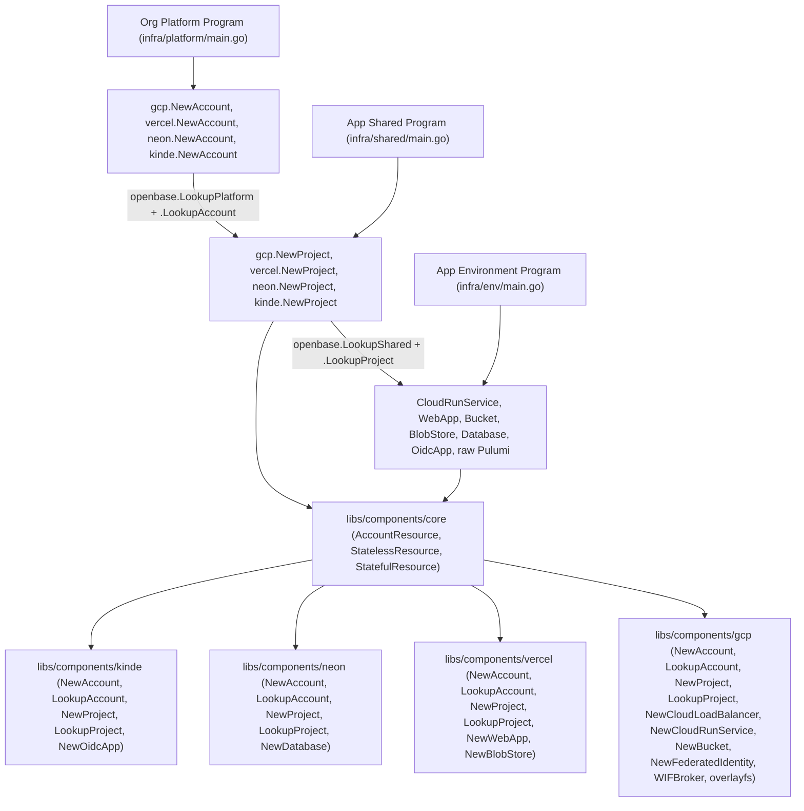

# OpenBase

OpenBase is a Go Pulumi component library (`github.com/cloudvoyant/openbase/libs/components`) that provisions stateless and stateful cloud infrastructure across Google Cloud Platform, Vercel, Neon, and Kinde. Every component uses the standard Pulumi Go constructor signature `New<Resource>(ctx, name, &<Resource>Args{...}, opts...)` across Premise's three root programs (`infra/platform`, `infra/shared`, and `infra/env`).



## Install

```sh
go get github.com/cloudvoyant/openbase/libs/components@latest
```

## Packages

| Import Path | Purpose | Constructors and Helpers |
| :--- | :--- | :--- |
| `github.com/cloudvoyant/openbase/libs/components` | Cross-stack `LookupPlatform` and `LookupShared` helpers and supported environment conventions | `LookupPlatform`, `LookupShared`, `SupportedEnvironments` |
| `github.com/cloudvoyant/openbase/libs/components/core` | `AccountResource` and `Resource` (`StatelessResource`, `StatefulResource`) contracts, environment rules, domain formulas, tags, `Links`, `ScopeRef`, and `IdentityBroker` | `AccountResource`, `StatelessResource`, `StatefulResource`, `NewCustomAccount`, `NewCustomStateless`, `NewCustomStateful`, `ResolveLinks`, `IdentityBroker` |
| `github.com/cloudvoyant/openbase/libs/components/gcp` | GCP account foundations (WIF, APIs, KMS, wildcard HTTPS Load Balancers), per-app Artifact Registry projects, Cloud Run v2 services (`OB_ENVIRONMENT`/`OB_REVISION`), `FederatedIdentity` and `WIFBroker` OIDC brokers, and GCS buckets with preview overlays | `NewAccount`, `LookupAccount`, `NewProject`, `LookupProject`, `NewCloudLoadBalancer`, `NewCloudRunService`, `NewBucket`, `NewFederatedIdentity`, `WIFBroker`, `overlayfs.Store` |
| `github.com/cloudvoyant/openbase/libs/components/vercel` | Team account settings, per-app Vercel Projects (`staging` CustomEnvironment, domains, bypass, shared Blob store), WebApp deployments (`OB_ENVIRONMENT`/`OB_REVISION`), and OIDC subject claims | `NewAccount`, `LookupAccount`, `NewProject`, `LookupProject`, `NewWebApp`, `NewBlobStore`, `BlobOverlayClient` |
| `github.com/cloudvoyant/openbase/libs/components/neon` | Org account defaults, per-app Neon Project clusters, and copy-on-write branched serverless PostgreSQL over `neondatabase/neon` | `NewAccount`, `LookupAccount`, `NewProject`, `LookupProject`, `NewDatabase` |
| `github.com/cloudvoyant/openbase/libs/components/kinde` | Kinde Business account (`Environments` map of `EnvironmentCredentials`), per-app OIDC `Application` pairs, and per-environment tier routing over `kinde-oss/kinde` | `NewAccount`, `LookupAccount`, `NewProject`, `LookupProject`, `NewOidcApp` |
| `github.com/cloudvoyant/openbase/libs/components/synthetic` | Offline deterministic doubles for fast unit tests | `NewService`, `NewStorage` |
| `github.com/cloudvoyant/openbase/libs/goutils` | Flat general Go helpers (`RunCommand`, Pulumi retry destroy, and Kinde/Vercel/Neon HTTP clients) | `RunCommand`, `DestroyPulumiStackWithRetry`, `KindeMgmtToken`, `DetectNeonOrgID`, `DetectVercelTeam` |
| `github.com/cloudvoyant/openbase/libs/testutils` | Flat test-only fixture materialization, env overrides, and live sandbox credential checks | `CopyFixtureTo`, `CommandEnvOverrides`, `RequireGCP`, `RequireNeon`, `RequireKinde`, `RequireVercel` |

## Development

```sh
mise run install          # Install pinned Go, Pulumi, and golangci-lint tools
mise run generate:check   # Make sure that bridged Go SDKs have zero drift
mise run format:check     # Make sure that Go formatting matches golangci-lint
mise run lint             # Run golangci-lint across libs/components and e2e/components
mise run test             # Run fast offline WithMocks and synthetic tests
mise run e2e -- core      # Run offline standalone Go consumer fixture preview test
```

### Live Cloud E2E Tests

Run live end-to-end suites against dedicated OpenBase cloud sandboxes (see [e2e/README.md](./e2e/README.md)):

```sh
mise run e2e:gcp
mise run e2e:neon
mise run e2e:kinde
mise run e2e:vercel
mise run e2e:apps
mise run e2e:live
```

## Publishing and Releases

`libs/components` sets `package.public: true` in `premise.yaml` (`package_managers: [go]`) and publishes from the shared `vX.Y.Z` Git tag:

- Include `[publish-rc]` in a commit message on a pull request branch to publish a release-candidate tag (`vX.Y.Z-rc.N`) through `.github/workflows/on-commit.yml`.
- Merge to `main` to run `.github/workflows/on-merge.yml` (`pm release publish`), which tags the next semantic version so Go consumers resolve `github.com/cloudvoyant/openbase@vX.Y.Z`.

## Documentation

- [User Guide](./docs/user-guide.md)
- [Architecture Overview](./docs/architecture/index.md)
- [Cross-Stack Lookups and Manifests](./docs/architecture/scopes.md)
- [Core Resources and Account Contracts](./docs/architecture/resources.md)
- [GCP Provider](./docs/architecture/providers/gcp/index.md)
- [Vercel Provider](./docs/architecture/providers/vercel/index.md)
- [Neon Provider](./docs/architecture/providers/neon/index.md)
- [Kinde Provider](./docs/architecture/providers/kinde/index.md)
- [End-to-End Test Suite](./e2e/README.md)
