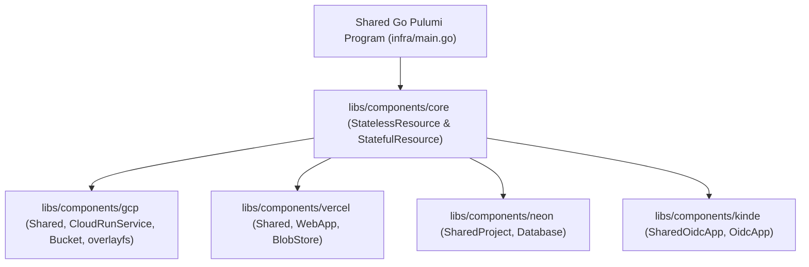

# OpenBase

OpenBase is a Go Pulumi component library (`github.com/cloudvoyant/openbase/libs/components`) for declaring stateless and stateful cloud infrastructure across **Google Cloud Platform**, **Vercel**, **Neon**, and **Kinde** from one shared Pulumi program.



## Install

```sh
go get github.com/cloudvoyant/openbase/libs/components@latest
```

## Packages

| Import Path | Purpose | Declarative Specs |
| :--- | :--- | :--- |
| `github.com/cloudvoyant/openbase/libs/components/core` | Environment validation (`shared`, `dev`, `stage`, `prod`, `preview-<slug>`), naming, `openbase.io/*` tags, escape hatches, and typed `Links` | `Stateless`, `Stateful`, `StatelessResource`, `StatefulResource`, `ResolveLinks` |
| `github.com/cloudvoyant/openbase/libs/components/gcp` | Cloud Run v2 services, GCS buckets with zero-copy preview overlays, and shared WIF/Artifact Registry/KMS roots | `Shared`, `CloudRunService`, `Bucket`, `overlayfs.Store` |
| `github.com/cloudvoyant/openbase/libs/components/vercel` | Team-safe Vercel web apps, Blob stores, custom `staging` environments, and keyless GCP OIDC federation | `Shared`, `WebApp`, `BlobStore`, `BlobOverlayClient` |
| `github.com/cloudvoyant/openbase/libs/components/neon` | Copy-on-write branched serverless PostgreSQL over `kislerdm/neon` | `SharedProject`, `Database` |
| `github.com/cloudvoyant/openbase/libs/components/kinde` | Two-tenant (`dev` + `prod`) OAuth2/OIDC applications over `kinde-oss/kinde` | `SharedOidcApp`, `OidcApp` |
| `github.com/cloudvoyant/openbase/libs/components/synthetic` | Offline deterministic doubles for `< 2s` unit tests | `Service`, `Storage` |

## Development

```sh
mise run install          # Install pinned Go, Pulumi, golangci-lint, and mmdc tools
mise run generate:check   # Verify bridged Go SDKs (internal/providers/{neon,kinde}) have zero drift
mise run format:check     # Verify Go formatting
mise run lint             # Run golangci-lint across libs/components and e2e/components
mise run test             # Run fast offline WithMocks + synthetic tests
mise run e2e              # Run offline standalone Go consumer fixture preview test
```

### Live Cloud E2E Tests

Every module is verified against live cloud sandboxes and a remote `gs://` Pulumi state backend (see [e2e/README.md](./e2e/README.md)):

```sh
export PULUMI_BACKEND_URL=gs://YOUR_STATE_BUCKET/openbase-e2e
export OPENBASE_TEST_GCP_PROJECT=YOUR_GCP_PROJECT

mise run e2e:gcp
mise run e2e:neon
mise run e2e:kinde
mise run e2e:vercel
mise run e2e:live
```

## Publishing & Releases

`libs/components` is configured with `package.public: true` in `premise.yaml` (`package_managers: [go]`) and publishes directly from the repository's shared `vX.Y.Z` Git tag:

- Include `[publish-rc]` in a commit message on a pull request branch to publish a release-candidate tag (`vX.Y.Z-rc.N`) via `.github/workflows/on-commit.yml`.
- Merging to `main` runs `.github/workflows/on-merge.yml` (`pm release publish`), tagging the next semantic version so Go consumers resolve `github.com/cloudvoyant/openbase@vX.Y.Z` immediately.

## Documentation

- [User Guide](./docs/user-guide.md)
- [Architecture Overview](./docs/architecture/index.md)
- [Resource Contracts & Links](./docs/architecture/resources.md)
- [GCP Provider](./docs/architecture/providers/gcp.md)
- [Vercel Provider](./docs/architecture/providers/vercel.md)
- [Neon Provider](./docs/architecture/providers/neon.md)
- [Kinde Provider](./docs/architecture/providers/kinde.md)
- [End-to-End Test Suite](./e2e/README.md)
