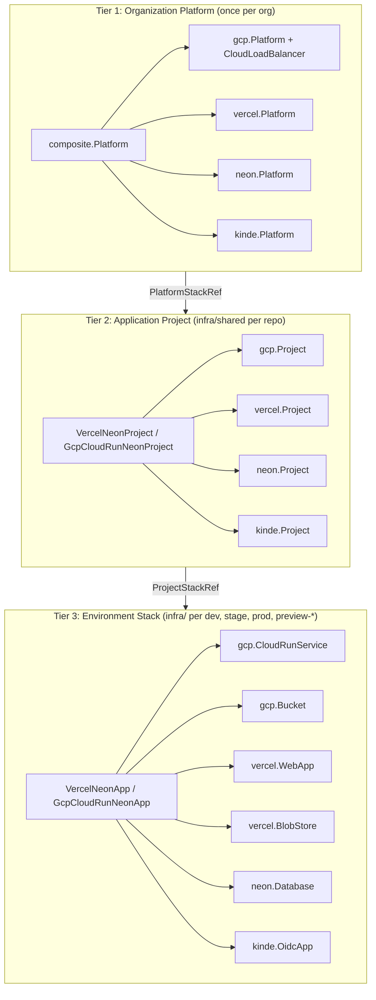
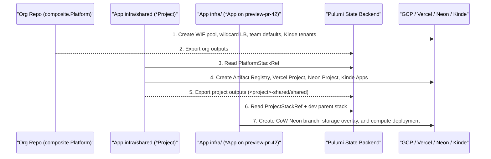

# OpenBase - software architecture

## Overview

OpenBase (`github.com/cloudvoyant/openbase/libs/components`) is a Go Pulumi component library across Google Cloud Platform, Vercel, Neon, and Kinde. It separates infrastructure into three strict tiers: organization `Platform` foundations, repository `Project` assets in `infra/shared`, and per-stack `Environment` deployments in `infra/`. It does not generate multi-language SDKs, run SQL migrations inside Pulumi state, or target AWS, Azure, or Kubernetes.

## Requirement

### Functional

- Provision organization cloud foundations once per organization and share their outputs across repositories.
- Provision shared project assets once per repository (`shared`) and deploy isolated application stacks across `dev`, `stage`, `prod`, and `preview-<slug>`.
- Branch `stage` stateful data from `prod` and `preview-<slug>` stateful data from `dev`.
- Bind environment variables, secrets, and least-privilege IAM or OIDC permissions between linked resources.

### Non-Functional

- Reject invalid environment names, invalid branch sources, and colliding link keys during `pulumi preview` before cloud state changes.
- Protect `prod` and `stage` stateful data against accidental deletion while tearing down `preview-<slug>` stacks cleanly on branch close.
- Authenticate across clouds through short-lived OIDC federation without static service-account keys.
- Run offline unit tests in under two seconds without cloud credentials or network access.

## Design

### Components and Responsibilities

- `libs/components/core` owns tier contracts, naming bounds, `openbase.io/*` tags, domain formatting, and `Links`.
- `libs/components/gcp`, `vercel`, `neon`, and `kinde` implement `Platform`, `Project`, and environment product components over upstream or bridged Pulumi providers.
- `libs/components/composite` wires multi-provider blueprints for Premise repositories (`infra/shared` and `infra/`).
- `libs/components/synthetic` supplies deterministic offline doubles for unit tests.

### Data and Control Flow

An organization deploys `Platform` once and exports shared identity and domain roots. Each repository deploys `Project` once in `infra/shared` and exports application identifiers. Each `dev`, `stage`, `prod`, or `preview-<slug>` stack reads `ProjectStackRef`, branches stateful data when configured, and binds runtime secrets and IAM grants through `Links`.

### Interfaces and Contracts

| Scope | Go Interface | Scope Fields | Canonical Name | Allowed Stacks |
| :--- | :--- | :--- | :--- | :--- |
| Organization Platform | `core.PlatformResource` | `Name`, `Org` | `<org>-<name>` | Central org stack |
| Shared Resource | `core.StatelessResource` / `core.StatefulResource` | `Name`, `Project`, `Repo`, `Environment: "shared"` | `<project>-<name>` | `shared` (`infra/shared`) |
| Environment Resource | `core.StatelessResource` / `core.StatefulResource` | `Name`, `Project`, `Repo`, `Environment`, `BranchFrom`, `Links` | `<project>-<env>-<name>` | `dev`, `stage`, `prod`, `preview-<slug>` |

## Implementation

### Provider bindings

`gcp` and `vercel` import `github.com/pulumi/pulumi-gcp/sdk/v9` and `github.com/pulumiverse/pulumi-vercel/sdk/v5`. `neon` (`kislerdm/neon`) and `kinde` (`kinde-oss/kinde`) use generated Go packages in `internal/providers/{neon,kinde}`. Run `mise run generate:check` in CI to make sure that generated bindings have zero drift.

### Shared vs environment naming

Every non-platform component satisfies `core.Resource` (`StatelessResource` or `StatefulResource`). When `Environment` is `dev`, `stage`, `prod`, or `preview-<slug>`, `core.CanonicalName` formats `<project>-<env>-<name>`. When `Environment` is `shared`, `core.CanonicalName` omits `env` and formats `<project>-<name>` so shared Artifact Registry repositories, Neon projects, and project load balancers stay concise.

## References

- [User Guide](../user-guide.md)
- [Core Resources and Tier Contracts](./resources.md)
- [GCP Provider](./providers/gcp/index.md)
- [Vercel Provider](./providers/vercel/index.md)
- [Neon Provider](./providers/neon/index.md)
- [Kinde Provider](./providers/kinde/index.md)
- [Composite Blueprints](./providers/composite/index.md)
