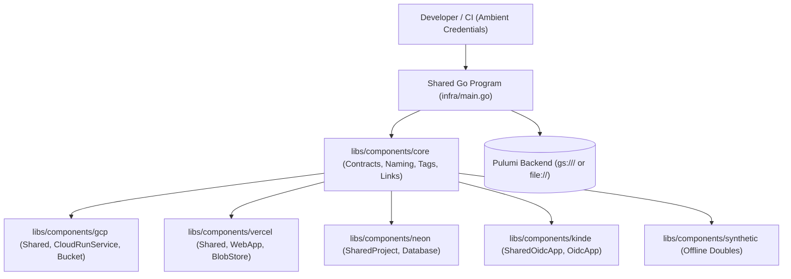
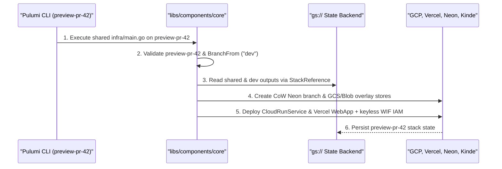

# OpenBase architecture - software architecture

## Overview

OpenBase (`github.com/cloudvoyant/openbase/libs/components`) is a declarative Go Pulumi component library for deploying stateless and stateful cloud resources across **GCP**, **Vercel**, **Neon**, and **Kinde** using ambient cloud credentials and upstream Pulumi or Terraform-bridged providers. Application teams write one shared Go Pulumi program (`infra/main.go`) and deploy it across `shared`, `dev`, `stage`, `prod`, and `preview-<slug>` stacks against a `gs://` or `file://` backend.

## Requirements

### Functional

- Application teams maintain one shared Go Pulumi program and select the target tier via stack name (`shared`, `dev`, `stage`, `prod`, or `preview-<slug>`).
- Concrete product specs (`gcp.CloudRunService`, `vercel.WebApp`, `kinde.OidcApp`, `gcp.Bucket`, `vercel.BlobStore`, `neon.Database`) expose `.Register(ctx, opts...)` returning `*<Product>Resource` handles that implement `core.StatelessResource` or `core.StatefulResource`.
- Stateful components enforce `pulumi.Protect(true)` and retention backups in `prod` and `stage`, clean up automatically in `dev` and `preview-*`, and branch from persistent tiers (`BranchFrom`).
- Every component validates its environment during `pulumi preview`, generates deterministic `<project>-<env>-<name>` identifiers, applies `openbase.io/*` tags (and sanitized GCP labels), and binds environment variables, secrets, and IAM/OIDC permissions through `Links`.

### Non-Functional

- Invalid environments, invalid `BranchFrom` targets, or duplicate link keys fail fast during `pulumi preview` before mutating cloud state.
- Offline `pulumi.WithMocks` unit tests run in under two seconds without cloud credentials.
- Explicit non-goals: multi-language SDK codegen, custom REST CRUD binaries, a `based` CLI, Kubernetes/GKE, AWS/Azure, and SQL migrations inside Pulumi state.

## Design

### Components and Responsibilities

- **Two-Layer Stack Topology**:
  - **`shared` stack**: Provisions cross-environment roots once (`gcp.Shared`, `vercel.Shared`, `neon.SharedProject`, and `kinde.SharedOidcApp`).
  - **`dev`, `stage`, `prod`, and `preview-<slug>` stacks**: Consume `shared` outputs via `pulumi.StackReference`, isolate stateful data per tier, and wire workloads via `Links`.
- **Upstream & Bridged Providers**:
  - `gcp` and `vercel` build directly on `github.com/pulumi/pulumi-gcp/sdk/v9` and `github.com/pulumiverse/pulumi-vercel/sdk/v5`.
  - `neon` (`kislerdm/neon`) and `kinde` (`kinde-oss/kinde`) compile against root-module Go bindings in `internal/providers/{neon,kinde}` generated by `scripts/generate-bridged.sh` (`pulumi-terraform-provider`), keeping a single root `go.mod` compatible with Premise's Git-tag Go release workflow.

### Data and Control Flow

| Environment | Resource Name | Protection & Backups | `BranchFrom` Default | Key `openbase.io/*` Tags |
| :--- | :--- | :--- | :--- | :--- |
| `shared` | `<project>-shared-<name>` | Shared roots | None | `environment=shared`, `ephemeral=false` |
| `dev` | `<project>-dev-<name>` | `ForceDestroy: true` | `main` (Neon) | `environment=dev`, `ephemeral=false` |
| `stage` | `<project>-stage-<name>` | `Protect: true` + versioning/PITR | `prod` (Neon) | `environment=stage`, `ephemeral=false` |
| `prod` | `<project>-prod-<name>` | `Protect: true` + versioning/PITR | `main` (Neon) | `environment=prod`, `ephemeral=false` |
| `preview-<slug>` | `<project>-preview-<slug>-<name>` | `ForceDestroy: true` | `dev` (CoW & overlay) | `environment=preview-<slug>`, `preview-id=<slug>`, `ephemeral=true` |

## Implementation

- `libs/components/core`: `Environment`, naming (`CanonicalName`, `ServiceAccountID`, `BucketName`), `StandardTags`/`GCPLabels`, `Links`, and declarative `Stateless`/`Stateful` escape hatches.
- `libs/components/gcp` & `libs/components/gcp/overlayfs`: `Shared`, `CloudRunService`, `Bucket`, and `overlayfs.Store`.
- `libs/components/vercel`: `Shared`, `WebApp`, `BlobStore`, and `BlobOverlayClient`.
- `libs/components/neon`: `SharedProject` and `Database`.
- `libs/components/kinde`: `SharedOidcApp` and `OidcApp`.
- `libs/components/synthetic`: `Service` and `Storage`.
- `e2e/components`: Standalone Go consumer fixtures and live cloud E2E suites.

## References

- [User Guide](../user-guide.md)
- [OpenBase Resources](./resources.md)
- [GCP Provider](./providers/gcp.md)
- [Vercel Provider](./providers/vercel.md)
- [Neon Provider](./providers/neon.md)
- [Kinde Provider](./providers/kinde.md)
