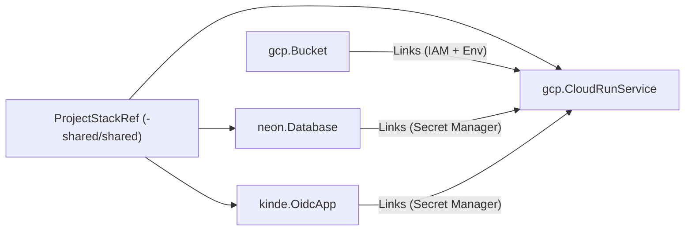
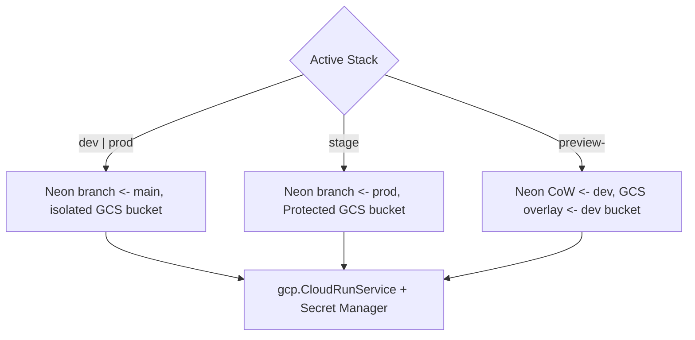

# Composite GcpCloudRunNeonApp - software architecture

## Overview

`composite.GcpCloudRunNeonApp` (`core.StatelessResource`) deploys a complete per-environment Google Cloud Run v2 web stack (`dev`, `stage`, `prod`, or `preview-<slug>`) in Premise's `infra/` directory. It wires `neon.Database`, optional `gcp.Bucket`, optional `kinde.OidcApp`, and `gcp.CloudRunService` automatically from `GcpCloudRunNeonProject` (`ProjectStackRef`).

## Requirement

### Functional

- Deploy a containerized Cloud Run web application backed by branched Neon PostgreSQL, optional Cloud Storage buckets, and optional Kinde OIDC authentication across `dev`, `stage`, `prod`, and `preview-<slug>`.
- Branch `stage` database state from `prod` and branch `preview-<slug>` database and bucket state from `dev`.
- Export service URLs, service-account emails, database URLs, and bucket names from each environment stack.

### Non-Functional

- Reject accidental execution against the `shared` project stack.
- Converge OIDC callback URLs and container secret mounts in a single `pulumi up` pass without circular dependencies.
- Mount database and OIDC secrets through Secret Manager with least-privilege service-account access.

## Design

### Components and Responsibilities



- `neon.Database` provisions the stack PostgreSQL branch.
- `gcp.Bucket` provisions the stack GCS bucket (with `dev` fallback reader IAM on `preview-<slug>`).
- `kinde.OidcApp` binds `dev` or `prod` Kinde credentials to the deterministic `siteURL`.
- `gcp.CloudRunService` mounts secrets from Secret Manager and exposes the HTTP service.

### Data and Control Flow



`GcpCloudRunNeonApp` injects `OPENBASE_ENVIRONMENT=<env>` alongside linked storage, database, and Kinde variables, then deploys `gcp.CloudRunService`.

### Interfaces and Contracts

```go
app, err := composite.GcpCloudRunNeonApp{
	Name:             "web",
	Project:          "storefront",
	GCPProject:       "cloudvoyant-openbase",
	GCPProjectNumber: "785485436615",
	BaseDomain:       "gcp.cloudvoyant.io",
	Image:            pulumi.String("us-central1-docker.pkg.dev/cloudvoyant-openbase/storefront-gcp/web:sha"),
	Auth:             &composite.KindeAppConfig{},
}.Register(ctx)
```

| Exported Stack Output | Source Component | Description |
| :--- | :--- | :--- |
| `url` / `urls` | `gcp.CloudRunService` | Primary HTTPS endpoint (`BaseDomain` or `.run.app`) and all routed URLs |
| `regionalUrl` | `gcp.CloudRunService` | Direct regional `.run.app` URL |
| `serviceAccountEmail` | `gcp.CloudRunService` | Bounded `6-30` char service-account email |
| `branchId` | `neon.Database` | Neon branch ID for child `stage` or `preview-*` stacks |
| `bucketName` / `fallbackBucketName` | `gcp.Bucket` | Primary and fallback GCS bucket names |

## Implementation

### Deterministic Kinde site URL

When `BaseDomain` is set, `resolveGCPEnvSiteURLs` sets `siteURL` to `https://{project}-{env}.{baseDomain}`. When `BaseDomain` is empty, it falls back to `gcp.CloudRunRegionalURL` using `GCPProjectNumber`.

### Optional storage and auth

Set `DisableBucket: true` to omit `gcp.Bucket`, or leave `Auth: nil` to omit `kinde.OidcApp`.

## References

- [Composite Platform and Projects](./index.md)
- [GCP Cloud Run Service](../gcp/cloud-run-service.md)
- [GCP Bucket and OverlayFS](../gcp/bucket.md)
- [Neon Database](../neon/database.md)
- [Kinde OidcApp](../kinde/oidc-app.md)
