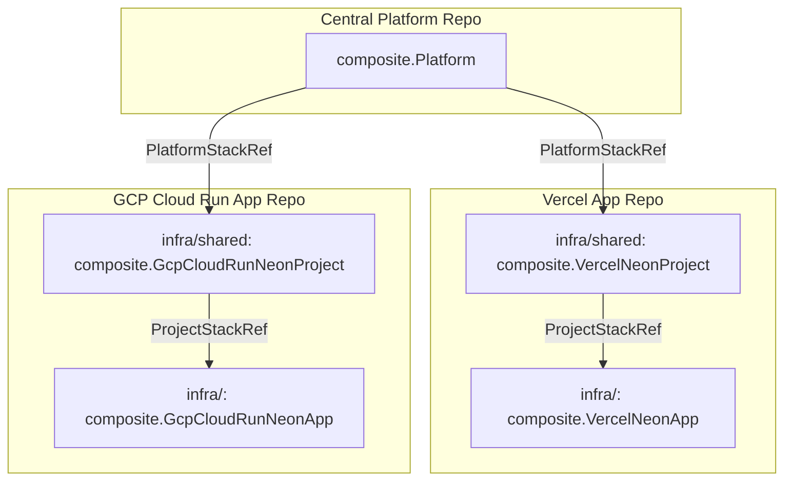
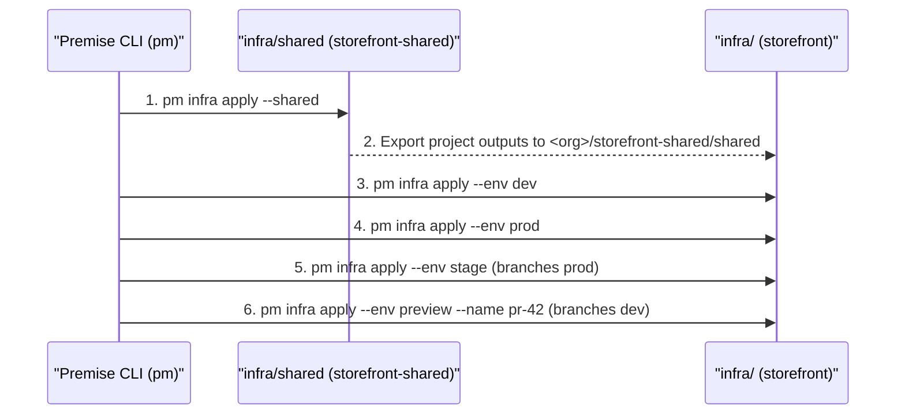

# Composite platform and projects - software architecture

## Overview

`libs/components/composite` provides turnkey multi-provider blueprints separating the Organization foundation (`composite.Platform`, `core.PlatformResource`) from shared repository blueprints (`composite.VercelNeonProject` and `composite.GcpCloudRunNeonProject`, `core.StatelessResource` on `shared`). It aligns directly with Premise's `workspace.infra.shared_directory: infra/shared` and `workspace.infra.directory: infra` layout.

## Requirement

### Functional

- Provision organization GCP, Vercel, Neon, and Kinde foundations from one central platform blueprint.
- Provision shared repository assets (project registries, Vercel projects, Neon clusters, and Kinde OIDC clients) once in `infra/shared`.
- Export a consistent set of shared stack outputs consumed by per-environment blueprints in `infra/`.

### Non-Functional

- Prevent shared project blueprints from deploying onto environment stacks (`dev`, `stage`, `prod`, `preview-<slug>`).
- Isolate privileged provider admin credentials (such as Kinde M2M secrets and Neon org keys) inside `infra/shared` and the organization platform stack.

## Design

### Components and Responsibilities



- `composite.Platform` provisions non-nil provider platforms once per organization.
- `composite.VercelNeonProject` provisions project-level Vercel, Blob, Neon, and Kinde assets in `infra/shared`.
- `composite.GcpCloudRunNeonProject` provisions project-level Artifact Registry, Neon, and Kinde assets in `infra/shared`.
- [composite.VercelNeonApp](./vercel-neon-app.md) and [composite.GcpCloudRunNeonApp](./gcp-cloud-run-neon-app.md) deploy each environment stack in `infra/`.

### Data and Control Flow



`pm infra apply --shared` runs once when onboarding a repository or updating project domains. Day-to-day CI runs only `infra/` against `dev`, `stage`, `prod`, and `preview-<slug>`.

### Interfaces and Contracts

```go
// Organization repo
_, err := composite.Platform{
	Org:    "cloudvoyant",
	GCP:    &gcp.Platform{GCPProject: pulumi.String("cloudvoyant-openbase"), BaseDomain: "gcp.cloudvoyant.io", EnableLoadBalancer: true},
	Vercel: &vercel.Platform{TeamID: teamID, TeamSlug: "cloudvoyant", BaseDomain: "vercel.cloudvoyant.io"},
	Neon:   &neon.Platform{OrgID: neonOrgID, RegionID: "aws-us-east-1"},
}.Register(ctx)

// App repo: infra/shared/main.go
_, err := composite.VercelNeonProject{
	Project:          "storefront",
	PlatformStackRef: "cloudvoyant/platform/shared",
	Auth:             &composite.KindeProjectConfig{Dev: devCreds, Prod: prodCreds},
}.Register(ctx)
```

| Blueprint | Contract | Premise Directory | Underlying Components |
| :--- | :--- | :--- | :--- |
| `composite.Platform` | `core.PlatformResource` | Central org repo | `gcp.Platform`, `vercel.Platform`, `neon.Platform`, `kinde.Platform` |
| `composite.VercelNeonProject` | `core.StatelessResource` (`shared`) | `infra/shared` | `vercel.Project`, `neon.Project`, `kinde.Project` |
| `composite.GcpCloudRunNeonProject` | `core.StatelessResource` (`shared`) | `infra/shared` | `gcp.Project`, `neon.Project`, `kinde.Project` |

## Implementation

### Shared preview variable seeding

`VercelNeonProject` seeds non-branch-specific `preview` variables (`VERCEL_AUTOMATION_BYPASS_SECRET`, `BLOB_BASE_URL`, and `dev` Kinde credentials) once at the project level so pull-request stacks only inject per-branch `DATABASE_URL` and `BLOB_PREFIX` values.

### Cloud Run callback precomputation

`GcpCloudRunNeonProject` computes regional `.run.app` and `BaseDomain` URLs for `dev`, `stage`, `prod`, and wildcard `preview-*` services up front so `kinde.Project` registers accurate OAuth2 allowlists before any container deploys.

## References

- [VercelNeonApp Blueprint](./vercel-neon-app.md)
- [GcpCloudRunNeonApp Blueprint](./gcp-cloud-run-neon-app.md)
- [User Guide](../../../user-guide.md)
