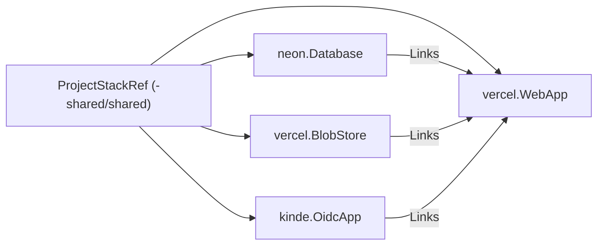
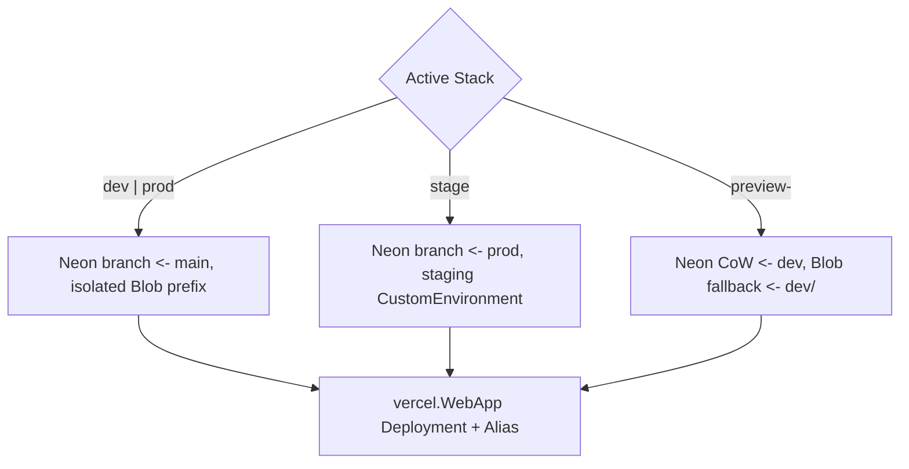

# Composite VercelNeonApp - software architecture

## Overview

`composite.VercelNeonApp` (`core.StatelessResource`) deploys a complete per-environment Vercel web stack (`dev`, `stage`, `prod`, or `preview-<slug>`) in Premise's `infra/` directory. It wires `neon.Database`, optional `vercel.BlobStore`, optional `kinde.OidcApp`, and `vercel.WebApp` automatically from `VercelNeonProject` (`ProjectStackRef`).

## Requirement

### Functional

- FR1: Resolve `ProjectStackRef` to `<org>/<project>-shared/shared` by default.
- FR2: Branch `neon.Database` from `prod` on `stage` and from `dev` on `preview-<slug>`, and branch `vercel.BlobStore` prefix overlays from `dev` on `preview-<slug>`.
- FR3: Link `Database`, `BlobStore`, `OidcApp`, and any custom `Links` into `vercel.WebApp` and export stack outputs (`url`, `urls`, `branchId`, `databaseUrl`, `blobPrefix`).

### Non-Functional

- NFR1: Reject execution on the `shared` stack (`core.ErrInvalidEnvironment`).
- NFR2: Require zero Kinde M2M admin credentials or Neon organization IDs in `infra/main.go`.

## Design

### Components and Responsibilities



- `neon.Database` provisions the stack PostgreSQL branch and pooled connection URL.
- `vercel.BlobStore` configures `<env>/` prefix isolation and `stage` custom-environment tokens.
- `kinde.OidcApp` selects `dev` or `prod` Kinde credentials and sets callback URLs.
- `vercel.WebApp` deploys `SourceDir` and binds primary plus `ExtraDomains` aliases.

### Data and Control Flow



`resolveDBBranch` and `resolvePreviewStorageBranch` inspect `meta.Environment` and configure `BranchFrom` and `BranchStackRef` automatically.

### Interfaces and Contracts

```go
app, err := composite.VercelNeonApp{
	Name:       "web",
	Project:    "storefront",
	TeamID:     os.Getenv("VERCEL_TEAM_ID"),
	TeamSlug:   "cloudvoyant",
	BaseDomain: "vercel.cloudvoyant.io",
	SourceDir:  "../apps/web",
	Auth:       &composite.KindeAppConfig{},
}.Register(ctx)
```

| Exported Stack Output | Source Component | Description |
| :--- | :--- | :--- |
| `url` / `urls` | `vercel.WebApp` | Primary alias URL and all bound URLs |
| `deploymentId` | `vercel.WebApp` | Immutable Vercel deployment ID |
| `branchId` | `neon.Database` | Neon branch ID (consumed by child `stage` or `preview-*` stacks) |
| `databaseUrl` / `directUrl` | `neon.Database` | Secret pooled and direct PostgreSQL URLs |
| `blobBaseUrl` / `blobPrefix` | `vercel.BlobStore` | Store base URL and `<env>/` object prefix |

## Implementation

### Source path normalization

When `SourceDir` is a relative parent path such as `../apps/web` and `PathPrefix` is empty, `VercelNeonApp` sets `PathPrefix = SourceDir` automatically so Vercel strips the local directory prefix from uploaded serverless file paths.

### Optional subsystems

Set `DisableBlobStore: true` to omit `vercel.BlobStore`, or leave `Auth: nil` to omit `kinde.OidcApp`.

## References

- [Composite Platform and Projects](./index.md)
- [Vercel WebApp](../vercel/web-app.md)
- [Neon Database](../neon/database.md)
- [Kinde OidcApp](../kinde/oidc-app.md)
