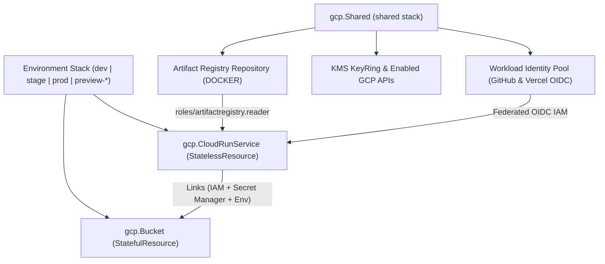

# GCP provider - software architecture

## Overview

The `libs/components/gcp` package implements OpenBase's Google Cloud Platform components over `github.com/pulumi/pulumi-gcp/sdk/v9`. It provides `gcp.Shared` for cross-environment project prerequisites, `gcp.CloudRunService` (`core.StatelessResource`) for public, internal, and worker containers, and `gcp.Bucket` (`core.StatefulResource`) with `libs/components/gcp/overlayfs` for zero-copy preview storage overlays.

## Requirements

### Functional

- Provision shared GCP prerequisites once in a `shared` stack (`gcp.Shared`): enabled APIs, a Docker Artifact Registry repository, a Workload Identity Pool with GitHub Actions and Vercel OIDC providers, and a KMS KeyRing.
- Deploy `gcp.CloudRunService` across `dev`, `stage`, `prod`, and `preview-*` stacks with `6–30` character Service Account IDs, Secret Manager secret mounts, self-impersonated GCS v4 URL signing, and `public`, `internal`, or `worker` visibility.
- Provision `gcp.Bucket` with `UniformBucketLevelAccess`, enforced public-access prevention, CORS rules, `Protect` plus versioning and 7-day soft-delete retention in `prod` and `stage`, `ForceDestroy` in `dev` and `preview-*`, and zero-copy `BranchFrom` fallback overlays.
- Grant least-privilege IAM roles (`roles/run.invoker`, `roles/storage.objectAdmin`, `roles/storage.objectViewer`, `roles/secretmanager.secretAccessor`) automatically when workloads declare `Links`.

### Non-Functional

- Preview Cloud Run services scale to zero when idle (`MinInstanceCount: 0`) and delete cleanly on `pulumi destroy`.
- External workloads (such as Vercel functions) authenticate to internal Cloud Run services and private GCS buckets through Workload Identity Federation without static JSON service-account keys.

## Design

### Components and Responsibilities



- **`gcp.Shared`**: Enables `run`, `artifactregistry`, `iam`, `iamcredentials`, `sts`, `storage`, `secretmanager`, and `cloudkms` APIs (`DisableOnDestroy: false`), creates a Docker Artifact Registry repository, creates a `4–32` char Workload Identity Pool (`ob-<project>-pool`) with optional GitHub Actions (`https://token.actions.githubusercontent.com`) and Vercel (`https://oidc.vercel.com/<team>`) OIDC providers, and creates a KMS KeyRing.
- **`gcp.CloudRunService` (`core.StatelessResource`)**:
  - Creates a `gcp.serviceaccount.Account` bounded to `6–30` characters via `core.ServiceAccountID`.
  - Grants `roles/iam.serviceAccountTokenCreator` to the service account on itself so running containers sign GCS v4 URLs under Application Default Credentials without JSON keys.
  - Grants `roles/artifactregistry.reader` to both the service account and `service-<projectNumber>@serverless-robot-prod.iam.gserviceaccount.com` when an Artifact Registry repository is configured.
  - Stores resolved link and workload secrets in `gcp.secretmanager.Secret` + `SecretVersion`, grants `roles/secretmanager.secretAccessor` to the service account, and mounts them via `ValueSource.SecretKeyRef`.
  - Configures `allUsers` `roles/run.invoker` for `public`, caller-scoped IAM for `internal`, internal-only ingress for `worker`, and optional `gcp.cloudrun.DomainMapping` on persistent environments.
- **`gcp.Bucket` (`core.StatefulResource`) & `gcp/overlayfs`**:
  - Enforces `UniformBucketLevelAccess: true`, `PublicAccessPrevention: "enforced"`, and sanitized `openbase-*` GCP labels.
  - Applies `pulumi.Protect(true)`, object versioning, and 7-day `SoftDeletePolicy` in `prod` and `stage`, and `ForceDestroy: true` with zero soft-delete retention in `dev` and `preview-*`.
  - When `BranchFrom` is set, exports `<PREFIX>_BUCKET` and `<PREFIX>_FALLBACK_BUCKET` and binds `roles/storage.objectAdmin` on primary plus `roles/storage.objectViewer` on fallback. `overlayfs.Store` reads from primary first, falls back to the parent bucket on `storage.ErrObjectNotExist`, and writes or deletes exclusively in primary.

### Interfaces and Contracts

```go
// Package gcp (github.com/cloudvoyant/openbase/libs/components/gcp)
shared, err := gcp.NewShared(ctx, "shared", gcp.SharedArgs{
	Project:        "storefront",
	GCPProject:     pulumi.String("my-gcp-project"),
	GitHubOrg:      "cloudvoyant",
	VercelTeamSlug: "cloudvoyant",
})

uploads, err := gcp.NewBucket(ctx, "uploads", gcp.BucketArgs{
	StatefulResourceArgs: core.StatefulResourceArgs{
		Project:    "storefront",
		BranchFrom: "dev", // on preview-* stacks
	},
	BucketNamespace: "my-gcp-project",
})

api, err := gcp.NewCloudRunService(ctx, "orders-api", gcp.CloudRunServiceArgs{
	StatelessResourceArgs: core.StatelessResourceArgs{
		Project: "storefront",
		Links:   []core.Resource{uploads},
	},
	SharedStackRef: "org/storefront/shared",
	Visibility:     gcp.VisibilityInternal,
	Image:          pulumi.String("us-central1-docker.pkg.dev/my-gcp-project/storefront/orders:latest"),
})
```

### Synthesized GCP Resources

| OpenBase Component | Environment | Synthesized `pulumi-gcp` v9 Resources |
| :--- | :--- | :--- |
| `gcp.Shared` | `shared` | `projects.Service`, `artifactregistry.Repository`, `iam.WorkloadIdentityPool`, `iam.WorkloadIdentityPoolProvider`, `kms.KeyRing` |
| `gcp.CloudRunService` | `dev`, `stage`, `prod`, `preview-*` | `serviceaccount.Account`, `serviceaccount.IAMMember` (`serviceAccountTokenCreator`), `artifactregistry.RepositoryIamMember`, `secretmanager.Secret` + `SecretVersion` + `SecretIamMember`, `cloudrunv2.Service`, `cloudrunv2.ServiceIamMember`, `cloudrun.DomainMapping` |
| `gcp.Bucket` | `dev`, `stage`, `prod`, `preview-*` | `storage.Bucket`, primary & fallback `storage.BucketIAMMember` |

## References

- [OpenBase Architecture Overview](../index.md)
- [OpenBase Resources](../resources.md)
- [Vercel Provider](./vercel.md)
- [Neon Provider](./neon.md)
- [Kinde Provider](./kinde.md)
