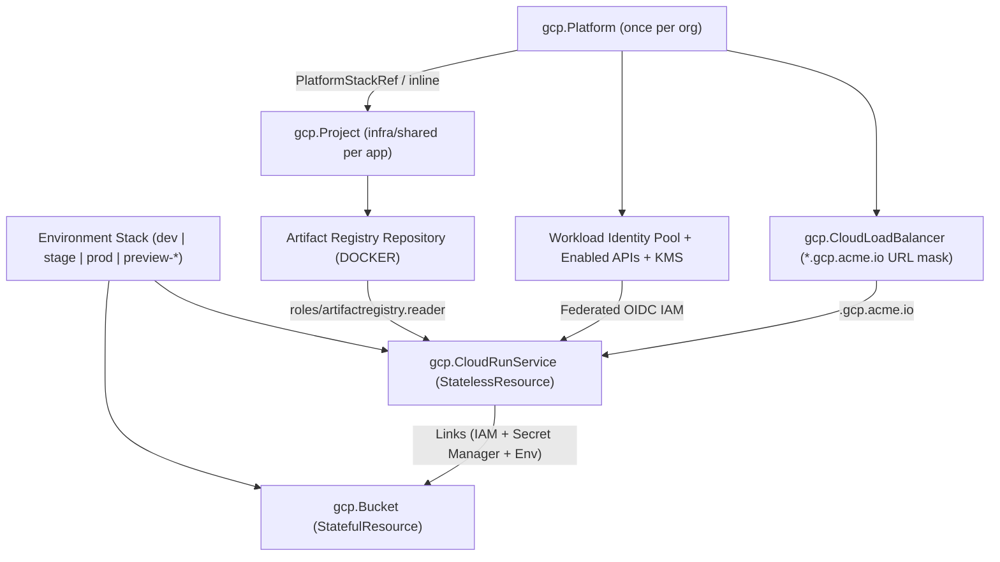

# GCP provider - software architecture

## Overview

The `libs/components/gcp` package implements OpenBase's declarative Google Cloud Platform components over `github.com/pulumi/pulumi-gcp/sdk/v9`. It separates organization-wide prerequisites (`gcp.Platform` + `gcp.CloudLoadBalancer`), per-application Artifact Registry projects (`gcp.Project`), per-environment containers (`gcp.CloudRunService`, `core.StatelessResource`), and object storage (`gcp.Bucket`, `core.StatefulResource`, plus `libs/components/gcp/overlayfs` for zero-copy preview overlays).

## Requirements

### Functional

- Provision org-wide GCP foundations once (`gcp.Platform`): enabled APIs, one `4–32` char Workload Identity Pool with GitHub Actions and Vercel OIDC providers, an optional KMS KeyRing, and an optional wildcard `gcp.CloudLoadBalancer`.
- Provision per-application `gcp.Project` in Premise's `infra/shared` stack: creates a Docker Artifact Registry repository and inherits WIF/APIs/LB/KeyRing from `Platform` or `PlatformStackRef` without duplicating Workload Identity Pools (falling back to inline `gcp.Platform` when standalone).
- Deploy `gcp.CloudRunService` across `dev`, `stage`, `prod`, and `preview-*` stacks with `6–30` character Service Account IDs, Secret Manager secret mounts, self-impersonated GCS v4 URL signing, and `public`, `internal`, or `worker` visibility.
- Provision `gcp.Bucket` with `UniformBucketLevelAccess`, enforced public-access prevention, CORS rules, `Protect` plus versioning and 7-day soft-delete retention in `prod` and `stage`, `ForceDestroy` in `dev` and `preview-*`, and zero-copy `BranchFrom` fallback overlays.

### Non-Functional

- Preview Cloud Run services scale to zero when idle (`MinInstanceCount: 0`) and delete cleanly on `pulumi destroy`.
- External workloads (such as Vercel functions) authenticate to internal Cloud Run services and private GCS buckets through Workload Identity Federation without static JSON service-account keys.

## Design

### Components and Responsibilities



- **`gcp.Platform` & `gcp.CloudLoadBalancer` (once per org)**:
  - `gcp.Platform` enables `run`, `artifactregistry`, `iam`, `iamcredentials`, `sts`, `storage`, `secretmanager`, and `cloudkms` APIs (`DisableOnDestroy: false`), creates an org Workload Identity Pool (`ob-<project>-pool`) with optional GitHub Actions and Vercel OIDC providers, and creates an optional KMS KeyRing.
  - `gcp.CloudLoadBalancer` (standalone or enabled via `EnableLoadBalancer: true` + `BaseDomain` on `gcp.Platform`) provisions a Global External HTTPS Load Balancer with a static Global IPv4 (`ipAddress`), DNS-authorized wildcard Google Certificate Manager certificate (`*.{baseDomain}`), and a regional Serverless NEG with `urlMask: "<service>.{baseDomain}"` — routing `{project}-{dev|stage|prod|previewId}.{baseDomain}` across all apps and PR previews with instant wildcard TLS and zero per-PR load-balancer changes.
- **`gcp.Project` (once per app in `infra/shared`)**:
  - Creates the application's Docker `artifactregistry.Repository` and reuses `gcp.Platform` outputs via `Platform` or `PlatformStackRef` (or provisions an inline `gcp.Platform` when used standalone).
- **`gcp.CloudRunService` (`*gcp.CloudRunServiceResource`)**:
  - Creates a `gcp.serviceaccount.Account` bounded to `6–30` characters via `core.ServiceAccountID` and grants `roles/iam.serviceAccountTokenCreator` to itself for keyless GCS v4 URL signing.
  - Grants `roles/artifactregistry.reader` to both the service account and `service-<projectNumber>@serverless-robot-prod.iam.gserviceaccount.com` when an Artifact Registry repository is configured via `GCPProjectRef` / `ProjectStackRef`.
  - Stores resolved link and workload secrets in `gcp.secretmanager.Secret` + `SecretVersion`, grants `roles/secretmanager.secretAccessor`, and mounts them via `ValueSource.SecretKeyRef`.
  - Names the service `{project}-{dev|stage|prod|previewId}` when `BaseDomain` is set (matching `CloudLoadBalancer`'s `<service>.{baseDomain}` URL mask), and binds `gcp.cloudrun.DomainMapping`s when `Domain` / `Domains` are supplied on persistent environments.
- **`gcp.Bucket` (`*gcp.BucketResource`) & `gcp/overlayfs`**:
  - Enforces `UniformBucketLevelAccess: true`, `PublicAccessPrevention: "enforced"`, `Protect` + versioning + 7-day soft-delete in `prod`/`stage`, `ForceDestroy` in `dev`/`preview-*`, and zero-copy `BranchFrom` fallback reads via `overlayfs.Store`.

### Interfaces and Contracts

```go
// 1. Once per org (central platform repo)
orgGCP, err := gcp.Platform{
	GCPProject:         pulumi.String("my-gcp-project"),
	GCPProjectNumber:   "123456789012",
	GitHubOrg:          "cloudvoyant",
	VercelTeamSlug:     "cloudvoyant",
	BaseDomain:         "gcp.cloudvoyant.io",
	EnableLoadBalancer: true,
}.Register(ctx)

// 2. Once per app (infra/shared)
appGCP, err := gcp.Project{
	Project:          "storefront",
	PlatformStackRef: "org/platform/shared",
	GCPProject:       pulumi.String("my-gcp-project"),
}.Register(ctx)

// 3. Per environment (infra/)
uploads, err := gcp.Bucket{
	Name:            "uploads",
	Project:         "storefront",
	BranchFrom:      "dev", // on preview-* stacks
	BucketNamespace: "my-gcp-project",
}.Register(ctx)

api, err := gcp.CloudRunService{
	Name:            "orders-api",
	Project:         "storefront",
	Links:           []core.Resource{uploads},
	ProjectStackRef: "org/storefront-shared/shared",
	Visibility:      gcp.VisibilityInternal,
	Image:           pulumi.String("us-central1-docker.pkg.dev/my-gcp-project/storefront/orders:latest"),
}.Register(ctx)
```

### Synthesized GCP Resources

| OpenBase Spec | Tier | Synthesized `pulumi-gcp` v9 Resources |
| :--- | :--- | :--- |
| `gcp.Platform` | Org (`shared`) | `projects.Service`, `iam.WorkloadIdentityPool`, `iam.WorkloadIdentityPoolProvider`, `kms.KeyRing`, optional `CloudLoadBalancer` |
| `gcp.Project` | App (`infra/shared`) | `artifactregistry.Repository` (plus inline `gcp.Platform` when `Platform` and `PlatformStackRef` are unset) |
| `gcp.CloudRunService` | Env (`dev`, `stage`, `prod`, `preview-*`) | `serviceaccount.Account`, `serviceaccount.IAMMember`, `artifactregistry.RepositoryIamMember`, `secretmanager.Secret` + `SecretVersion` + `SecretIamMember`, `cloudrunv2.Service`, `cloudrunv2.ServiceIamMember`, `cloudrun.DomainMapping` |
| `gcp.Bucket` | Env (`dev`, `stage`, `prod`, `preview-*`) | `storage.Bucket`, primary & fallback `storage.BucketIAMMember` |

## References

- [OpenBase Architecture Overview](../index.md)
- [OpenBase Resources](../resources.md)
- [Vercel Provider](./vercel.md)
- [Neon Provider](./neon.md)
- [Kinde Provider](./kinde.md)
