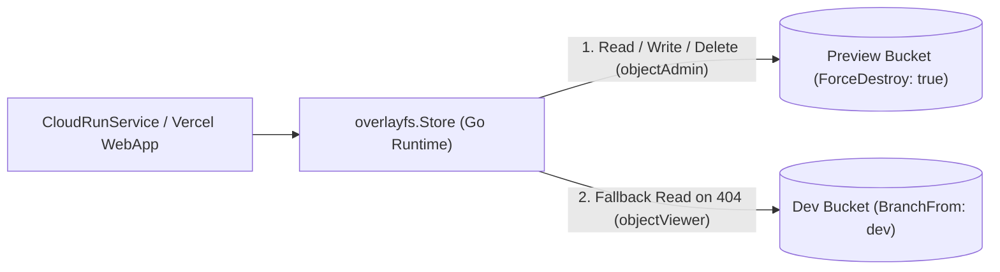
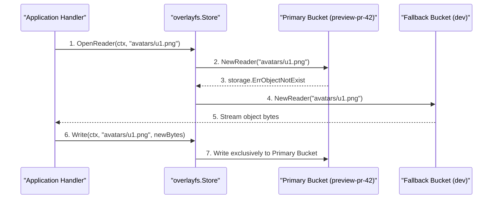

# GCP Bucket and OverlayFS - software architecture

## Overview

`gcp.Bucket` (`core.StatefulResource`) provisions private Google Cloud Storage buckets across `dev`, `stage`, `prod`, and `preview-<slug>` stacks. Together with `libs/components/gcp/overlayfs`, it gives ephemeral preview branches zero-copy read access to `dev` objects while keeping preview writes and deletes isolated.

## Requirement

### Functional

- Provision private object storage buckets for persistent environments and ephemeral preview branches.
- Retain versioned backups and soft-deleted objects on `prod` and `stage` buckets.
- Give branched preview environments read fallback to parent environment objects while isolating new writes and deletes.

### Non-Functional

- Block public bucket ACLs and enforce uniform IAM access control on every bucket.
- Branch preview storage without copying parent objects and delete non-empty preview buckets cleanly on teardown.
- Guarantee that preview writes and deletes never modify parent environment objects.

## Design

### Components and Responsibilities



- `gcp.Bucket` creates `storage.Bucket`, resolves the parent bucket name when `BranchFrom` is set, and registers a `LinkDescriptor` with `GrantAccess`.
- `GrantAccess` binds `roles/storage.objectAdmin` on the primary bucket and `roles/storage.objectViewer` on the fallback bucket to the linked workload service account.
- `overlayfs.Store` wraps `*storage.Client` in application Go code to implement copy-on-write object lookup.

### Data and Control Flow



Reads try the primary bucket first and fall back to the parent bucket only on `storage.ErrObjectNotExist`. Writes and deletes target only the primary bucket, leaving parent data untouched.

### Interfaces and Contracts

```go
// Infrastructure (infra/env/main.go)
uploads, err := gcp.NewBucket(ctx, "uploads", &gcp.BucketArgs{
	Account:         gcpAcc,
	BucketNamespace: "cloudvoyant-openbase",
})

// Application runtime
store, err := overlayfs.NewStore(gcsClient, primaryBucket, fallbackBucket)
```

| Environment Tier | `Protect` | `ForceDestroy` | `Versioning` | `SoftDeletePolicy` |
| :--- | :--- | :--- | :--- | :--- |
| `prod` / `stage` | `true` | `false` | `true` | `604800s` (7 days) |
| `dev` / `preview-<slug>` | `false` | `true` | `false` | `0s` |

## Implementation

### Global bucket naming

GCS bucket names share one global namespace. `BucketNamespace` prepends the organization or GCP project slug (`<namespace>-<project>-<env>-<name>`) bounded to `63` characters via `core.BucketName`.

### Explicit bucket outputs

`Bucket` exposes typed `BucketName`, `BucketURL`, and `FallbackBucketName` outputs so callers wire whichever environment variable names their application expects while `Links` binds `roles/storage.objectAdmin` and `roles/storage.objectViewer` IAM permissions.

## References

- [GCP Platform and Project](./index.md)
- [Cloud Run Service](./cloud-run-service.md)
- [Core Resources and Tier Contracts](../../resources.md)
