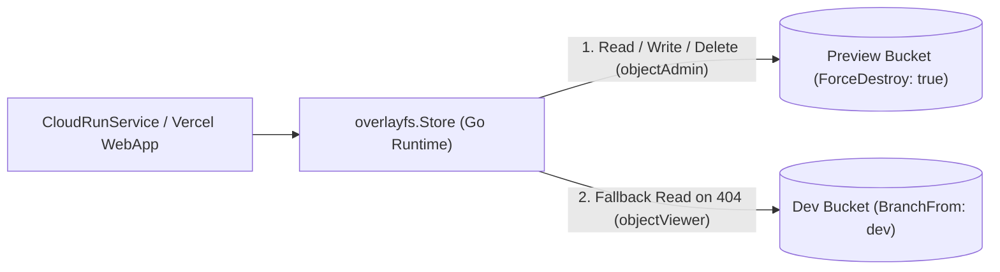
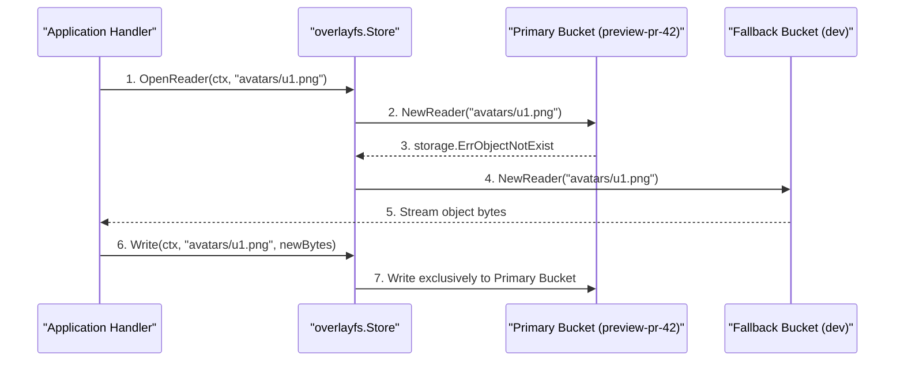

# GCP Bucket and OverlayFS - software architecture

## Overview

`gcp.Bucket` (`core.StatefulResource`) provisions private Google Cloud Storage buckets across `dev`, `stage`, `prod`, and `preview-<slug>` stacks. Together with `libs/components/gcp/overlayfs`, it gives ephemeral preview branches zero-copy read access to `dev` objects while keeping preview writes and deletes isolated.

## Requirement

### Functional

- FR1: Enforce `UniformBucketLevelAccess: true` and `PublicAccessPrevention: "enforced"` on every bucket.
- FR2: Enable `pulumi.Protect(true)`, object versioning, and 7-day `SoftDeletePolicy` on `prod` and `stage`, and set `ForceDestroy: true` with zero soft-delete retention on `dev` and `preview-<slug>`.
- FR3: Export primary and fallback bucket names plus scoped IAM roles (`objectAdmin` on primary, `objectViewer` on fallback) when `BranchFrom` is set.

### Non-Functional

- NFR1: Preview creation must not copy objects from `dev` and must clean up non-empty preview buckets on `pulumi destroy`.
- NFR2: Preview writes and deletes must never mutate the parent `BranchFrom` bucket.

## Design

### Components and Responsibilities



- `gcp.Bucket` creates `storage.Bucket`, resolves the parent bucket name when `BranchFrom` is set, and registers a `LinkDescriptor` with `GrantAccess`.
- `GrantAccess` binds `roles/storage.objectAdmin` on the primary bucket and `roles/storage.objectViewer` on the fallback bucket to the linked workload service account.
- `overlayfs.Store` wraps `*storage.Client` in application Go code to implement copy-on-write object lookup.

### Data and Control Flow



Reads try the primary bucket first and fall back to the parent bucket only on `storage.ErrObjectNotExist`. Writes and deletes target only the primary bucket, leaving parent data untouched.

### Interfaces and Contracts

```go
// Infrastructure (infra/main.go)
uploads, err := gcp.Bucket{
	Name:            "uploads",
	Project:         "storefront",
	Environment:     "preview-pr-42",
	BranchFrom:      "dev",
	BucketNamespace: "cloudvoyant-openbase",
}.Register(ctx)

// Application runtime
store, err := overlayfs.NewStoreFromEnv(gcsClient, "STORAGE")
```

| Environment Tier | `Protect` | `ForceDestroy` | `Versioning` | `SoftDeletePolicy` |
| :--- | :--- | :--- | :--- | :--- |
| `prod` / `stage` | `true` | `false` | `true` | `604800s` (7 days) |
| `dev` / `preview-<slug>` | `false` | `true` | `false` | `0s` |

## Implementation

### Global bucket naming

GCS bucket names share one global namespace. `BucketNamespace` prepends the organization or GCP project slug (`<namespace>-<project>-<env>-<name>`) bounded to `63` characters via `core.BucketName`.

### Prefix customization

`EnvPrefix` defaults to `STORAGE` (exporting `STORAGE_BUCKET`, `STORAGE_BUCKET_URL`, and `STORAGE_FALLBACK_BUCKET`). Set `EnvPrefix` when linking multiple buckets to one service so link keys stay unique.

## References

- [GCP Platform and Project](./index.md)
- [Cloud Run Service](./cloud-run-service.md)
- [Core Resources and Tier Contracts](../../resources.md)
