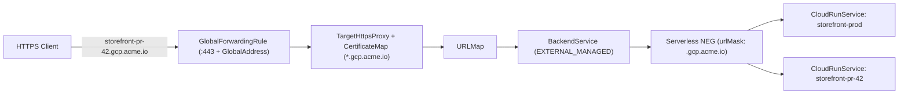
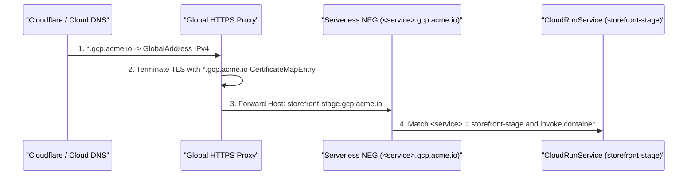

# GCP Cloud Load Balancer - software architecture

## Overview

`gcp.CloudLoadBalancer` (`core.StatelessResource`) provisions a Global External Application Load Balancer that routes `*.{baseDomain}` to Cloud Run services through a Serverless Network Endpoint Group (NEG) URL mask. Teams can deploy it once per organization inside `gcp.Platform`, once per project on `shared` (`<project>-lb`), or per environment (`<project>-<env>-lb`).

## Requirement

### Functional

- FR1: Allocate a static Global IPv4 address (`ipAddress`) and DNS-authorized wildcard TLS certificate covering `{baseDomain}` and `*.{baseDomain}`.
- FR2: Route HTTPS requests matching `<service>.{baseDomain}` to the regional Cloud Run service named `<service>` without per-environment load-balancer edits.
- FR3: Export `ipAddress`, `dnsAuthRecordName`, and `dnsAuthRecordData` so DNS operators configure one wildcard `A` record and one ACME `CNAME` record.

### Non-Functional

- NFR1: New `preview-<slug>` Cloud Run services must receive valid HTTPS on `{project}-{previewId}.{baseDomain}` immediately with zero certificate issuance wait.
- NFR2: Reject empty `BaseDomain` inputs during `pulumi preview` with `gcp.ErrBaseDomainRequired`.

## Design

### Components and Responsibilities



- `compute.GlobalAddress` reserves a static external IPv4 address.
- `certificatemanager.DnsAuthorization`, `Certificate`, `CertificateMapResource`, and `CertificateMapEntry` issue and attach the wildcard certificate.
- `compute.RegionNetworkEndpointGroup` parses `<service>` from `<service>.{baseDomain}` and forwards traffic to the matching Cloud Run service in the region.
- `compute.BackendService`, `URLMap`, `TargetHttpsProxy`, and `GlobalForwardingRule` terminate TLS on port `443`.

### Data and Control Flow



DNS points `*.{baseDomain}` to `ipAddress` once. When `gcp.CloudRunService` deploys with `BaseDomain` set, it names the Cloud Run service `{project}-{dev|stage|prod|previewId}`. The Serverless NEG resolves the service name directly from the `Host` header.

### Interfaces and Contracts

```go
lb, err := gcp.CloudLoadBalancer{
	Project:     "storefront",
	Environment: "shared",
	GCPProject:  pulumi.String("cloudvoyant-openbase"),
	Location:    "us-central1",
	BaseDomain:  "gcp.cloudvoyant.io",
}.Register(ctx)
```

| Output | Type | Purpose |
| :--- | :--- | :--- |
| `ipAddress` | `pulumi.StringOutput` | Target IPv4 for the `*.{baseDomain}` DNS `A` record |
| `dnsAuthRecordName` | `pulumi.StringOutput` | ACME DNS authorization `CNAME` host |
| `dnsAuthRecordData` | `pulumi.StringOutput` | ACME DNS authorization `CNAME` target |
| `urlMask` | `string` | `<service>.{baseDomain}` mask configured on the Serverless NEG |

## Implementation

### Certificate Manager vs DomainMapping

Cloud Run `DomainMapping` does not support wildcard certificates and takes 5 to 15 minutes per hostname. Certificate Manager DNS authorization issues one `*.{baseDomain}` certificate at the organization tier so ephemeral preview environments skip TLS provisioning completely.

### Multi-application sharing

Because `urlMask` extracts `<service>` dynamically and OpenBase prefixes Cloud Run service names with `<project>-`, one `gcp.CloudLoadBalancer` serves every application and preview branch in the region.

## References

- [GCP Platform and Project](./index.md)
- [Cloud Run Service](./cloud-run-service.md)
