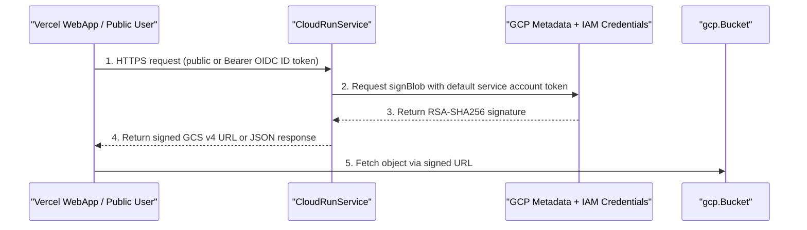

# GCP Cloud Run service - software architecture

## Overview

`gcp.CloudRunService` (`core.StatelessResource`) deploys per-environment Cloud Run v2 containers across `dev`, `stage`, `prod`, and `preview-<slug>` stacks. It manages bounded service accounts, Secret Manager secret mounts, Artifact Registry pull IAM, caller visibility, and custom domain bindings.

## Requirement

### Functional

- Run containerized HTTP services and background workers with an isolated service account per deployment.
- Mount application and linked secrets from Secret Manager and grant container image pull permissions.
- Control caller access across public internet, authenticated service-to-service, and internal-only worker modes.
- Bind predictable environment subdomains and optional custom vanity domains.

### Non-Functional

- Scale idle development and preview containers to zero to minimize compute cost.
- Keep secret values out of plain container environment definitions.
- Sign Cloud Storage URLs at runtime using ambient service-account credentials instead of static JSON keys.

## Design

### Components and Responsibilities

```mermaid
flowchart TD
    Proj["gcp.LookupProject(shared, \"gcp\")"] -->|"repositoryId"| ARIAM["RepositoryIamMember (reader)"]
    Links["Links (Bucket, internal CloudRunService)"] -->|"ResolveLinks"| IAMGrants["Linked Resource GrantAccess IAM"]
    Secrets["Explicit Secrets Map"] --> SM["Secret + SecretVersion + SecretIamMember"]
    SA["serviceaccount.Account (6-30 chars)"] --> SelfSign["serviceAccount.IAMMember (tokenCreator)"]
    SA --> ARIAM
    SA --> IAMGrants
    SA --> SM
    SA --> Svc["cloudrunv2.Service"]
    SM -->|"SecretKeyRef"| Svc
    Svc --> Vis{"Visibility"}
    Vis -->|"public"| AllUsers["ServiceIamMember (allUsers)"]
    Vis -->|"internal"| Scoped["LinkGrantContext (run.invoker)"]
    Vis -->|"worker"| IntOnly["INGRESS_TRAFFIC_INTERNAL_ONLY"]
```

- `serviceaccount.Account` isolates container identity per stack and service.
- `secretmanager.Secret` and `SecretVersion` hold secrets from `Secrets` and grant `roles/secretmanager.secretAccessor` to the service account.
- `cloudrunv2.Service` runs the container image, injects caller `Env` variables and secret references, and exports `URL`, `RegionalURL`, `URLs`, and `ServiceAccountEmail`.
- `LinkDescriptor.GrantAccess` grants `roles/run.invoker` to downstream `CloudRunService` or `vercel.WebApp` consumers when linked.

### Data and Control Flow



During `NewCloudRunService`, the component resolves `Links`, writes secrets to Secret Manager, and waits for IAM bindings before creating `cloudrunv2.Service`. At runtime, containers sign GCS URLs through the IAM Credentials API without static JSON keys.

### Interfaces and Contracts

```go
api, err := gcp.NewCloudRunService(ctx, "web", &gcp.CloudRunServiceArgs{
	Account: gcp.LookupAccount(plat, "gcp"),
	Project: gcp.LookupProject(shared, "gcp"),
	Links:   []core.Resource{uploads},
	Env: map[string]pulumi.StringInput{
		"STORAGE_BUCKET":   uploads.BucketName,
		"KINDE_ISSUER_URL": auth.IssuerURL,
	},
	Secrets: map[string]pulumi.StringInput{
		"DATABASE_URL":        db.DatabaseURL,
		"KINDE_CLIENT_SECRET": auth.ClientSecret,
	},
	BaseDomain: "gcp.cloudvoyant.io",
	Domains:    []string{"stage.storefront.io"},
	Visibility: gcp.VisibilityPublic,
	Image:      pulumi.String("us-central1-docker.pkg.dev/cloudvoyant-openbase/storefront-gcp/web:sha"),
})
```

| Field / Output | Direction | Description |
| :--- | :--- | :--- |
| `Visibility` | Input | `public` (default), `internal`, or `worker` |
| `BaseDomain` | Input | Formats `{project}-{env}.{baseDomain}` for `CloudLoadBalancer` |
| `Domains` | Input | Extra vanity domains bound via `cloudrun.DomainMapping` on `dev`, `stage`, or `prod` |
| `URL` / `RegionalURL` / `URLs` | Output | Primary HTTPS endpoint, regional `.run.app` URL, and all routed URLs |
| `Links` | Access Grant | Binds `roles/run.invoker` on `internal` and `worker` services to linked callers |

## Implementation

### Predictable regional URLs

When `GCPProjectNumber` is provided, `CloudRunRegionalURL` computes `https://<service>-<projectNumber>.<location>.run.app` deterministically before deployment. Composite blueprints pass this URL to `kinde.OidcApp` without circular resource dependencies.

### Vanity domain mappings

`cloudrun.DomainMapping` runs only on persistent tiers (`dev`, `stage`, `prod`) when `Domain` or `Domains` adds custom hostnames outside `BaseDomain`. Preview branches always use wildcard `BaseDomain` or regional `.run.app` URLs.

## References

- [GCP Account and Project](./index.md)
- [Cloud Load Balancer](./cloud-load-balancer.md)
- [GCS Bucket and OverlayFS](./bucket.md)
