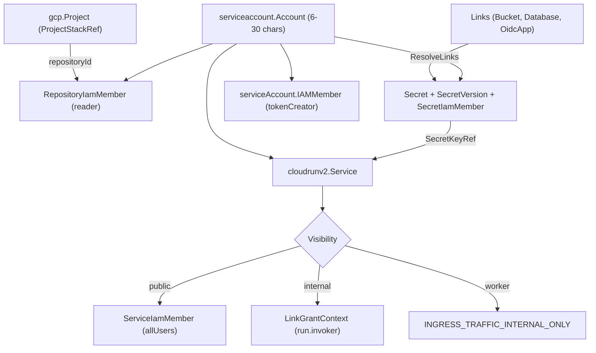
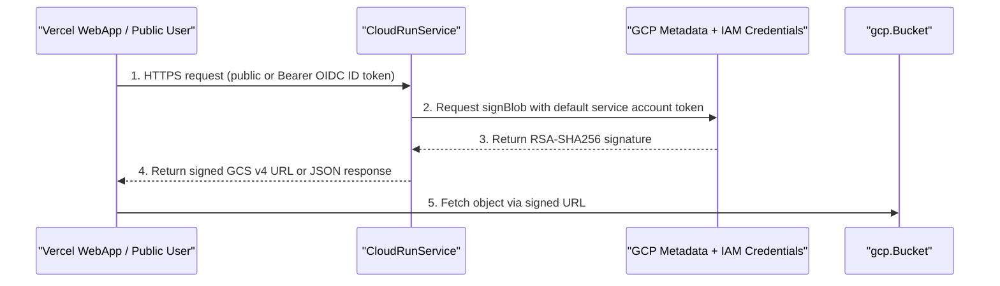

# GCP Cloud Run service - software architecture

## Overview

`gcp.CloudRunService` (`core.StatelessResource`) deploys per-environment Cloud Run v2 containers across `dev`, `stage`, `prod`, and `preview-<slug>` stacks. It manages bounded service accounts, Secret Manager secret mounts, Artifact Registry pull IAM, caller visibility, and custom domain bindings.

## Requirement

### Functional

- FR1: Create a dedicated `6-30` character service account per service with `roles/iam.serviceAccountTokenCreator` on itself for keyless GCS v4 URL signing.
- FR2: Store workload and linked secrets in Secret Manager and mount them into the container via `SecretKeyRef`.
- FR3: Support `public` (`allUsers` invoker), `internal` (IAM and federated OIDC callers only), and `worker` (`INGRESS_TRAFFIC_INTERNAL_ONLY`) modes.
- FR4: Name services `{project}-{dev|stage|prod|previewId}` when `BaseDomain` is set so [gcp.CloudLoadBalancer](./cloud-load-balancer.md) routes traffic automatically, and attach optional `cloudrun.DomainMapping`s on persistent environments.

### Non-Functional

- NFR1: Scale `dev` and `preview-<slug>` containers to zero when idle (`MinInstanceCount: 0`).
- NFR2: Never pass secret values as plain Cloud Run environment variables.

## Design

### Components and Responsibilities



- `serviceaccount.Account` isolates container identity per stack and service.
- `secretmanager.Secret` and `SecretVersion` hold merged secrets from `Secrets` and `Links`.
- `cloudrunv2.Service` runs the container image, injects plain `Env` variables and secret references, and exports `URL`, `URLs`, and `ServiceAccountEmail`.
- `LinkDescriptor.GrantAccess` grants `roles/run.invoker` to downstream `CloudRunService` or `vercel.WebApp` consumers when linked.

### Data and Control Flow



During `Register`, `CloudRunService` resolves `Links`, writes secrets to Secret Manager, and waits for IAM bindings before creating `cloudrunv2.Service`. At runtime, containers sign GCS URLs through the IAM Credentials API without static JSON keys.

### Interfaces and Contracts

```go
api, err := gcp.CloudRunService{
	Name:            "web",
	Project:         "storefront",
	Environment:     "stage",
	Links:           []core.Resource{uploads, db, auth},
	ProjectStackRef: "cloudvoyant/storefront-shared/shared",
	BaseDomain:      "gcp.cloudvoyant.io",
	Domains:         []string{"stage.storefront.io"},
	Visibility:      gcp.VisibilityPublic,
	Image:           pulumi.String("us-central1-docker.pkg.dev/cloudvoyant-openbase/storefront-project-gcp/web:sha"),
}.Register(ctx)
```

| Field / Output | Direction | Description |
| :--- | :--- | :--- |
| `Visibility` | Input | `public` (default), `internal`, or `worker` |
| `BaseDomain` | Input | Formats `{project}-{env}.{baseDomain}` for `CloudLoadBalancer` |
| `Domains` | Input | Extra vanity domains bound via `cloudrun.DomainMapping` on `dev`, `stage`, or `prod` |
| `URL` / `URLs` | Output | Primary HTTPS endpoint and all routed URLs |
| `<NAME>_URL` | Link Env | Exported to linked callers alongside automatic `roles/run.invoker` IAM |

## Implementation

### Predictable regional URLs

When `GCPProjectNumber` is provided, `CloudRunRegionalURL` computes `https://<service>-<projectNumber>.<location>.run.app` deterministically before deployment. Composite blueprints pass this URL to `kinde.OidcApp` without circular resource dependencies.

### Vanity domain mappings

`cloudrun.DomainMapping` runs only on persistent tiers (`dev`, `stage`, `prod`) when `Domain` or `Domains` adds custom hostnames outside `BaseDomain`. Preview branches always use wildcard `BaseDomain` or regional `.run.app` URLs.

## References

- [GCP Platform and Project](./index.md)
- [Cloud Load Balancer](./cloud-load-balancer.md)
- [GCS Bucket and OverlayFS](./bucket.md)
