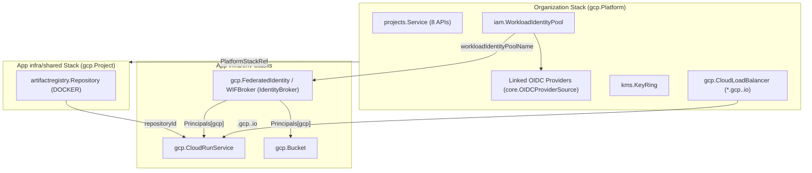
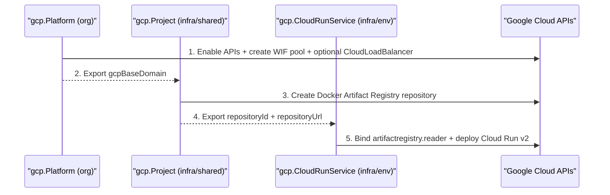

# GCP platform and project - software architecture

## Overview

`libs/components/gcp` separates organization Google Cloud foundations (`gcp.Platform`, `core.PlatformResource`) from shared repository assets (`gcp.Project`, `core.StatelessResource` with `Environment: "shared"`) over `github.com/pulumi/pulumi-gcp/sdk/v9`. `gcp.Platform` runs once per organization and owns APIs, Workload Identity Federation, KMS, and wildcard load balancing. `gcp.Project` runs once per repository in `infra/shared` and owns strictly the application Docker Artifact Registry (`<project>-gcp`).

## Requirement

### Functional

- Enable required Google Cloud APIs once per organization without disabling dependent services on stack teardown.
- Federate GitHub Actions and Vercel OIDC identities at the organization level and broker external callers into federated GCP service accounts via `gcp.WIFBroker`.
- Provision optional organization KMS key rings and wildcard HTTPS load balancing for all Cloud Run applications.
- Provision a dedicated Docker container registry per application repository without threading OIDC pools through project resources.

### Non-Functional

- Reuse one organization Workload Identity Pool across repositories instead of creating duplicate pools per application.
- Keep `gcp.Project` focused solely on shared container registry state so OIDC federation stays strictly between `gcp.Platform` and workload `Links`.

## Design

### Components and Responsibilities



- `gcp.Platform` enables `run`, `artifactregistry`, `iam`, `iamcredentials`, `sts`, `storage`, `secretmanager`, and `cloudkms` APIs, creates the OIDC pool and providers, and exports `workloadIdentityPoolName`, `<id>OidcProviderName`, `keyRingId`, and `gcpBaseDomain`.
- `gcp.Project` creates `<project>-<name>` in Artifact Registry (omitting `shared` from the repository ID) and exports `repositoryId`, `repositoryUrl`, and `baseDomain`.
- `gcp.FederatedIdentity` and `gcp.WIFBroker` implement `core.IdentityBroker`, minting a federated GCP service account and `roles/iam.workloadIdentityUser` binding when non-GCP workloads (such as `vercel.WebApp`) link GCP resources, with `FederatedIdentity` exposing typed `ServiceAccountEmail` and `ProviderAudience` outputs.
- [gcp.CloudRunService](./cloud-run-service.md) and [gcp.Bucket](./bucket.md) consume `ProjectStackRef` and `Principals["gcp"]` on `dev`, `stage`, `prod`, and `preview-<slug>`.

### Data and Control Flow



`gcp.Platform` establishes organization identity and edge routing once. `gcp.Project` creates the application image registry without forwarding WIF pools. Environment stacks read `repositoryId` from `ProjectStackRef` for image pull access, while hybrid workloads pass `gcp.WIFBroker` to `core.ResolveLinks` when crossing cloud boundaries.

### Interfaces and Contracts

```go
// Tier 1: Organization (core.PlatformResource)
plat, err := gcp.Platform{
	Org:                "cloudvoyant",
	GCPProject:         pulumi.String("cloudvoyant-openbase"),
	GCPProjectNumber:   "785485436615",
	Links:              []core.OIDCProviderSource{vercelPlat, core.GitHubActionsOIDC("cloudvoyant")},
	BaseDomain:         "gcp.cloudvoyant.io",
	EnableLoadBalancer: true,
}.Register(ctx)

// Shared Project Resource in infra/shared (core.StatelessResource)
proj, err := gcp.Project{
	Project:          "storefront",
	Repo:             "cloudvoyant/storefront",
	PlatformStackRef: "cloudvoyant/platform/platform",
}.Register(ctx)
```

| Spec | Contract | Synthesized `pulumi-gcp` Resources | Key Outputs |
| :--- | :--- | :--- | :--- |
| `gcp.Platform` | `core.PlatformResource` | `projects.Service`, `iam.WorkloadIdentityPool`, `iam.WorkloadIdentityPoolProvider`, `kms.KeyRing`, optional `CloudLoadBalancer` | `workloadIdentityPoolName`, `vercelOidcProviderName`, `keyRingId`, `gcpBaseDomain` |
| `gcp.Project` | `core.StatelessResource` (`shared`) | `artifactregistry.Repository` | `repositoryId`, `repositoryUrl`, `baseDomain` |

## Implementation

### Organization WIF trust boundary

`gcp.Platform` attaches an `iam.WorkloadIdentityPoolProvider` for each generic `core.OIDCProviderSource` in `Links` (such as `vercel.Platform` or `core.GitHubActionsOIDC`) without hardcoding external vendor fields in `gcp`. `gcp.WIFBroker` narrows each federated service account further by the caller's `PrincipalClaim` (for example `attribute.project_id/<vercelProjectId>`).

### Cloud Run callback helper

`gcp.BuildCloudRunCallbackURLs` computes deterministic Cloud Run wildcard (`dev` and `preview-*`) and regional or custom-domain (`stage` and `prod`) OAuth callback sets so `kinde.Project` can register Cloud Run redirect allowlists in `infra/shared`.

## References

- [Cloud Load Balancer](./cloud-load-balancer.md)
- [Cloud Run Service](./cloud-run-service.md)
- [GCS Bucket and OverlayFS](./bucket.md)
- [OpenBase Architecture Overview](../../index.md)
