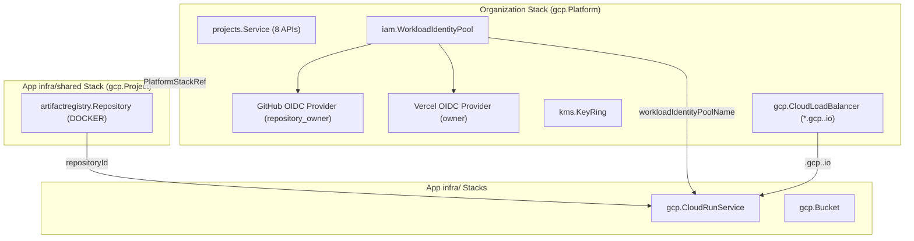
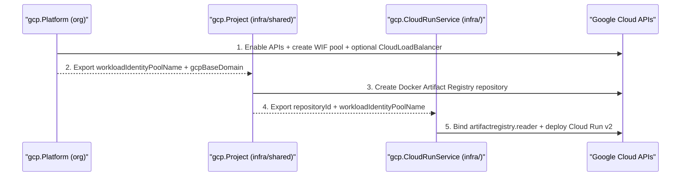

# GCP platform and project - software architecture

## Overview

`libs/components/gcp` separates organization Google Cloud foundations (`gcp.Platform`, `core.PlatformResource`) from shared repository assets (`gcp.Project`, `core.StatelessResource` with `Environment: "shared"`) over `github.com/pulumi/pulumi-gcp/sdk/v9`. `gcp.Platform` runs once per organization and owns APIs, Workload Identity Federation, KMS, and wildcard load balancing. `gcp.Project` runs once per repository in `infra/shared` and owns the application Docker Artifact Registry (`<project>-gcp`).

## Requirement

### Functional

- FR1: Enable required Google Cloud APIs once per organization in `gcp.Platform` with `DisableOnDestroy: false`.
- FR2: Provision one organization Workload Identity Pool (`ob-<org>-pool`) with optional GitHub Actions (`assertion.repository_owner`) and Vercel (`assertion.owner`) OIDC providers.
- FR3: Provision an optional KMS `KeyRing` and optional wildcard [gcp.CloudLoadBalancer](./cloud-load-balancer.md) in `gcp.Platform`.
- FR4: Provision a per-application Docker `artifactregistry.Repository` in `gcp.Project` and inherit `gcp.Platform` outputs via `Platform` or `PlatformStackRef`.

### Non-Functional

- NFR1: Never duplicate Workload Identity Pools across application repositories when `Platform` or `PlatformStackRef` is set.
- NFR2: Keep `gcp.Platform` free of application `Project`, `Repo`, and `Environment` fields.

## Design

### Components and Responsibilities



- `gcp.Platform` enables `run`, `artifactregistry`, `iam`, `iamcredentials`, `sts`, `storage`, `secretmanager`, and `cloudkms` APIs, creates the OIDC pool and providers, and exports `workloadIdentityPoolName`, `vercelOidcProviderName`, `keyRingId`, and `gcpBaseDomain`.
- `gcp.Project` creates `<project>-<name>` in Artifact Registry (omitting `shared` from the repository ID) and forwards inherited `Platform` outputs to environment stacks.
- [gcp.CloudRunService](./cloud-run-service.md) and [gcp.Bucket](./bucket.md) consume `ProjectStackRef` on `dev`, `stage`, `prod`, and `preview-<slug>`.

### Data and Control Flow



`gcp.Platform` establishes organization identity and edge routing once. `gcp.Project` reads `PlatformStackRef` without creating a second WIF pool and creates the application image registry. Environment stacks read `ProjectStackRef` to grant image pull permissions and bind federated OIDC callers.

### Interfaces and Contracts

```go
// Tier 1: Organization (core.PlatformResource)
plat, err := gcp.Platform{
	Org:                "cloudvoyant",
	GCPProject:         pulumi.String("cloudvoyant-openbase"),
	GCPProjectNumber:   "785485436615",
	GitHubOrg:          "cloudvoyant",
	VercelTeamSlug:     "cloudvoyant",
	BaseDomain:         "gcp.cloudvoyant.io",
	EnableLoadBalancer: true,
}.Register(ctx)

// Shared Project Resource in infra/shared (core.StatelessResource)
proj, err := gcp.Project{
	Project:          "storefront",
	Repo:             "cloudvoyant/storefront",
	PlatformStackRef: "cloudvoyant/platform/shared",
	GCPProject:       pulumi.String("cloudvoyant-openbase"),
}.Register(ctx)
```

| Spec | Contract | Synthesized `pulumi-gcp` Resources | Key Outputs |
| :--- | :--- | :--- | :--- |
| `gcp.Platform` | `core.PlatformResource` | `projects.Service`, `iam.WorkloadIdentityPool`, `iam.WorkloadIdentityPoolProvider`, `kms.KeyRing`, optional `CloudLoadBalancer` | `workloadIdentityPoolName`, `vercelOidcProviderName`, `keyRingId`, `gcpBaseDomain` |
| `gcp.Project` | `core.StatelessResource` (`shared`) | `artifactregistry.Repository` | `repositoryId`, `repositoryUrl`, `baseDomain`, `workloadIdentityPoolName` |

## Implementation

### Organization WIF trust boundary

`gcp.Platform` restricts GitHub OIDC tokens to `assertion.repository_owner == '<GitHubOrg>'` and Vercel OIDC tokens to `assertion.owner == '<VercelTeamSlug>'`. Individual service accounts in environment stacks narrow access further by project or subject claim.

### Standalone project mode

If an application registers `gcp.Project` without `Platform` or `PlatformStackRef`, `gcp.Project` creates only the Docker `artifactregistry.Repository`. It does not create hidden organization WIF pools or KMS key rings.

## References

- [Cloud Load Balancer](./cloud-load-balancer.md)
- [Cloud Run Service](./cloud-run-service.md)
- [GCS Bucket and OverlayFS](./bucket.md)
- [OpenBase Architecture Overview](../../index.md)
