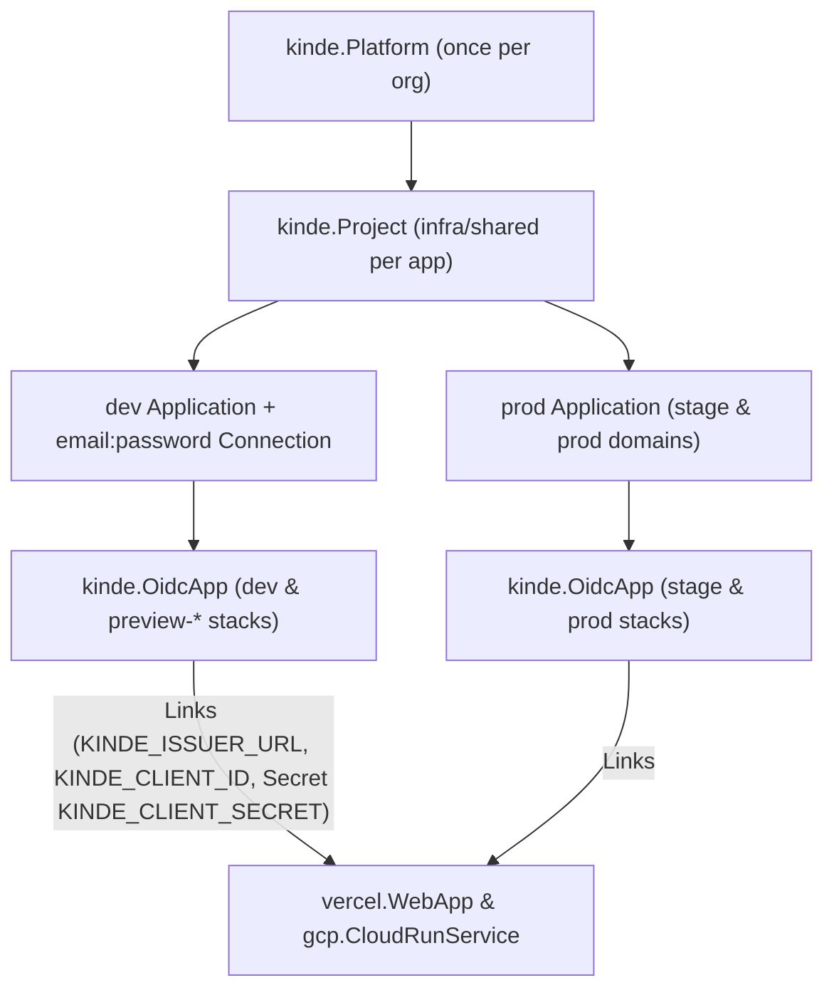

# Kinde provider - software architecture

## Overview

The `libs/components/kinde` package implements OpenBase's declarative two-tenant OIDC authentication components over the bridged `kinde-oss/kinde` Terraform provider (`internal/providers/kinde`). It provides `kinde.Platform` for organization-level `dev` & `prod` tenant connections, `kinde.Project` for provisioning an application's `dev` & `prod` OIDC `Application`s in `infra/shared`, and `kinde.OidcApp` (`*kinde.OidcAppResource`, `core.StatelessResource`) for routing per-environment stacks to the matching tenant credentials and callback URLs.

## Requirements

### Functional

- Validate org-wide `dev` & `prod` Kinde tenants and discover the shared `email:password` connection ID once in `kinde.Platform`.
- Provision per-application `dev` and `prod` Kinde `Application`s in `kinde.Project` (`infra/shared`):
  - `dev` `Application`: localhost callbacks (`http://localhost:5173/...`, `http://localhost:3000/...`), wildcard preview callbacks (`https://<project>-*.{baseDomain}/...` or `https://<project>-*-<teamSlug>.vercel.app/...`), and `email:password` `ApplicationConnection`.
  - `prod` `Application`: `stage` and `prod` domain callbacks (`https://<stageDomain>/...` and `https://<prodDomain>/...`).
- Route `dev` and `preview-*` stacks in `kinde.OidcApp` to the `dev` tenant and `stage` and `prod` stacks to the `prod` tenant, exporting `KINDE_*` OIDC variables and secret `KINDE_CLIENT_SECRET` via `Links`.

### Non-Functional

- Never delete shared `dev` or `prod` Kinde `Application`s when an ephemeral `preview-*` stack is destroyed.
- Keep `KINDE_CLIENT_SECRET` and M2M client secrets encrypted as Pulumi secrets across state and links.

## Design

### Components and Responsibilities



- **`kinde.Platform` (once per org)**: Creates `dev` & `prod` `kinde.Provider`s, discovers `email:password` connection ID via `GetConnections`, and exports `devIssuerUrl`, `prodIssuerUrl`, and `emailPasswordConn`.
- **`kinde.Project` (once per app in `infra/shared`)**: Creates `reg` backend OIDC `Application`s in both tenants, attaches `email:password` on `dev`, and exports `devIssuerUrl`, `devClientId`, `devClientSecret`, `prodIssuerUrl`, `prodClientId`, and `prodClientSecret`.
- **`kinde.OidcApp` (`*kinde.OidcAppResource`)**: Selects `dev` outputs for `dev` and `preview-<slug>` and `prod` outputs for `stage` and `prod`, computes environment-specific `KINDE_SITE_URL`, `KINDE_REDIRECT_URL`, `KINDE_POST_LOGIN_REDIRECT_URL`, and `KINDE_POST_LOGOUT_REDIRECT_URL`, and exports them in its `LinkDescriptor`.

### Interfaces and Contracts

```go
// 1. Once per app (infra/shared)
appKinde, err := kinde.Project{
	Project:        "storefront",
	VercelTeamSlug: "cloudvoyant",
	BaseDomain:     "vercel.cloudvoyant.io",
	Dev: kinde.TenantCredentials{
		Domain:       os.Getenv("KINDE_DEV_TENANT_DOMAIN"),
		ClientID:     pulumi.String(os.Getenv("KINDE_DEV_M2M_CLIENT_ID")),
		ClientSecret: pulumi.String(os.Getenv("KINDE_DEV_M2M_CLIENT_SECRET")),
	},
	Prod: kinde.TenantCredentials{
		Domain:       os.Getenv("KINDE_PROD_TENANT_DOMAIN"),
		ClientID:     pulumi.String(os.Getenv("KINDE_PROD_M2M_CLIENT_ID")),
		ClientSecret: pulumi.String(os.Getenv("KINDE_PROD_M2M_CLIENT_SECRET")),
	},
}.Register(ctx)

// 2. Per environment (infra/)
oidc, err := kinde.OidcApp{
	Name:            "auth",
	Project:         "storefront",
	ProjectStackRef: "org/storefront-shared/shared",
	VercelTeamSlug:  "cloudvoyant",
	BaseDomain:      "vercel.cloudvoyant.io",
}.Register(ctx)
```

### Synthesized Kinde Resources

| OpenBase Spec | Tier | Synthesized Bridged `kinde-oss/kinde` Resources |
| :--- | :--- | :--- |
| `kinde.Platform` | Org (`shared`) | 2x `kinde.Provider` (`dev`, `prod`), `GetConnections` |
| `kinde.Project` | App (`infra/shared`) | 2x `kinde.Application`, `kinde.ApplicationConnection` (`email:password` on `dev`) |
| `kinde.OidcApp` | Env (`dev`, `stage`, `prod`, `preview-*`) | Component outputs + `KINDE_*` `LinkDescriptor` (no duplicate per-branch Kinde apps) |

## References

- [OpenBase Architecture Overview](../index.md)
- [OpenBase Resources](../resources.md)
- [GCP Provider](./gcp.md)
- [Vercel Provider](./vercel.md)
- [Neon Provider](./neon.md)
