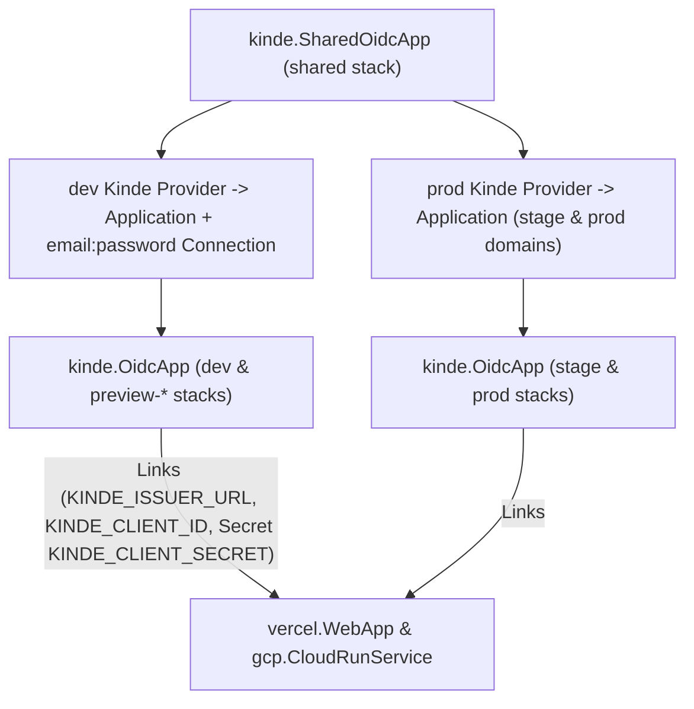

# Kinde provider - software architecture

## Overview

The `libs/components/kinde` package implements OpenBase's declarative two-tenant OIDC authentication components over the bridged `kinde-oss/kinde` Terraform provider (`internal/providers/kinde`). It provides `kinde.SharedOidcApp` for managing Kinde OIDC applications across separate `dev` and `prod` Kinde tenants in the `shared` stack, and `kinde.OidcApp` (`*kinde.OidcAppResource`, `core.StatelessResource`) for routing per-environment stacks to the matching tenant credentials and callback URLs.

## Requirements

### Functional

- Manage two explicit `kinde.Provider` instances (`dev` M2M credentials and `prod` M2M credentials) inside `kinde.SharedOidcApp`.
- Configure the `dev` Kinde `Application` with localhost callbacks (`http://localhost:5173/...`, `http://localhost:3000/...`), wildcard preview callbacks (`https://<project>-*-<teamSlug>.vercel.app/...`), and an `email:password` `ApplicationConnection` for deterministic automated E2E logins.
- Configure the `prod` Kinde `Application` with `stage` and `prod` domain callbacks (`https://<stageDomain>/...` and `https://<prodDomain>/...`).
- Route `dev` and `preview-*` stacks in `kinde.OidcApp` to the `dev` tenant and `stage` and `prod` stacks to the `prod` tenant, exporting `KINDE_*` OIDC variables and secret `KINDE_CLIENT_SECRET` via `Links`.

### Non-Functional

- Never delete shared `dev` or `prod` Kinde `Application`s when an ephemeral `preview-*` stack is destroyed.
- Keep `KINDE_CLIENT_SECRET` and M2M client secrets encrypted as Pulumi secrets across state and links.

## Design

### Components and Responsibilities



- **`kinde.SharedOidcApp`**: Normalizes tenant domains (`https://<subdomain>.kinde.com`), sets audience to `https://<subdomain>.kinde.com/api`, creates `reg` backend OIDC applications in both tenants, queries `GetConnections` on `dev` to bind the `email:password` strategy via `ApplicationConnection`, and exports tenant-keyed outputs (`devIssuerUrl`, `devClientId`, `devClientSecret`, `prodIssuerUrl`, `prodClientId`, `prodClientSecret`).
- **`kinde.OidcApp` (`*kinde.OidcAppResource`)**: Selects `dev` outputs for `dev` and `preview-<slug>` and `prod` outputs for `stage` and `prod`, computes environment-specific `KINDE_SITE_URL`, `KINDE_REDIRECT_URL`, `KINDE_POST_LOGIN_REDIRECT_URL`, and `KINDE_POST_LOGOUT_REDIRECT_URL`, and exports them in its `LinkDescriptor`.

### Interfaces and Contracts

```go
// Package kinde (github.com/cloudvoyant/openbase/libs/components/kinde)
sharedOidc, err := kinde.SharedOidcApp{
	Name:           "shared-oidc",
	Project:        "storefront",
	VercelTeamSlug: "cloudvoyant",
	Dev: kinde.TenantCredentials{
		Domain:       os.Getenv("KINDE_DEV_TENANT_DOMAIN"),
		ClientID:     pulumi.String(os.Getenv("KINDE_DEV_M2M_CLIENT_ID")),
		ClientSecret: pulumi.String(os.Getenv("KINDE_DEV_M2M_CLIENT_SECRET")),
	},
	Prod: kinde.TenantCredentials{
		Domain:       os.Getenv("KINDE_PROD_TENANT_DOMAIN"),
		ClientID:     pulumi.String(os.Getenv("KINDE_PROD_M2M_CLIENT_ID")),
		ClientSecret: pulumi.String(os.Getenv("KINDE_PROD_M2M_CLIENT_SECRET")),
	},
}.Register(ctx)

oidc, err := kinde.OidcApp{
	Name:           "auth",
	Project:        "storefront",
	SharedStackRef: "org/storefront/shared",
	VercelTeamSlug: "cloudvoyant",
}.Register(ctx)
```

### Synthesized Kinde Resources

| OpenBase Spec | Environment | Synthesized Bridged `kinde-oss/kinde` Resources |
| :--- | :--- | :--- |
| `kinde.SharedOidcApp` | `shared` | 2x `kinde.Provider` (`dev`, `prod`), 2x `kinde.Application`, `GetConnections`, `kinde.ApplicationConnection` (`email:password` on `dev`) |
| `kinde.OidcApp` | `dev`, `stage`, `prod`, `preview-*` | Component outputs + `KINDE_*` `LinkDescriptor` (no duplicate per-branch Kinde apps) |

## References

- [OpenBase Architecture Overview](../index.md)
- [OpenBase Resources](../resources.md)
- [GCP Provider](./gcp.md)
- [Vercel Provider](./vercel.md)
- [Neon Provider](./neon.md)
