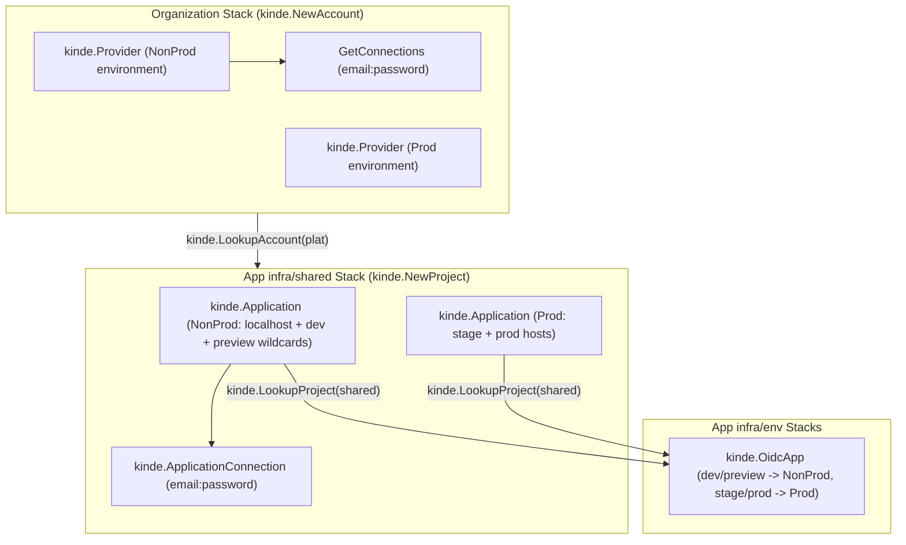
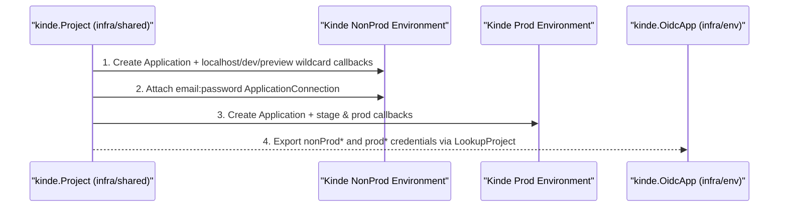

# Kinde account and project - software architecture

## Overview

`libs/components/kinde` separates Kinde Business account connections (`kinde.Account`, `core.AccountResource`) from shared OIDC client registrations (`kinde.Project`, `core.StatelessResource` with `Environment: "shared"`) over the bridged `kinde-oss/kinde` provider (`libs/internal/pulumi-kinde-go-sdk`). `kinde.Account` runs once per organization in `infra/platform` to configure `NonProd` and `Prod` Kinde environments (`EnvironmentCredentials`) inside the Business account and discover shared authentication connections. `kinde.Project` runs once per repository in `infra/shared` to register paired `NonProd` and `Prod` OIDC applications.

## Requirement

### Functional

- Connect to a Kinde Business account's `NonProd` and `Prod` environments and discover shared authentication strategies once per organization.
- Register paired `NonProd` and `Prod` OAuth2/OIDC applications per repository.
- Allow localhost, `dev`, and wildcard preview callback URLs on the `NonProd` environment while restricting the `Prod` environment to `stage` and `prod` domains.

### Non-Functional

- Keep shared `NonProd` and `Prod` OIDC applications intact when ephemeral pull-request previews are destroyed.
- Avoid per-pull-request mutations to Kinde callback allowlists so concurrent previews never race.
- Keep management M2M credentials and OIDC client secrets encrypted in Pulumi state.

## Design

### Components and Responsibilities



- `kinde.Account` configures both Kinde environment providers and caches `emailPasswordConn`.
- `kinde.Project` creates one OIDC application per Kinde environment, binds `email:password` on `NonProd`, and exports `nonProdClientId`, `nonProdClientSecret`, `prodClientId`, and `prodClientSecret`.
- [kinde.OidcApp](./oidc-app.md) binds environment-specific redirect URLs on `dev`, `stage`, `prod`, and `preview-<slug>`.

### Data and Control Flow



`kinde.Project` registers wildcard callback patterns once in `infra/shared`. Because Kinde supports wildcard subdomain callbacks on `NonProd`, pull-request stacks never mutate Kinde application allowlists or race with concurrent PRs.

### Interfaces and Contracts

```go
// Tier 1: Organization (infra/platform/main.go)
acc, err := kinde.NewAccount(ctx, "kinde", &kinde.AccountArgs{
	Org:     "cloudvoyant",
	NonProd: nonProdEnvCreds,
	Prod:    prodEnvCreds,
})

// Shared Project Resource in infra/shared/main.go
plat, err := openbase.LookupPlatform(ctx)
proj, err := kinde.NewProject(ctx, "auth", &kinde.ProjectArgs{
	Account:        kinde.LookupAccount(plat),
	VercelTeamSlug: "cloudvoyant",
	BaseDomain:     "vercel.cloudvoyant.io",
})
```

| Type | Contract | Synthesized `kinde` Resources | Key Outputs |
| :--- | :--- | :--- | :--- |
| `kinde.Account` | `core.AccountResource` | 2x `kinde.Provider`, `GetConnections` | `nonProdIssuerUrl`, `prodIssuerUrl`, `emailPasswordConn` |
| `kinde.Project` | `core.StatelessResource` (`shared`) | 2x `kinde.Application`, `kinde.ApplicationConnection` | `nonProdIssuerUrl`, `nonProdClientId`, `nonProdClientSecret`, `prodIssuerUrl`, `prodClientId`, `prodClientSecret` |

## Implementation

### Sandbox import and retention

`ImportNonProdAppID`, `ImportProdAppID`, and `RetainApplicationsOnDelete` allow E2E suites and existing applications to adopt pre-existing Kinde OIDC applications and update callback lists in place without deleting apps on teardown.

### Issuer normalization

`NormalizeIssuerURL` trims trailing slashes and prepends `https://` when omitted so `KINDE_ISSUER_URL` and `<issuer>/api` management audiences stay consistent.

## References

- [Kinde OidcApp](./oidc-app.md)
- [OpenBase Architecture Overview](../../index.md)
