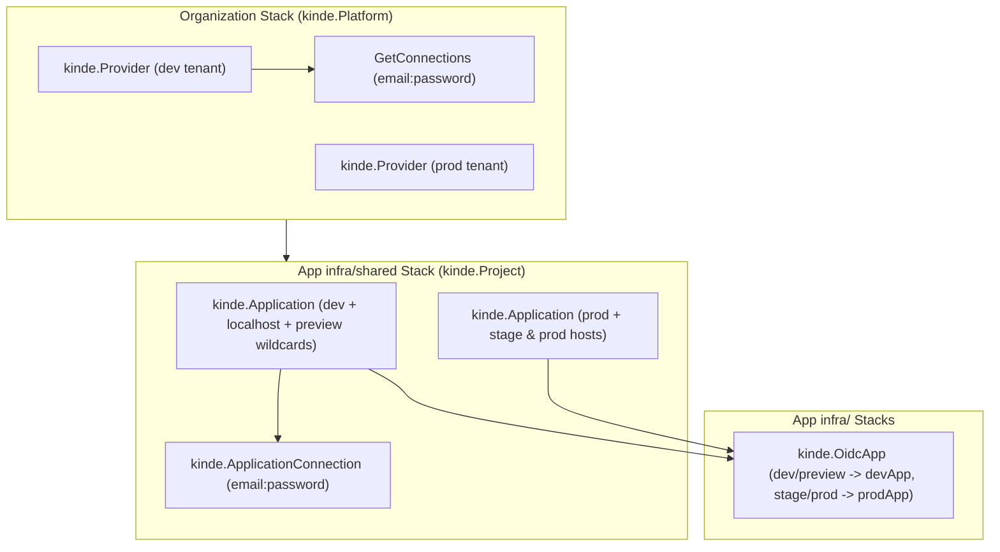
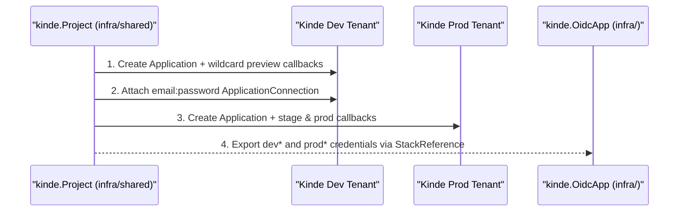

# Kinde platform and project - software architecture

## Overview

`libs/components/kinde` separates organization two-tenant Kinde connections (`kinde.Platform`, `core.PlatformResource`) from per-application OIDC client registrations (`kinde.Project`, `core.ProjectResource`) over the bridged `kinde-oss/kinde` provider (`internal/providers/kinde`). `kinde.Platform` runs once per organization to configure `dev` and `prod` Kinde tenants and discover shared authentication connections. `kinde.Project` runs once per repository in `infra/shared` to register `dev` and `prod` OIDC applications.

## Requirement

### Functional

- FR1: Validate `dev` and `prod` Kinde M2M credentials in `kinde.Platform`, create explicit `kinde.Provider` instances, and discover the `email:password` connection ID once.
- FR2: Provision `reg` backend OIDC `Application` pairs (`dev` and `prod`) in `kinde.Project` (`infra/shared`).
- FR3: Populate localhost and wildcard preview redirect URIs (`https://<project>-*.{baseDomain}/...` or `https://<vProjName>-*-<teamSlug>.vercel.app/...`) on the `dev` application, and `stage` plus `prod` domain callbacks on the `prod` application.

### Non-Functional

- NFR1: Never destroy shared `dev` or `prod` Kinde `Application`s when an ephemeral `preview-<slug>` stack runs `pulumi destroy`.
- NFR2: Keep M2M secrets and `ClientSecret` outputs encrypted as Pulumi secrets.

## Design

### Components and Responsibilities



- `kinde.Platform` configures both tenant providers and caches `emailPasswordConn`.
- `kinde.Project` creates one OIDC application per tenant, binds `email:password` on `dev`, and exports `devClientId`, `devClientSecret`, `prodClientId`, and `prodClientSecret`.
- [kinde.OidcApp](./oidc-app.md) binds environment-specific redirect URLs on `dev`, `stage`, `prod`, and `preview-<slug>`.

### Data and Control Flow



`kinde.Project` registers wildcard callback patterns once in `infra/shared`. Because Kinde supports wildcard subdomain callbacks on `dev`, pull-request stacks never mutate Kinde application allowlists or race with concurrent PRs.

### Interfaces and Contracts

```go
// Tier 1: Organization (core.PlatformResource)
plat, err := kinde.Platform{
	Org:  "cloudvoyant",
	Dev:  devTenantCreds,
	Prod: prodTenantCreds,
}.Register(ctx)

// Tier 2: Application Project in infra/shared (core.ProjectResource)
proj, err := kinde.Project{
	Project:        "storefront",
	Repo:           "cloudvoyant/storefront",
	Platform:       plat,
	VercelTeamSlug: "cloudvoyant",
	BaseDomain:     "vercel.cloudvoyant.io",
}.Register(ctx)
```

| Spec | Tier Interface | Synthesized `kinde` Resources | Key Outputs |
| :--- | :--- | :--- | :--- |
| `kinde.Platform` | `core.PlatformResource` | 2x `kinde.Provider`, `GetConnections` | `devIssuerUrl`, `prodIssuerUrl`, `emailPasswordConn` |
| `kinde.Project` | `core.ProjectResource` | 2x `kinde.Application`, `kinde.ApplicationConnection` | `devIssuerUrl`, `devClientId`, `devClientSecret`, `prodIssuerUrl`, `prodClientId`, `prodClientSecret` |

## Implementation

### Sandbox import and retention

`ImportDevAppID`, `ImportProdAppID`, and `RetainApplicationsOnDelete` allow E2E suites and existing applications to adopt pre-existing Kinde OIDC applications and update callback lists in place without deleting tenant apps on teardown.

### Issuer normalization

`NormalizeIssuerURL` trims trailing slashes and prepends `https://` when omitted so `KINDE_ISSUER_URL` and `<issuer>/api` management audiences stay consistent.

## References

- [Kinde OidcApp](./oidc-app.md)
- [OpenBase Architecture Overview](../../index.md)
