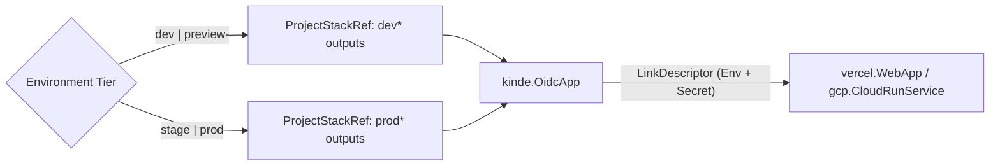
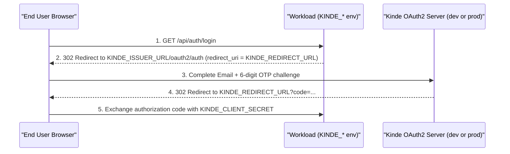

# Kinde OidcApp - software architecture

## Overview

`kinde.OidcApp` (`core.StatelessResource`) routes per-environment stacks (`dev`, `stage`, `prod`, and `preview-<slug>`) to the matching Kinde tenant credentials from `kinde.Project` (`ProjectStackRef`) and computes environment-specific OIDC callback and post-logout URLs. It creates zero duplicate Kinde applications per branch.

## Requirement

### Functional

- FR1: Route `dev` and `preview-<slug>` stacks to `dev` tenant outputs (`devIssuerUrl`, `devClientId`, `devClientSecret`).
- FR2: Route `stage` and `prod` stacks to `prod` tenant outputs (`prodIssuerUrl`, `prodClientId`, `prodClientSecret`).
- FR3: Export `KINDE_ISSUER_URL`, `KINDE_CLIENT_ID`, `KINDE_SITE_URL`, `KINDE_REDIRECT_URL`, `KINDE_POST_LOGIN_REDIRECT_URL`, `KINDE_POST_LOGOUT_REDIRECT_URL`, and secret `KINDE_CLIENT_SECRET` via `Links`.

### Non-Functional

- NFR1: Require zero Kinde M2M management credentials in `infra/main.go` when `ProjectStackRef` is set.
- NFR2: Keep `KINDE_CLIENT_SECRET` marked as a Pulumi secret in state and linked workloads.

## Design

### Components and Responsibilities



- `selectTenantOutputs` picks `dev` or `prod` credentials based on `meta.Environment`.
- `resolveSiteURL` computes `https://{project}-{dev|stage|prod|previewId}.{baseDomain}` (or explicit `SiteURL` / `.vercel.app` fallback).
- `SetLink` exports the standard Kinde SDK environment contract to linked workloads.

### Data and Control Flow



`OidcApp` computes `KINDE_REDIRECT_URL` (`<SiteURL><CallbackPath>`) during `Register`. At runtime, the workload redirects unauthenticated users to Kinde and exchanges the authorization code using `KINDE_CLIENT_SECRET`.

### Interfaces and Contracts

```go
auth, err := kinde.OidcApp{
	Name:            "auth",
	Project:         "storefront",
	Environment:     "stage",
	ProjectStackRef: "cloudvoyant/storefront-shared/shared",
	BaseDomain:      "vercel.cloudvoyant.io",
	CallbackPath:    "/api/auth/kinde_callback",
}.Register(ctx)
```

| Environment | Selected Tenant | Exported `KINDE_REDIRECT_URL` (`BaseDomain = vercel.acme.io`) |
| :--- | :--- | :--- |
| `dev` | `dev` | `https://storefront-dev.vercel.acme.io/api/auth/kinde_callback` |
| `preview-pr-20` | `dev` | `https://storefront-pr-20.vercel.acme.io/api/auth/kinde_callback` |
| `stage` | `prod` | `https://storefront-stage.vercel.acme.io/api/auth/kinde_callback` |
| `prod` | `prod` | `https://storefront-prod.vercel.acme.io/api/auth/kinde_callback` |

## Implementation

### Explicit SiteURL override

Cloud Run composite blueprints compute `siteURL` from `BaseDomain` or `gcp.CloudRunRegionalURL` and pass `SiteURL` directly to `kinde.OidcApp` so container environment variables match the deployed Cloud Run URL before the container starts.

### Custom env prefix

`EnvPrefix` defaults to `KINDE`. Override `EnvPrefix` only when a single workload links multiple OIDC clients simultaneously.

## References

- [Kinde Platform and Project](./index.md)
- [Core Resources and Tier Contracts](../../resources.md)
