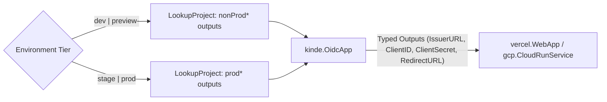
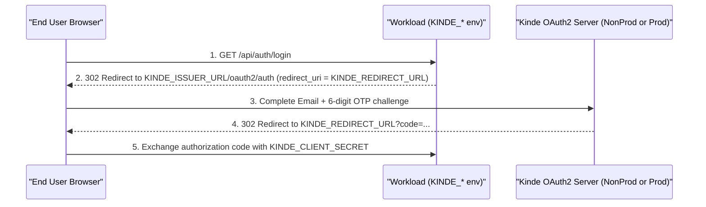

# Kinde OidcApp - software architecture

## Overview

`kinde.OidcApp` (`core.StatelessResource`) routes per-environment stacks (`dev`, `stage`, `prod`, and `preview-<slug>`) to the matching `NonProd` or `Prod` Kinde environment credentials from `kinde.LookupProject(shared, "auth")` and computes environment-specific OIDC callback and post-logout URLs. It creates zero duplicate Kinde applications per branch.

## Requirement

### Functional

- Bind `dev` and `preview-<slug>` deployments to the `NonProd` Kinde environment and `stage` and `prod` deployments to the `Prod` Kinde environment.
- Compute environment-specific site, login callback, post-login, and post-logout URLs for each stack.
- Expose typed OIDC issuer, client ID, redirect URL, and client secret outputs for application workloads.

### Non-Functional

- Require zero Kinde management M2M credentials during per-environment and pull-request deployments.
- Keep OIDC client secrets encrypted across state outputs and consumer workloads.

## Design

### Components and Responsibilities



- `resolveEnvCredOutputs` picks `nonProd` or `prod` credentials based on `meta.Environment`.
- `resolveSiteURL` computes `https://{project}-{dev|stage|prod|previewId}.{baseDomain}` (or explicit `SiteURL` and `.vercel.app` fallback).
- `OidcApp` exposes `IssuerURL`, `ClientID`, `ClientSecret`, `SiteURL`, `RedirectURL`, `PostLoginRedirectURL`, and `PostLogoutRedirectURL` so callers wire whichever OIDC environment variables their SDK expects.

### Data and Control Flow



`NewOidcApp` computes `KINDE_REDIRECT_URL` (`<SiteURL><CallbackPath>`) during registration. At runtime, the workload redirects unauthenticated users to Kinde and exchanges the authorization code using `KINDE_CLIENT_SECRET`.

### Interfaces and Contracts

```go
auth, err := kinde.NewOidcApp(ctx, "auth", &kinde.OidcAppArgs{
	Project:      kinde.LookupProject(shared, "auth"),
	BaseDomain:   "vercel.cloudvoyant.io",
	CallbackPath: "/api/auth/kinde_callback",
})
```

| Environment | `KindeEnvironment` | Exported `KINDE_REDIRECT_URL` (`BaseDomain = vercel.acme.io`) |
| :--- | :--- | :--- |
| `dev` | `non-prod` | `https://storefront-dev.vercel.acme.io/api/auth/kinde_callback` |
| `preview-pr-20` | `non-prod` | `https://storefront-pr-20.vercel.acme.io/api/auth/kinde_callback` |
| `stage` | `prod` | `https://storefront-stage.vercel.acme.io/api/auth/kinde_callback` |
| `prod` | `prod` | `https://storefront-prod.vercel.acme.io/api/auth/kinde_callback` |

## Implementation

### Explicit SiteURL override

Cloud Run `infra/env/main.go` programs compute `siteURL` from `BaseDomain` or `gcp.CloudRunRegionalURL` and pass `SiteURL` directly to `kinde.NewOidcApp` so container environment variables match the deployed Cloud Run URL before the container starts.

## References

- [Kinde Account and Project](./index.md)
- [Core Resources and Account Contracts](../../resources.md)
