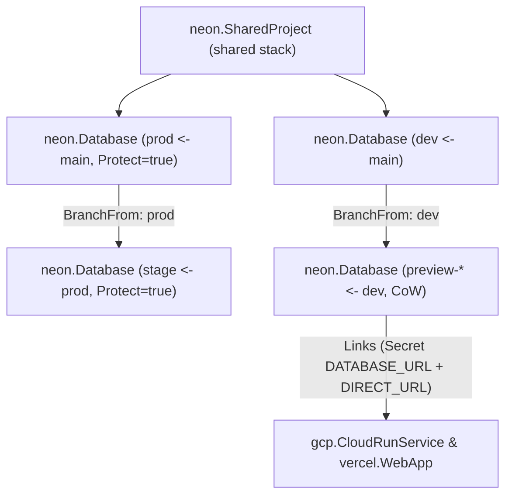

# Neon provider - software architecture

## Overview

The `libs/components/neon` package implements OpenBase's serverless PostgreSQL components over the bridged `kislerdm/neon` Terraform provider (`internal/providers/neon`). It provides `neon.SharedProject` for provisioning the root Neon project once in `shared`, and `neon.Database` (`core.StatefulResource`) for per-environment branches, compute endpoints, roles, databases, and secret connection strings.

## Requirements

### Functional

- Provision a shared `neon.Project` once in the `shared` stack (`neon.SharedProject`) with configured region, Postgres version, password storage, and PITR history window.
- Provision isolated `neon.Branch` and `neon.Endpoint` resources across `dev`, `stage`, `prod`, and `preview-<slug>` stacks (`neon.Database`).
- Branch `dev` and `prod` off `main`, `stage` off `prod` (`BranchFrom: "prod"`), and `preview-<slug>` off `dev` (`BranchFrom: "dev"`) using instant copy-on-write branching.
- Enforce `pulumi.Protect(true)` on `prod` and `stage` branches while deleting `preview-*` branches automatically on `pulumi destroy`.
- Export secret pooled (`DATABASE_URL` via `-pooler` host) and unpooled (`DIRECT_URL`) connection strings through `Links`.

### Non-Functional

- Copy-on-write branches inherit parent roles, databases, schemas, and rows immediately without copying storage pages or causing `409` role/database collisions.
- Idle `dev` and `preview-*` compute endpoints scale to zero automatically (`SuspendSeconds: 300` default).

## Design

### Components and Responsibilities



- **`neon.SharedProject`**: Creates `neon.Project` (`StorePassword: "yes"`), exporting `projectId`, `defaultBranchId`, and `regionId`.
- **`neon.Database` (`core.StatefulResource`)**:
  - Root branches (`BranchFrom == ""`, such as `dev` and `prod`) branch from `defaultBranchId` and create `neon.Endpoint`, `neon.Role` (`openbase_app`), and `neon.Database` (`openbase`).
  - Child branches (`BranchFrom != ""`, such as `stage <- prod` and `preview-* <- dev`) branch from the parent stack's `branchId`, create an isolated `neon.Endpoint`, and read the inherited role password via `GetBranchRolePasswordOutput`.

### Interfaces and Contracts

```go
// Package neon (github.com/cloudvoyant/openbase/libs/components/neon)
sharedDB, err := neon.NewSharedProject(ctx, "shared-db", neon.SharedProjectArgs{
	Project:  "storefront",
	RegionID: "aws-us-east-1",
})

db, err := neon.NewDatabase(ctx, "db", neon.DatabaseArgs{
	StatefulResourceArgs: core.StatefulResourceArgs{
		Project:    "storefront",
		BranchFrom: "dev", // on preview-* stacks ("prod" on stage)
	},
	SharedStackRef: "org/storefront/shared",
	BranchStackRef: "org/storefront/dev",
})
```

### Synthesized Neon Resources

| OpenBase Component | Environment | Synthesized Bridged `kislerdm/neon` Resources |
| :--- | :--- | :--- |
| `neon.SharedProject` | `shared` | `neon.Project` |
| `neon.Database` (root) | `dev`, `prod` | `neon.Branch` (`Protect` on `prod`), `neon.Endpoint`, `neon.Role`, `neon.Database` |
| `neon.Database` (branched) | `stage`, `preview-*` | `neon.Branch` (`ParentId` from `BranchFrom`; `Protect` on `stage`), `neon.Endpoint`, `GetBranchRolePasswordOutput` |

## References

- [OpenBase Architecture Overview](../index.md)
- [OpenBase Resources](../resources.md)
- [GCP Provider](./gcp.md)
- [Vercel Provider](./vercel.md)
- [Kinde Provider](./kinde.md)
