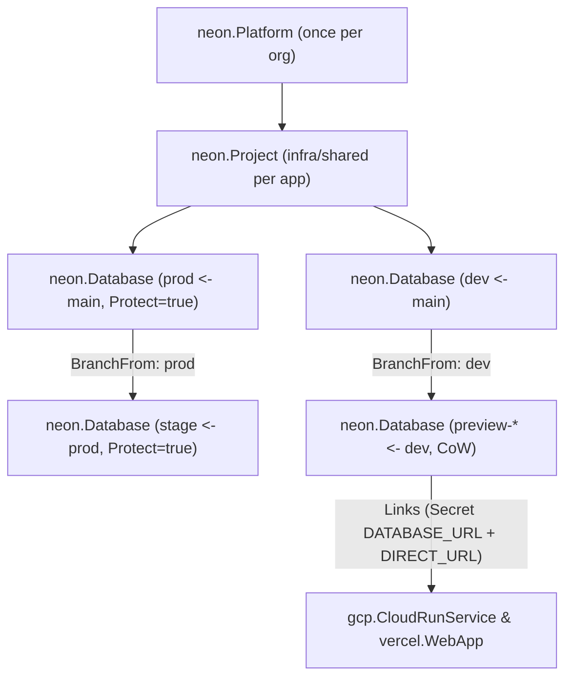

# Neon provider - software architecture

## Overview

The `libs/components/neon` package implements OpenBase's declarative serverless PostgreSQL components over the bridged `kislerdm/neon` Terraform provider (`internal/providers/neon`). It provides `neon.Platform` for organization-level defaults, `neon.Project` for provisioning each application's Neon cluster once in `infra/shared`, and `neon.Database` (`*neon.DatabaseResource`, `core.StatefulResource`) for per-environment branches, compute endpoints, roles, databases, and secret connection strings.

## Requirements

### Functional

- Provision `neon.Platform` once per organization with `OrgID`, `RegionID`, `PostgresVersion`, `HistoryRetentionSeconds`, and optional `OrgApiKey`.
- Provision a per-application `neon.Project` once in `infra/shared` (inheriting `OrgID`/`RegionID` from `Platform` or `PlatformStackRef`).
- Provision isolated `neon.Branch` and `neon.Endpoint` resources across `dev`, `stage`, `prod`, and `preview-<slug>` stacks (`neon.Database`).
- Branch `dev` and `prod` off `main`, `stage` off `prod` (`BranchFrom: "prod"`), and `preview-<slug>` off `dev` (`BranchFrom: "dev"`) using instant copy-on-write branching.
- Enforce `pulumi.Protect(true)` on `prod` and `stage` branches while deleting `preview-*` branches automatically on `pulumi destroy`.

### Non-Functional

- Copy-on-write branches inherit parent roles, databases, schemas, and rows immediately without copying storage pages or causing `409` role/database collisions.
- Idle `dev` and `preview-*` compute endpoints scale to zero automatically (`SuspendSeconds: 300` default).

## Design

### Components and Responsibilities



- **`neon.Platform` (once per org)**: Exports `neonOrgId`, `neonRegionId`, `neonPostgresVersion`, and `neonHistoryRetentionSeconds`, plus optional `OrgApiKey`.
- **`neon.Project` (once per app in `infra/shared`)**: Creates `neon.Project` (`StorePassword: "yes"`), exporting `projectId`/`neonProjectId`, `defaultBranchId`/`neonDefaultBranchId`, and `regionId`.
- **`neon.Database` (`*neon.DatabaseResource`)**:
  - Root branches (`BranchFrom == ""`, such as `dev` and `prod`) branch from `defaultBranchId` and create `neon.Endpoint`, `neon.Role` (`openbase_app`), and `neon.Database` (`openbase`).
  - Child branches (`BranchFrom != ""`, such as `stage <- prod` and `preview-* <- dev`) branch from the parent stack's `branchId`, create an isolated `neon.Endpoint`, and read the inherited role password via `GetBranchRolePasswordOutput`.

### Interfaces and Contracts

```go
// 1. Once per org
orgNeon, err := neon.Platform{
	OrgID:    os.Getenv("NEON_ORG_ID"),
	RegionID: "aws-us-east-1",
}.Register(ctx)

// 2. Once per app (infra/shared)
appNeon, err := neon.Project{
	Project:          "storefront",
	PlatformStackRef: "org/platform/shared",
}.Register(ctx)

// 3. Per environment (infra/)
db, err := neon.Database{
	Name:            "db",
	Project:         "storefront",
	BranchFrom:      "dev", // on preview-* stacks ("prod" on stage)
	ProjectStackRef: "org/storefront-shared/shared",
	BranchStackRef:  "org/storefront/dev",
}.Register(ctx)
```

### Synthesized Neon Resources

| OpenBase Spec | Tier | Synthesized Bridged `kislerdm/neon` Resources |
| :--- | :--- | :--- |
| `neon.Platform` | Org (`shared`) | Optional `neon.OrgApiKey` + exported org/region defaults |
| `neon.Project` | App (`infra/shared`) | `neon.Project` |
| `neon.Database` (root) | Env (`dev`, `prod`) | `neon.Branch` (`Protect` on `prod`), `neon.Endpoint`, `neon.Role`, `neon.Database` |
| `neon.Database` (branched) | Env (`stage`, `preview-*`) | `neon.Branch` (`ParentId` from `BranchFrom`; `Protect` on `stage`), `neon.Endpoint`, `GetBranchRolePasswordOutput` |

## References

- [OpenBase Architecture Overview](../index.md)
- [OpenBase Resources](../resources.md)
- [GCP Provider](./gcp.md)
- [Vercel Provider](./vercel.md)
- [Kinde Provider](./kinde.md)
