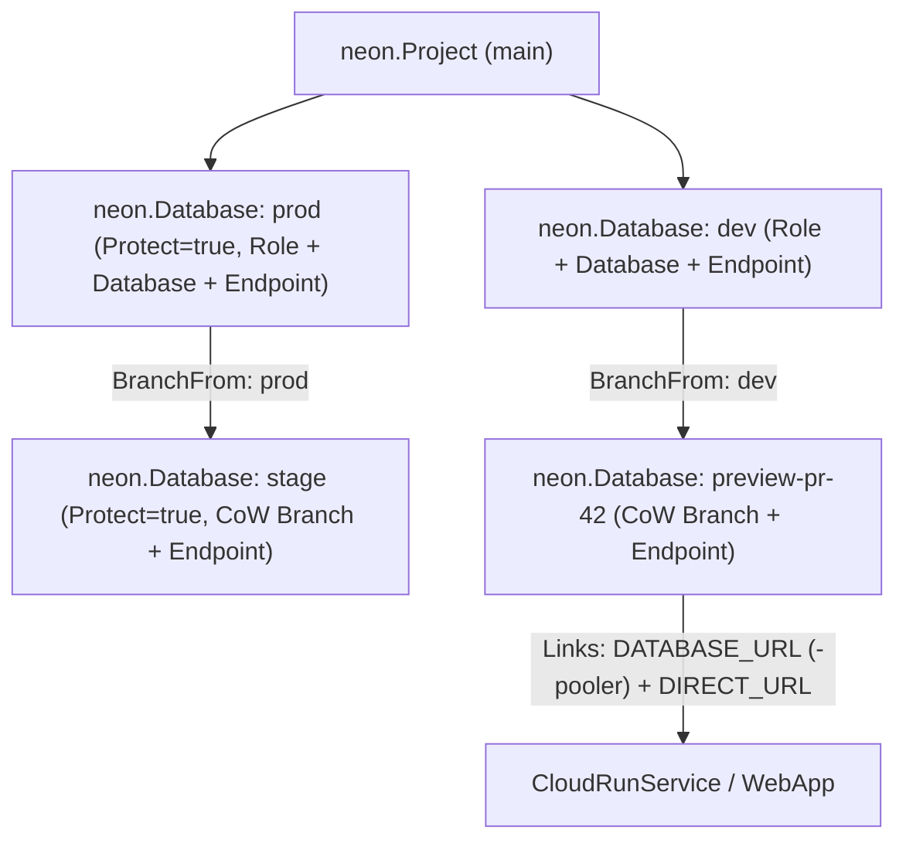
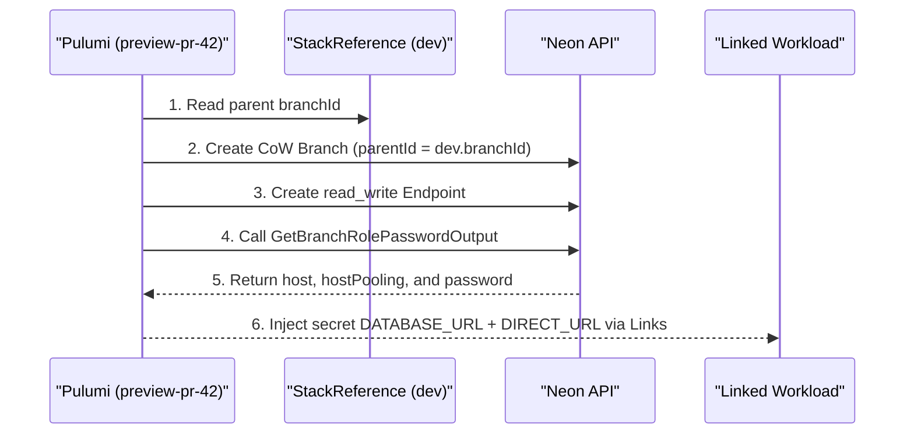

# Neon Database - software architecture

## Overview

`neon.Database` (`core.StatefulResource`) provisions per-environment serverless PostgreSQL branches, compute endpoints, roles, and databases across `dev`, `stage`, `prod`, and `preview-<slug>` stacks. It uses Neon copy-on-write branching so `stage` branches from `prod` and `preview-<slug>` branches from `dev` in seconds without copying storage pages.

## Requirement

### Functional

- Provision isolated PostgreSQL branches and compute endpoints for `dev`, `stage`, `prod`, and `preview-<slug>` stacks.
- Branch `stage` from `prod` and `preview-<slug>` from `dev` with inherited schemas, roles, and seed data.
- Export pooled connection URLs for serverless workloads and direct connection URLs for schema migrations.

### Non-Functional

- Branch child databases in seconds via copy-on-write storage without duplicating storage pages or colliding on existing roles.
- Protect `prod` and `stage` database branches from accidental deletion while deleting ephemeral preview branches on teardown.
- Scale idle `dev` and `preview-<slug>` compute endpoints to zero to control database cost.

## Design

### Components and Responsibilities



- `neon.Branch` snapshots either `defaultBranchId` (root tier) or the `BranchFrom` stack `branchId` (child tier).
- `neon.Endpoint` creates an isolated read-write compute endpoint with `-pooler` PgBouncer pooling.
- `neon.Role` and `neon.Database` run only on root branches (`BranchFrom == ""`).
- `GetBranchRolePasswordOutput` fetches the inherited role password on child branches.

### Data and Control Flow



When `preview-pr-42` runs `pulumi up`, it branches instantaneously from `dev` with all schema migrations and seed rows intact. SQL writes on `preview-pr-42` stay isolated from `dev`, and `pulumi destroy` removes the preview branch and endpoint cleanly.

### Interfaces and Contracts

```go
db, err := neon.Database{
	Name:            "db",
	Project:         "storefront",
	Environment:     "preview-pr-42",
	BranchFrom:      "dev",
	ProjectStackRef: "cloudvoyant/storefront-shared/shared",
	BranchStackRef:  "cloudvoyant/storefront/dev",
}.Register(ctx)
```

| Link Key | Secret | Host Target | Purpose |
| :--- | :--- | :--- | :--- |
| `<PREFIX>_HOST` | No | `Endpoint.HostPooling` | Pooled PgBouncer hostname (`-pooler`) |
| `<PREFIX>_NAME` | No | `DatabaseName` (`openbase`) | Logical PostgreSQL database name |
| `DATABASE_URL` | Yes | `Endpoint.HostPooling` | Pooled connection URL for serverless workloads |
| `DIRECT_URL` | Yes | `Endpoint.Host` | Direct connection URL for schema migrations (`pm migrate`) |

## Implementation

### Root vs child branch split

`provisionRootRoleAndDB` creates `neon.Role` (`openbase_app`) and `neon.Database` (`openbase`) when `BranchFrom` is empty. When `BranchFrom` is set, `readInheritedRolePassword` skips role and database creation because Neon copies catalog objects from the parent branch automatically.

### Connection URL escaping

`buildPostgresURLs` percent-encodes passwords via `url.UserPassword` and sets `sslmode=require` on both pooled and direct URLs.

## References

- [Neon Platform and Project](./index.md)
- [Core Resources and Tier Contracts](../../resources.md)
