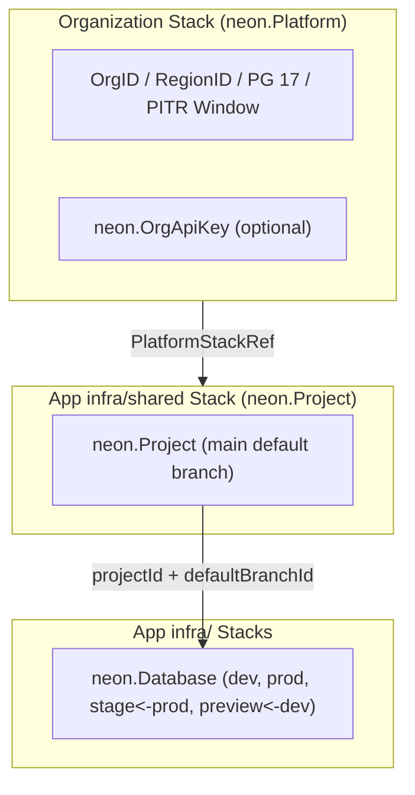
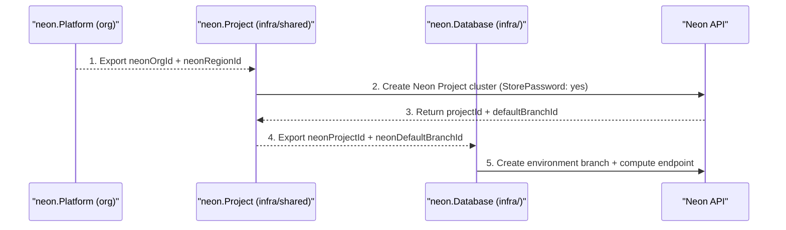

# Neon platform and project - software architecture

## Overview

`libs/components/neon` separates organization Neon configuration (`neon.Platform`, `core.PlatformResource`) from shared PostgreSQL clusters (`neon.Project`, `core.StatefulResource` with `Environment: "shared"`) over the bridged `kislerdm/neon` provider (`internal/providers/neon`). `neon.Platform` runs once per organization and exports organization, region, Postgres version, and retention defaults. `neon.Project` runs once per repository in `infra/shared` and creates the application Neon Project cluster (`<project>-neon`).

## Requirement

### Functional

- Share Neon organization ID, default region, PostgreSQL version, and point-in-time recovery window from one organization platform stack.
- Provision optional organization API keys for automation pipelines.
- Provision an isolated Neon PostgreSQL cluster per application repository that environment branches inherit from.

### Non-Functional

- Keep organization platform configuration independent of individual application names and environments.
- Keep generated Neon API keys and stored role passwords encrypted in Pulumi state.

## Design

### Components and Responsibilities



- `neon.Platform` centralizes Neon organization settings and optional CI API keys.
- `neon.Project` creates one isolated Neon Project cluster per application repository.
- [neon.Database](./database.md) creates per-environment copy-on-write branches inside the application `neon.Project`.

### Data and Control Flow



`neon.Platform` defines organization defaults once. `neon.Project` provisions the root cluster in `infra/shared`. Environment stacks read `ProjectStackRef` so `infra/main.go` never needs `NEON_ORG_ID`.

### Interfaces and Contracts

```go
// Tier 1: Organization (core.PlatformResource)
plat, err := neon.Platform{
	Org:             "cloudvoyant",
	OrgID:           os.Getenv("NEON_ORG_ID"),
	RegionID:        "aws-us-east-1",
	PostgresVersion: 17,
}.Register(ctx)

// Shared Project Resource in infra/shared (core.StatefulResource)
proj, err := neon.Project{
	Project:          "storefront",
	Repo:             "cloudvoyant/storefront",
	PlatformStackRef: "cloudvoyant/platform/shared",
}.Register(ctx)
```

| Spec | Contract | Synthesized `neon` Resources | Key Outputs |
| :--- | :--- | :--- | :--- |
| `neon.Platform` | `core.PlatformResource` | Optional `neon.OrgApiKey` | `neonOrgId`, `neonRegionId`, `neonPostgresVersion`, `neonHistoryRetentionSeconds` |
| `neon.Project` | `core.StatefulResource` (`shared`) | `neon.Project` | `projectId`, `neonProjectId`, `defaultBranchId`, `neonDefaultBranchId`, `regionId` |

## Implementation

### Password persistence for branching

`neon.Project` sets `StorePassword: "yes"` on the cluster. Child copy-on-write branches in [neon.Database](./database.md) retrieve inherited role passwords through `GetBranchRolePasswordOutput` without resetting credentials on parent branches.

### Bridged provider SDK

`internal/providers/neon` is generated from `kislerdm/neon` via `pulumi-terraform-provider` inside the root `go.mod` module.

## References

- [Neon Database](./database.md)
- [OpenBase Architecture Overview](../../index.md)
