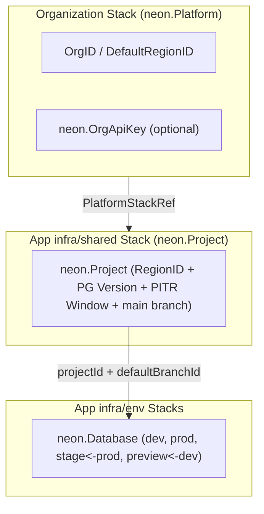
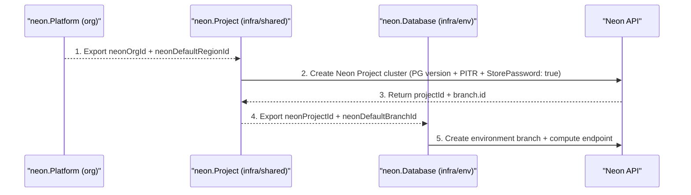

# Neon platform and project - software architecture

## Overview

`libs/components/neon` separates account-level Neon configuration (`neon.Platform`, `core.PlatformResource`) from per-repository PostgreSQL clusters (`neon.Project`, `core.StatefulResource` with `Environment: "shared"`) over the official bridged `neondatabase/neon` provider (`libs/internal/pulumi-neon-go-sdk`). `neon.Platform` runs once per organization and exports account `OrgID` and `DefaultRegionID` values (plus optional org API keys). `neon.Project` runs once per repository in `infra/shared` and owns the Neon Project cluster (`<project>-neon`), including per-project `RegionID`, `PostgresVersion`, and `HistoryRetentionSeconds`.

## Requirement

### Functional

- Share Neon organization ID and default region from one organization platform stack.
- Provision optional organization API keys for automation pipelines.
- Provision an isolated Neon PostgreSQL cluster per application repository with project-scoped Postgres version and point-in-time recovery retention.

### Non-Functional

- Keep organization account configuration independent of per-project database engine versions, retention policies, and environments.
- Keep generated Neon API keys and stored role passwords encrypted in Pulumi state.

## Design

### Components and Responsibilities



- `neon.Platform` centralizes Neon account `OrgID`, `DefaultRegionID`, and optional CI API keys.
- `neon.Project` creates one isolated Neon Project cluster per application repository with per-project `RegionID` (inheriting `DefaultRegionID` when omitted), `PostgresVersion` (default `17`), and `HistoryRetentionSeconds` (default `86400`).
- [neon.Database](./database.md) creates per-environment copy-on-write branches inside the application `neon.Project`.

### Data and Control Flow



`neon.Platform` defines account defaults once. `neon.Project` provisions the root cluster in `infra/shared`. Environment stacks read `ProjectStackRef` so `infra/env/main.go` never needs `NEON_ORG_ID`.

### Interfaces and Contracts

```go
// Tier 1: Organization Account (infra/platform/main.go)
plat, err := neon.NewPlatform(ctx, "neon-platform", &neon.PlatformArgs{
	Org:             "cloudvoyant",
	OrgID:           "org-cloudvoyant",
	DefaultRegionID: "aws-us-east-1",
})

// Shared Project Resource in infra/shared/main.go
platRef, err := openbase.LookupPlatform(ctx, "cloudvoyant/platform/platform")
proj, err := neon.NewProject(ctx, "neon-project", &neon.ProjectArgs{
	Project:                 "storefront",
	Repo:                    "cloudvoyant/storefront",
	PlatformStack:           platRef,
	PostgresVersion:         17,
	HistoryRetentionSeconds: 86400,
})
```

| Spec | Contract | Synthesized `neon` Resources | Key Outputs |
| :--- | :--- | :--- | :--- |
| `neon.Platform` | `core.PlatformResource` | Optional `neon.OrgApiKey` | `neonOrgId`, `neonDefaultRegionId` |
| `neon.Project` | `core.StatefulResource` (`shared`) | `neon.Project` | `projectId`, `neonProjectId`, `defaultBranchId`, `neonDefaultBranchId`, `regionId` |

## Implementation

### Password persistence for branching

`neon.Project` sets `StorePassword: true` on the cluster. Because `neondatabase/neon` `0.19.0-beta` omits plaintext role passwords from Terraform state, [neon.Database](./database.md) fetches role passwords through the Neon v2 `reveal_password` endpoint during `pulumi up` and wraps them in Pulumi secrets without resetting parent branch credentials.

### Bridged provider SDK

`libs/internal/pulumi-neon-go-sdk` is generated from `neondatabase/neon` (`0.19.0-beta.3`) via `pulumi-terraform-provider` inside the root `go.mod` module.

## References

- [Neon Database](./database.md)
- [OpenBase Architecture Overview](../../index.md)
