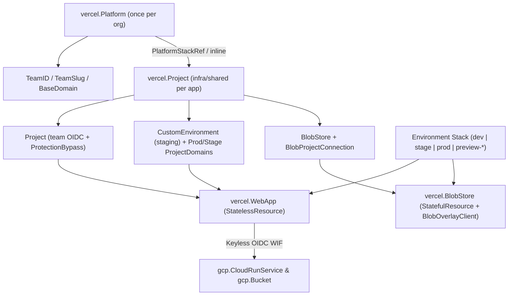

# Vercel provider - software architecture

## Overview

The `libs/components/vercel` package implements OpenBase's declarative Vercel components over `github.com/pulumiverse/pulumi-vercel/sdk/v5`. It separates team-wide configuration (`vercel.Platform`), per-application Vercel projects (`vercel.Project` in `infra/shared`), prefix-isolated Blob storage (`vercel.BlobStore`, `core.StatefulResource`), and per-environment web deployments (`vercel.WebApp`, `core.StatelessResource`).

## Requirements

### Functional

- Provision `vercel.Platform` once per organization/team: `TeamID`, `TeamSlug`, and `BaseDomain` (e.g. `vercel.cloudvoyant.io`).
- Provision `vercel.Project` once per application in `infra/shared`: `vercel.Project` (team OIDC issuer mode, `standard_protection_new` deployment protection, `IgnoreCommand: "exit 0"`), `vercel.CustomEnvironment` (`staging`), attached `prod` & `staging` `ProjectDomain`s, `vercel.ProjectProtectionBypass`, and optional shared `vercel.BlobStore` + `BlobProjectConnection`.
- Provision `vercel.BlobStore` across `dev`, `stage`, `prod`, and `preview-*` stacks, deriving `BLOB_BASE_URL`, propagating `BLOB_READ_WRITE_TOKEN` into Custom Environments, and exporting `BLOB_PREFIX=<env>/` plus `BLOB_FALLBACK_PREFIX=<branchFrom>/`.
- Deploy `vercel.WebApp` with deterministic aliases, target-scoped `ProjectEnvironmentVariable` bindings, and keyless GCP Workload Identity Federation.

### Non-Functional

- Never store static GCP service-account JSON keys in Vercel environment variables; exchange `x-vercel-oidc-token` via GCP STS and `iamcredentials` at runtime.
- Never attach un-scoped custom `ProjectDomain`s for nameless `dev` or `preview-*` tiers (which Vercel treats as `Production` domains); bind `dev` and `preview-*` custom domains strictly via `vercel.Alias`.

## Design

### Components and Responsibilities



- **`vercel.Platform` (once per org)**: Exports `teamId`, `teamSlug`, and `vercelBaseDomain` for downstream `vercel.Project` stacks without coupling the platform to downstream project IDs.
- **`vercel.Project` (once per app in `infra/shared`)**: Configures `OidcTokenConfig` (`IssuerMode: "team"` -> `https://oidc.vercel.com/<teamSlug>`), `IgnoreCommand: "exit 0"`, `ProjectProtectionBypass` (`x-vercel-protection-bypass`), and Custom Environment + Domain tiers:
  - **Custom Environments by plan quota**:
    - **Pro default (`1` included slot, `$0/mo`)**: Built-in `Production` (`prod`) + `staging` `CustomEnvironment` (`stage`), while persistent `dev` and ephemeral `preview-*` remain nameless in Vercel environments and bind URL conventions via `vercel.Alias`.
    - **Additional Custom Environment pack (`EnableDevEnvironment: true`)**: Also creates a named `dev` `CustomEnvironment` (`devCustomEnvironmentId`) with an attached `ProjectDomain`.
    - **Hobby / zero-slot plans (`SkipStageEnvironment: true`)**: Creates `0` `CustomEnvironment`s; `stage` deploys via `DeploymentArgs.Environment` + `{project}-stage...` alias.
  - **Domains (`BaseDomain` + multiple domains)**: When `BaseDomain` is set (`vercel.cloudvoyant.io`), formats `{project}-{dev|stage|prod|previewId}.{baseDomain}`; otherwise falls back to `<vProjName>-<teamSlug>.vercel.app` (`prod`), `<vProjName>-stage-<teamSlug>.vercel.app` (`stage`), `<vProjName>-dev-<teamSlug>.vercel.app` (`dev`), and `<vProjName>-<previewId>-<teamSlug>.vercel.app` (`preview-*`).
- **`vercel.BlobStore` & `vercel.BlobOverlayClient`**: Derives `https://<slug>.public.blob.vercel-storage.com` from `store_<Slug>`, propagates `BLOB_BASE_URL` and `BLOB_READ_WRITE_TOKEN` into `CustomEnvironmentIds`, and exports `BLOB_PREFIX` + `BLOB_FALLBACK_PREFIX`.
- **`vercel.WebApp`**: Binds deployment `Alias`es and optional keyless GCP Service Account WIF (`principalSet://iam.googleapis.com/<pool>/attribute.project_id/<vercelProjectId>`).

### Interfaces and Contracts

```go
// 1. Once per org (central platform repo)
orgVercel, err := vercel.Platform{
	TeamID:     "team_...",
	TeamSlug:   "cloudvoyant",
	BaseDomain: "vercel.cloudvoyant.io",
}.Register(ctx)

// 2. Once per app (infra/shared)
appVercel, err := vercel.Project{
	Project:          "storefront",
	PlatformStackRef: "org/platform/shared",
	EnableBlobStore:  true,
}.Register(ctx)

// 3. Per environment (infra/)
blobs, err := vercel.BlobStore{
	Name:            "blobs",
	Project:         "storefront",
	BranchFrom:      "dev",
	ProjectStackRef: "org/storefront-shared/shared",
}.Register(ctx)

web, err := vercel.WebApp{
	Name:                    "web",
	Project:                 "storefront",
	Links:                   []core.Resource{api, blobs, db, oidc},
	ProjectStackRef:         "org/storefront-shared/shared",
	SourceDir:               "apps/web",
	GCPProject:              pulumi.String("my-gcp-project"),
	GCPWorkloadIdentityPool: gcpPoolName,
	GCPVercelOIDCProvider:   gcpVercelProviderName,
}.Register(ctx)
```

### Synthesized Vercel Resources

| OpenBase Spec | Tier | Synthesized `pulumiverse/pulumi-vercel` v5 Resources |
| :--- | :--- | :--- |
| `vercel.Platform` | Org (`shared`) | Exported team/domain outputs (`teamId`, `teamSlug`, `vercelBaseDomain`) |
| `vercel.Project` | App (`infra/shared`) | `Project`, `CustomEnvironment`, `ProjectDomain`, `ProjectProtectionBypass`, optional `BlobStore` + `BlobProjectConnection` |
| `vercel.BlobStore` | Env (`dev`, `stage`, `prod`, `preview-*`) | `BlobStore` + `BlobProjectConnection` (or project store ref), CustomEnvironment `ProjectEnvironmentVariable`s |
| `vercel.WebApp` | Env (`dev`, `stage`, `prod`, `preview-*`) | `ProjectEnvironmentVariable`, `Deployment`, `Alias`, optional GCP `serviceaccount.Account` + `serviceaccount.IAMMember` |

## References

- [OpenBase Architecture Overview](../index.md)
- [OpenBase Resources](../resources.md)
- [GCP Provider](./gcp.md)
- [Neon Provider](./neon.md)
- [Kinde Provider](./kinde.md)
