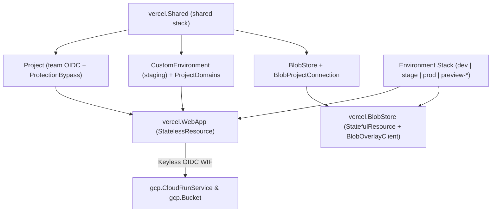

# Vercel provider - software architecture

## Overview

The `libs/components/vercel` package implements OpenBase's declarative Vercel components over `github.com/pulumiverse/pulumi-vercel/sdk/v5`. It provides `vercel.Shared` for project-level settings, custom `staging` environments, domains, and deployment-protection bypass tokens; `vercel.BlobStore` (`*vercel.BlobStoreResource`, `core.StatefulResource`) for prefix-isolated Blob storage with custom-environment token propagation; and `vercel.WebApp` (`*vercel.WebAppResource`, `core.StatelessResource`) for deployments, squat-proof team aliases, scoped environment variables, and keyless GCP OIDC federation.

## Requirements

### Functional

- Provision `vercel.Shared` once in the `shared` stack: `vercel.Project` (team OIDC issuer mode, `standard_protection_new` deployment protection, `IgnoreCommand: "exit 0"`), `vercel.CustomEnvironment` (`staging`), team-scoped `<project>-<teamSlug>.vercel.app` domains, `vercel.ProjectProtectionBypass`, and optional shared `vercel.BlobStore` + `BlobProjectConnection`.
- Provision `vercel.BlobStore` across `dev`, `stage`, `prod`, and `preview-*` stacks, deriving `BLOB_BASE_URL`, propagating `BLOB_READ_WRITE_TOKEN` into the `staging` `CustomEnvironment`, and exporting `BLOB_PREFIX=<env>/` plus `BLOB_FALLBACK_PREFIX=<branchFrom>/`.
- Deploy `vercel.WebApp` with deterministic `<project>-<slug>-<teamSlug>.vercel.app` preview aliases, target-scoped `ProjectEnvironmentVariable` bindings, and keyless GCP Workload Identity Federation.

### Non-Functional

- Never store static GCP service-account JSON keys in Vercel environment variables; exchange `x-vercel-oidc-token` via GCP STS and `iamcredentials` at runtime.
- Delete ephemeral preview `Deployment` and `Alias` resources automatically on `pulumi destroy`.

## Design

### Components and Responsibilities



- **`vercel.Shared`**: Configures `OidcTokenConfig` (`IssuerMode: "team"` -> `https://oidc.vercel.com/<teamSlug>`), creates the `staging` `CustomEnvironment`, attaches `<project>-<teamSlug>.vercel.app` and `<project>-stage-<teamSlug>.vercel.app`, and creates `ProjectProtectionBypass` for automated E2E probes (`x-vercel-protection-bypass`).
- **`vercel.BlobStore` & `vercel.BlobOverlayClient`**: Derives `https://<slug>.public.blob.vercel-storage.com` from `store_<Slug>`, propagates `BLOB_BASE_URL` and `BLOB_READ_WRITE_TOKEN` into `CustomEnvironmentIds` on `stage`, and exports `BLOB_PREFIX` + `BLOB_FALLBACK_PREFIX`. `BlobOverlayClient` reads from `PrimaryPrefix` first and falls back to `FallbackPrefix` on `404`.
- **`vercel.WebApp`**: When `GCPProject` and `GCPWorkloadIdentityPool` are supplied, creates a `6–30` char GCP Service Account bound with `roles/iam.workloadIdentityUser` to `principalSet://iam.googleapis.com/<pool>/attribute.project_id/<vercelProjectId>`, grants IAM on linked GCP resources, and injects `GCP_WORKLOAD_IDENTITY_PROVIDER` and `GCP_SERVICE_ACCOUNT_EMAIL` into the deployment.

### Interfaces and Contracts

```go
// Package vercel (github.com/cloudvoyant/openbase/libs/components/vercel)
sharedVercel, err := vercel.Shared{
	Name:            "shared-vercel",
	Project:         "storefront",
	TeamID:          "team_...",
	TeamSlug:        "cloudvoyant",
	EnableBlobStore: true,
}.Register(ctx)

blobs, err := vercel.BlobStore{
	Name:           "blobs",
	Project:        "storefront",
	BranchFrom:     "dev",
	SharedStackRef: "org/storefront/shared",
}.Register(ctx)

web, err := vercel.WebApp{
	Name:                    "web",
	Project:                 "storefront",
	Links:                   []core.Resource{api, blobs, db, oidc},
	SharedStackRef:          "org/storefront/shared",
	SourceDir:               "apps/web",
	GCPProject:              pulumi.String("my-gcp-project"),
	GCPWorkloadIdentityPool: gcpPoolName,
	GCPVercelOIDCProvider:   gcpVercelProviderName,
}.Register(ctx)
```

### Synthesized Vercel Resources

| OpenBase Spec | Environment | Synthesized `pulumiverse/pulumi-vercel` v5 Resources |
| :--- | :--- | :--- |
| `vercel.Shared` | `shared` | `Project`, `CustomEnvironment`, `ProjectDomain`, `ProjectProtectionBypass`, optional `BlobStore` + `BlobProjectConnection` |
| `vercel.BlobStore` | `dev`, `stage`, `prod`, `preview-*` | `BlobStore` + `BlobProjectConnection` (or shared store ref), `stage` `ProjectEnvironmentVariable` (`BLOB_BASE_URL`, `BLOB_READ_WRITE_TOKEN`) |
| `vercel.WebApp` | `dev`, `stage`, `prod`, `preview-*` | `ProjectEnvironmentVariable`, `Deployment`, `Alias`, optional GCP `serviceaccount.Account` + `serviceaccount.IAMMember` |

## References

- [OpenBase Architecture Overview](../index.md)
- [OpenBase Resources](../resources.md)
- [GCP Provider](./gcp.md)
- [Neon Provider](./neon.md)
- [Kinde Provider](./kinde.md)
