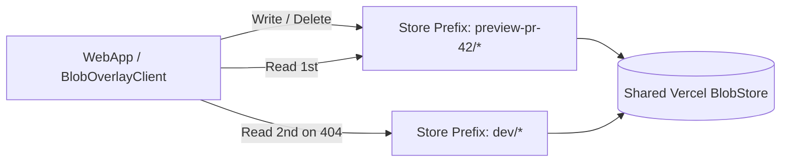
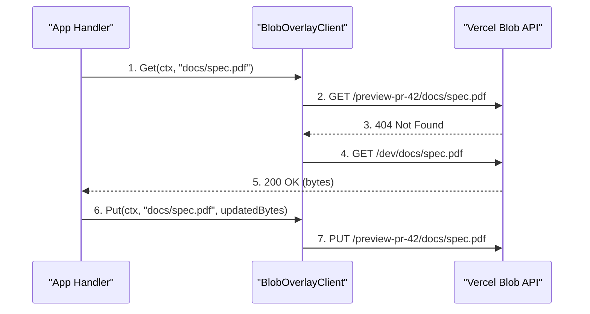

# Vercel BlobStore - software architecture

## Overview

`vercel.BlobStore` (`core.StatefulResource`) provisions or attaches Vercel Blob storage across `dev`, `stage`, `prod`, and `preview-<slug>` stacks. Together with `vercel.BlobOverlayClient`, it isolates each environment under `<env>/` key prefixes and gives preview branches zero-copy fallback reads from `<branchFrom>/`.

## Requirement

### Functional

- FR1: Reuse the project Blob store from `vercel.Project` (`ProjectStackRef`) or create a dedicated `vercelprov.BlobStore` + `BlobProjectConnection`.
- FR2: Propagate `BLOB_BASE_URL` and `BLOB_READ_WRITE_TOKEN` into `CustomEnvironmentIds` (`stage`, and `dev` when enabled) because `BlobProjectConnection` only populates built-in `development`, `preview`, and `production` targets.
- FR3: Export `BLOB_PREFIX=<env>/` and `BLOB_FALLBACK_PREFIX=<branchFrom>/` via `Links`.

### Non-Functional

- NFR1: Preview writes and deletes must stay inside `preview-<slug>/` and never mutate `dev/` keys.
- NFR2: Keep `BLOB_READ_WRITE_TOKEN` encrypted as a Pulumi secret across stack state and links.

## Design

### Components and Responsibilities



- `vercel.BlobStore` derives `https://<slug>.public.blob.vercel-storage.com` from `store_<Slug>`, syncs custom-environment variables, and populates `LinkDescriptor`.
- `vercel.BlobOverlayClient` wraps Vercel Blob HTTP PUT, GET, HEAD, and DELETE calls with prefix routing in Go runtimes.

### Data and Control Flow



`BlobOverlayClient.Get` checks `<PrimaryPrefix><key>` first and falls back to `<FallbackPrefix><key>` on `404`. `Put` and `Delete` write only under `<PrimaryPrefix>`.

### Interfaces and Contracts

```go
blobs, err := vercel.BlobStore{
	Name:               "uploads",
	Project:            "storefront",
	Environment:        "preview-pr-20",
	BranchFrom:         "dev",
	ProjectStackRef:    "cloudvoyant/storefront-shared/shared",
	BlobReadWriteToken: rwToken,
}.Register(ctx)

client := vercel.NewBlobOverlayClient(baseURL, token, "preview-pr-20/", "dev/")
```

| Link Key | Secret | Example (`preview-pr-20`, `BranchFrom: "dev"`) |
| :--- | :--- | :--- |
| `BLOB_STORE_ID` | No | `store_AbcXyz` |
| `BLOB_BASE_URL` | No | `https://abcxyz.public.blob.vercel-storage.com` |
| `BLOB_PREFIX` | No | `preview-pr-20/` |
| `BLOB_FALLBACK_PREFIX` | No | `dev/` |
| `BLOB_READ_WRITE_TOKEN` | Yes | `vercel_blob_rw_...` |

## Implementation

### Custom environment token sync

Vercel's `BlobProjectConnection` injects `BLOB_READ_WRITE_TOKEN` only into built-in `development`, `preview`, and `production` targets. When `BlobStore` runs on `stage` (or `dev` with `EnableDevEnvironment: true`), `syncCustomEnvBlobVars` creates explicit `ProjectEnvironmentVariable` bindings targeting `CustomEnvironmentIds`.

### Base URL derivation

`DeriveBlobBaseURL` lowercases the suffix after `store_` to produce `https://<slug>.public.blob.vercel-storage.com` deterministically during `pulumi up`.

## References

- [Vercel Platform and Project](./index.md)
- [Vercel WebApp](./web-app.md)
- [Core Resources and Tier Contracts](../../resources.md)
