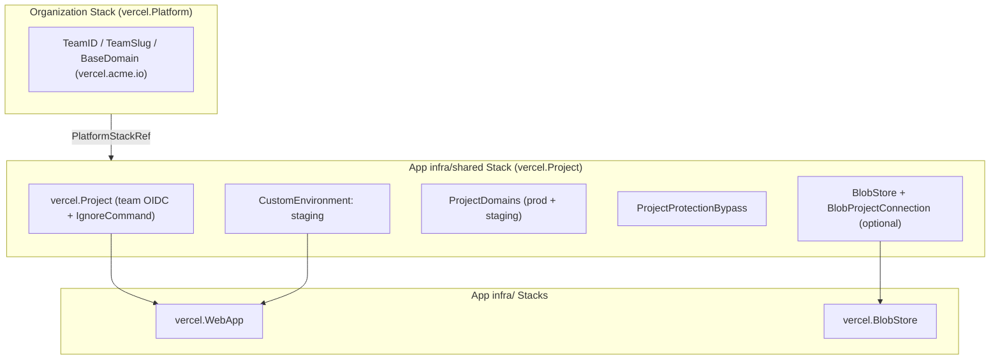
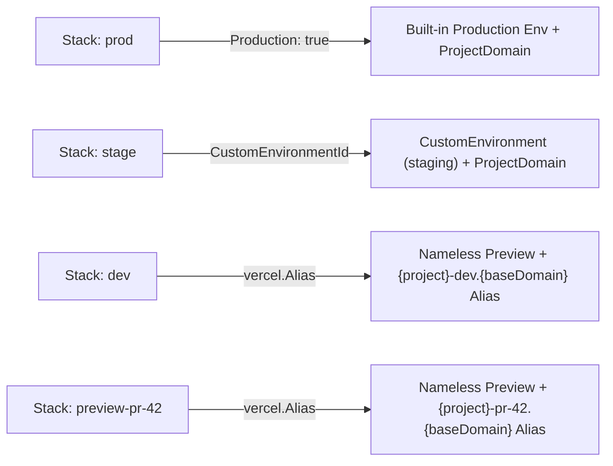

# Vercel platform and project - software architecture

## Overview

`libs/components/vercel` separates team-wide Vercel configuration (`vercel.Platform`, `core.PlatformResource`) from shared repository assets (`vercel.Project`, `core.StatelessResource` with `Environment: "shared"`) over `github.com/pulumiverse/pulumi-vercel/sdk/v5`. `vercel.Platform` runs once per organization and owns team and base-domain defaults. `vercel.Project` runs once per repository in `infra/shared` and owns the Vercel Project, `staging` Custom Environment, attached domains, automation bypass secret, and optional shared Blob store.

## Requirement

### Functional

- FR1: Export `teamId`, `teamSlug`, and `vercelBaseDomain` once per organization in `vercel.Platform` without coupling to downstream project IDs.
- FR2: Provision `vercel.Project` in `infra/shared` with team OIDC issuer mode (`https://oidc.vercel.com/<teamSlug>`), `IgnoreCommand: "exit 0"`, and `ProjectProtectionBypass`.
- FR3: Support `0`, `1` (Pro default: `staging` Custom Environment), or `2` (`dev` + `staging`) Custom Environments per project based on plan quota.
- FR4: Attach `prod` and `staging` `ProjectDomain`s while leaving nameless `dev` and `preview-<slug>` tiers free for deployment `Alias` binding.

### Non-Functional

- NFR1: Never attach an un-scoped `ProjectDomain` for nameless `dev` or `preview-<slug>` tiers because Vercel marks un-scoped domains as `Production` and hijacks them on `prod` deploys.
- NFR2: Keep `vercel.Platform` free of application `Project`, `Repo`, and `Environment` fields.

## Design

### Components and Responsibilities



- `vercel.Platform` exports team and wildcard domain defaults for all repositories in the organization.
- `vercel.Project` creates the Vercel Project, `staging` Custom Environment, `prod` and `staging` domains, bypass token, and optional shared Blob store.
- [vercel.WebApp](./web-app.md) and [vercel.BlobStore](./blob-store.md) consume `ProjectStackRef` on `dev`, `stage`, `prod`, and `preview-<slug>`.

### Data and Control Flow



 Vercel Pro includes one free Custom Environment per project (`staging`). `prod` targets built-in `Production`, `stage` targets `staging`, and `dev` plus `preview-<slug>` deploy as nameless preview deployments bound to deterministic `vercel.Alias` hostnames.

### Interfaces and Contracts

```go
// Tier 1: Organization (core.PlatformResource)
plat, err := vercel.Platform{
	Org:        "cloudvoyant",
	TeamID:     "team_123",
	TeamSlug:   "cloudvoyant",
	BaseDomain: "vercel.cloudvoyant.io",
}.Register(ctx)

// Shared Project Resource in infra/shared (core.StatelessResource)
proj, err := vercel.Project{
	Project:          "storefront",
	Repo:             "cloudvoyant/storefront",
	PlatformStackRef: "cloudvoyant/platform/shared",
	ExtraProdDomains: []string{"storefront.io"},
	EnableBlobStore:  true,
}.Register(ctx)
```

| Mode | Flags on `vercel.Project` | Custom Environments Created | Attached `ProjectDomain`s |
| :--- | :--- | :--- | :--- |
| Pro default | *(none)* | `1` (`staging`) | `prod`, `stage` |
| Paid Custom Env add-on | `EnableDevEnvironment: true` | `2` (`dev`, `staging`) | `prod`, `stage`, `dev` |
| Hobby / zero slots | `SkipStageEnvironment: true` | `0` | `prod` |

## Implementation

### Domain convention

When `BaseDomain` is set (`vercel.cloudvoyant.io`), `vercel.Project` computes `{project}-{prod|stage|dev}.{baseDomain}`. When `BaseDomain` is empty, it falls back to `<vProjName>-<teamSlug>.vercel.app` (`prod`) and `<vProjName>-<env>-<teamSlug>.vercel.app` (`stage`, `dev`).

### Git auto-deploy guard

`vercel.Project` sets `IgnoreCommand: "exit 0"` so direct Git pushes do not trigger uncoordinated Vercel builds or overwrite `Production` outside Premise (`pm infra apply`).

## References

- [Vercel WebApp](./web-app.md)
- [Vercel BlobStore](./blob-store.md)
- [OpenBase Architecture Overview](../../index.md)
