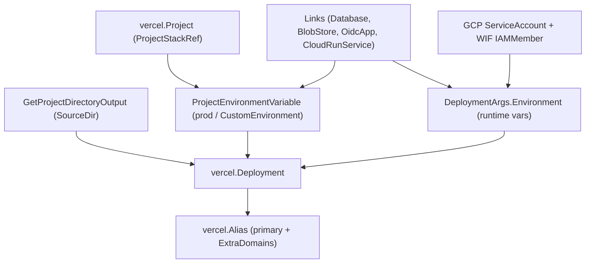
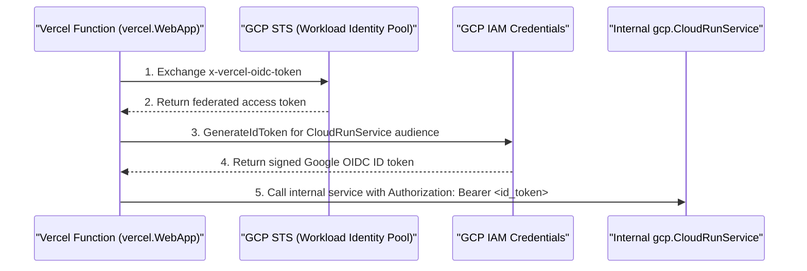

# Vercel WebApp - software architecture

## Overview

`vercel.WebApp` (`core.StatelessResource`) deploys per-environment Vercel web applications across `dev`, `stage`, `prod`, and `preview-<slug>` stacks. It scopes environment variables by tier, creates deployments, attaches deterministic `vercel.Alias` hostnames, and configures keyless GCP Workload Identity Federation when linked to Google Cloud resources.

## Requirement

### Functional

- FR1: Scope `ProjectEnvironmentVariable` entries to `production` (`prod`), `CustomEnvironmentIds` (`stage`, or `dev` when enabled), or `development` (`dev` local `vercel env pull`), while injecting per-deployment variables on nameless preview builds.
- FR2: Bind primary and `ExtraDomains` hostnames through `vercel.Alias` on every deployment.
- FR3: Create a `6-30` character GCP service account and bind `roles/iam.workloadIdentityUser` when `GCPProject` and `GCPWorkloadIdentityPool` are set.

### Non-Functional

- NFR1: Never store static GCP JSON service-account keys in Vercel environment variables.
- NFR2: Delete preview `Deployment` and `Alias` resources cleanly on `pulumi destroy` without affecting `dev`, `stage`, or `prod`.

## Design

### Components and Responsibilities



- `GetProjectDirectoryOutput` hashes application source files under `SourceDir`.
- `ProjectEnvironmentVariable` persists tier-scoped configuration in Vercel project settings without colliding across `preview-*` branches.
- `Deployment` builds and publishes the serverless bundle for the stack.
- `Alias` maps `{project}-{dev|stage|prod|previewId}.{baseDomain}` (or team `.vercel.app` fallback) plus `ExtraDomains` to `Deployment.ID()`.

### Data and Control Flow



When a `vercel.WebApp` links an internal `gcp.CloudRunService` or private `gcp.Bucket`, `ResolveLinks` grants `roles/run.invoker` or `roles/storage.objectAdmin` to the federated GCP service account. At runtime, Vercel exchanges `x-vercel-oidc-token` for short-lived GCP credentials.

### Interfaces and Contracts

```go
web, err := vercel.WebApp{
	Name:                    "web",
	Project:                 "storefront",
	Environment:             "preview-pr-20",
	Links:                   []core.Resource{api, blobs, db, auth},
	ProjectStackRef:         "cloudvoyant/storefront-shared/shared",
	BaseDomain:              "vercel.cloudvoyant.io",
	ExtraDomains:            []string{"pr20.storefront.io"},
	SourceDir:               "../apps/web",
	GCPProject:              pulumi.String("cloudvoyant-openbase"),
	GCPWorkloadIdentityPool: poolName,
	GCPVercelOIDCProvider:   vercelOidcProvider,
}.Register(ctx)
```

| Stack | `Deployment.Production` | `Deployment.CustomEnvironmentId` | Alias Formula (`BaseDomain` set) |
| :--- | :--- | :--- | :--- |
| `prod` | `true` | `nil` | `{project}-prod.{baseDomain}` |
| `stage` | `false` | `stageCustomEnvironmentId` | `{project}-stage.{baseDomain}` |
| `dev` | `false` | `devCustomEnvironmentId` (or `nil`) | `{project}-dev.{baseDomain}` |
| `preview-<slug>` | `false` | `nil` | `{project}-{previewId}.{baseDomain}` |

## Implementation

### Alias-only binding on nameless tiers

When `EnableDevEnvironment` is `false` (default on Pro), `dev` and `preview-<slug>` do not create `ProjectDomain` resources. Instead, `bindWebAppAliases` attaches custom domains via `vercel.Alias` so `prod` deployments never steal `dev` or `preview-<slug>` traffic.

### Parallel preview isolation

Per-branch secrets (such as `DATABASE_URL` for `preview-pr-20`) pass through `DeploymentArgs.Environment` instead of shared `preview`-target `ProjectEnvironmentVariable`s so concurrent pull requests never overwrite each other.

## References

- [Vercel Platform and Project](./index.md)
- [Vercel BlobStore](./blob-store.md)
- [GCP Platform and Project](../gcp/index.md)
