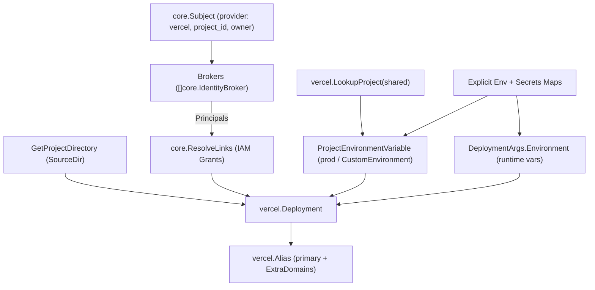
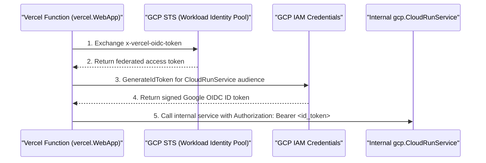

# Vercel WebApp - software architecture

## Overview

`vercel.WebApp` (`core.StatelessResource`) deploys per-environment Vercel web applications across `dev`, `stage`, `prod`, and `preview-<slug>` stacks. It scopes environment variables by tier, creates deployments, attaches deterministic `vercel.Alias` hostnames, and emits a provider-neutral Vercel OIDC `core.Subject` so `core.IdentityBroker` implementations (such as `gcp.WIFBroker`) can federate cross-cloud access without coupling `vercel` to other cloud SDKs.

## Requirement

### Functional

- Build and deploy web application directories to `dev`, `stage`, `prod`, and `preview-<slug>` environments.
- Isolate environment variables and linked secrets per tier and per concurrent pull-request preview.
- Bind deterministic environment domains and extra vanity aliases to each deployment.
- Authenticate Vercel functions to private external cloud services and buckets through `Brokers` (`core.IdentityBroker`).

### Non-Functional

- Exchange short-lived Vercel OIDC tokens at runtime instead of storing static cloud keys in Vercel.
- Keep `libs/components/vercel` free of `pulumi-gcp` or other external cloud provider SDK imports.
- Keep concurrent pull-request deployments isolated so branch builds never overwrite each other's secrets or aliases.

## Design

### Components and Responsibilities



- `GetProjectDirectory` hashes application source files under `SourceDir`.
- `ProjectEnvironmentVariable` persists caller `Env` and `Secrets` entries in Vercel project settings without colliding across `preview-*` branches.
- `Deployment` builds and publishes the serverless bundle for the stack.
- `Alias` maps `{project}-{dev|stage|prod|previewId}.{baseDomain}` (or team `.vercel.app` fallback) plus `ExtraDomains` to `Deployment.ID()`.

### Data and Control Flow



When a `vercel.WebApp` links an internal `gcp.CloudRunService` or private `gcp.Bucket` with `gcp.FederatedIdentity` (or `gcp.WIFBroker`) in `Brokers`, `ResolveLinks` grants `roles/run.invoker` or `roles/storage.objectAdmin` to the federated service account, while the caller wires `fed.ServiceAccountEmail` and `fed.ProviderAudience` into `Env` under the variable names its runtime code reads. At runtime, Vercel exchanges `x-vercel-oidc-token` for short-lived GCP credentials.

### Interfaces and Contracts

```go
web, err := vercel.NewWebApp(ctx, "web", &vercel.WebAppArgs{
	Project: vercel.LookupProject(shared),
	Links:   []core.Resource{api, blobs},
	Brokers: []core.IdentityBroker{fed},
	Env: map[string]pulumi.StringInput{
		"GCP_SERVICE_ACCOUNT_EMAIL":      fed.ServiceAccountEmail,
		"GCP_WORKLOAD_IDENTITY_PROVIDER": fed.ProviderAudience,
		"API_URL":                        api.URL,
		"BLOB_BASE_URL":                  blobs.BlobBaseURL,
		"BLOB_PREFIX":                    pulumi.String(blobs.BlobPrefix),
	},
	Secrets: map[string]pulumi.StringInput{
		"DATABASE_URL":        db.DatabaseURL,
		"KINDE_CLIENT_SECRET": auth.ClientSecret,
	},
	BaseDomain:   "vercel.cloudvoyant.io",
	ExtraDomains: []string{"pr20.storefront.io"},
	SourceDir:    "../../apps/web",
})
```

| Stack | `Deployment.Production` | `Deployment.CustomEnvironmentId` | Alias Formula (`BaseDomain` set) |
| :--- | :--- | :--- | :--- |
| `prod` | `true` | `nil` | `{project}-prod.{baseDomain}` |
| `stage` | `false` | `stageCustomEnvironmentId` | `{project}-stage.{baseDomain}` |
| `dev` | `false` | `devCustomEnvironmentId` (or `nil`) | `{project}-dev.{baseDomain}` |
| `preview-<slug>` | `false` | `nil` | `{project}-{previewId}.{baseDomain}` |

## Implementation

### Alias-only binding on nameless tiers

When `EnableDevEnvironment` is `false` (default on Pro), `dev` and `preview-<slug>` do not create `ProjectDomain` resources. Instead, `bindWebAppAliases` attaches custom domains via `vercel.Alias` so `prod` deployments never steal `dev` or `preview-<slug>` traffic.

### Parallel preview isolation

Per-branch secrets (such as `DATABASE_URL` for `preview-pr-20`) pass through `DeploymentArgs.Environment` instead of shared `preview`-target `ProjectEnvironmentVariable`s so concurrent pull requests never overwrite each other.

## References

- [Vercel Account and Project](./index.md)
- [Vercel BlobStore](./blob-store.md)
- [GCP Account and Project](../gcp/index.md)
