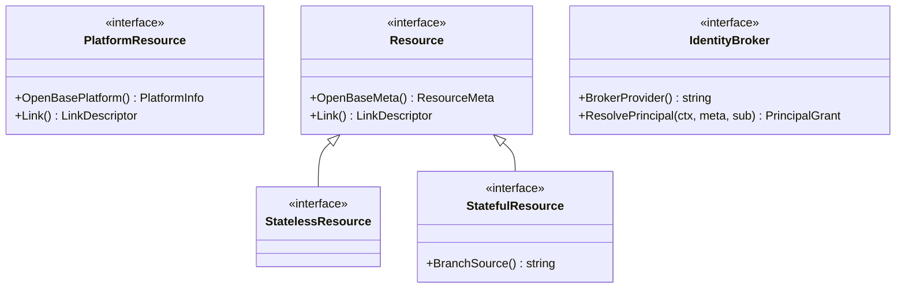
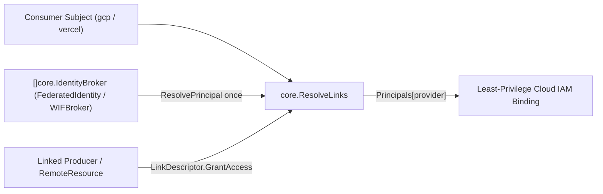

# Core resources and platform contracts - software architecture

## Overview

`libs/components/core` defines two top-level contracts: `PlatformResource` for organization foundations and `Resource` (`StatelessResource` and `StatefulResource`) for all shared and per-environment resources. It owns naming rules, domain formulas, `openbase.io/*` tags, `ScopeRef` manifest lookups, `RecordStackExports`, provider-neutral `IdentityBroker` federation, and typed `Links`. It imports zero cloud provider SDKs.

## Requirement

### Functional

- Validate resource identifiers, deployment environments (`shared`, `dev`, `stage`, `prod`, `preview-<slug>`), and stateful branch parents.
- Generate bounded, deterministic cloud resource names and hostnames that omit the environment token when a resource is `shared`.
- Resolve external workload OIDC `Subject` identities into cloud IAM `Principals` once per consumer through `IdentityBroker` and pass them into linked `GrantAccess` hooks.
- Allow callers to wrap custom Pulumi resources with the same lifecycle, tagging, manifest export, and linking contract as built-in components.

### Non-Functional

- Fail during `pulumi preview` before registering cloud resources when inputs violate naming or branching rules.
- Keep secret resource outputs encrypted in Pulumi state and output maps, and read zero ambient process environment variables inside `libs/components`.
- Stay free of cloud provider SDK dependencies so `core` tests run offline in milliseconds.

## Design

### Components and Responsibilities



- `platform.go` defines `PlatformResource`, `PlatformInfo`, `PlatformMeta`, `InitPlatform`, `GCPPlatformLabels`, and the `core.NewCustomPlatform` escape hatch.
- `environment.go` parses `shared`, `dev`, `stage`, `prod`, and `preview-<slug>` stacks and validates `BranchFrom` parents.
- `resource.go` defines `Resource`, `StatelessResource`, `StatefulResource`, `ResolveProject`, `RequireSharedStack`, and custom escape-hatch constructors (`core.NewStateless` and `core.NewStateful`).
- `links.go` defines `Subject`, `PrincipalGrant`, `IdentityBroker`, `LinkGrantContext`, and `ResolveLinks`.
- `scope.go` defines `ScopeRef`, `RemoteResource`, `ResolveStackReference`, `DefaultBranchFrom`, `DefaultBranchStackRef`, `RecordStackExports`, and `BuildManifestMap`.
- `naming.go` and `domain.go` omit `env` when `Environment` is `shared` and enforce cloud length bounds with deterministic SHA-256 truncation suffixes.

### Data and Control Flow



A consumer passes its provider-neutral `Subject` and `Brokers` into `core.ResolveLinks`. Each `IdentityBroker` translates external OIDC claims into a target-cloud IAM member once (`Principals["gcp"]`). `ResolveLinks` then invokes each linked resource's `GrantAccess` hook without injecting unsolicited environment variable names into the consumer workload.

### Interfaces and Contracts

```go
type Subject struct {
	Provider string
	NativeID pulumi.StringOutput
	Claims   map[string]pulumi.StringOutput
}

type IdentityBroker interface {
	BrokerProvider() string
	ResolvePrincipal(ctx *pulumi.Context, consumer ResourceMeta, sub Subject) (PrincipalGrant, error)
}
```

| Environment | Canonical Name | `IsPersistent()` | `IsProtected()` | `IsEphemeral()` | Valid `BranchFrom` |
| :--- | :--- | :--- | :--- | :--- | :--- |
| `shared` | `<project>-<name>` | `false` | `false` | `false` | `""` |
| `dev` | `<project>-dev-<name>` | `true` | `false` | `false` | `""`, `"stage"`, `"prod"` |
| `stage` | `<project>-stage-<name>` | `true` | `true` | `false` | `""`, `"dev"`, `"prod"` |
| `prod` | `<project>-prod-<name>` | `true` | `true` | `false` | `""`, `"dev"`, `"stage"` |
| `preview-<slug>` | `<project>-preview-<slug>-<name>` | `false` | `false` | `true` | `""`, `"dev"`, `"stage"`, `"prod"` |

## Implementation

### Shared naming rule

When `env == EnvShared`, `CanonicalName` returns `<project>-<name>` instead of `<project>-shared-<name>`, and `HostLabel` returns `<project>` (for `web`) or `<project>-<service>` (for named services). Any concrete resource such as `gcp.NewCloudLoadBalancer` or `gcp.NewBucket` can deploy as a `shared` project resource or as an environment resource without redundant `-shared-` tokens in cloud names.

### Escape hatches

Teams can wrap any raw Pulumi resource in `core.NewCustomPlatform`, `core.NewStateless`, or `core.NewStateful`. Each escape hatch publishes its `LinkDescriptor` to `openbaseManifest` and implements `PlatformResource` or `Resource`, so custom resources plug directly into `Links` alongside built-in OpenBase components.

## References

- [OpenBase Architecture Overview](./index.md)
- [Cross-Stack Lookups and Manifests](./scopes.md)
- [GCP Provider](./providers/gcp/index.md)
- [Vercel Provider](./providers/vercel/index.md)
- [Neon Provider](./providers/neon/index.md)
- [Kinde Provider](./providers/kinde/index.md)
