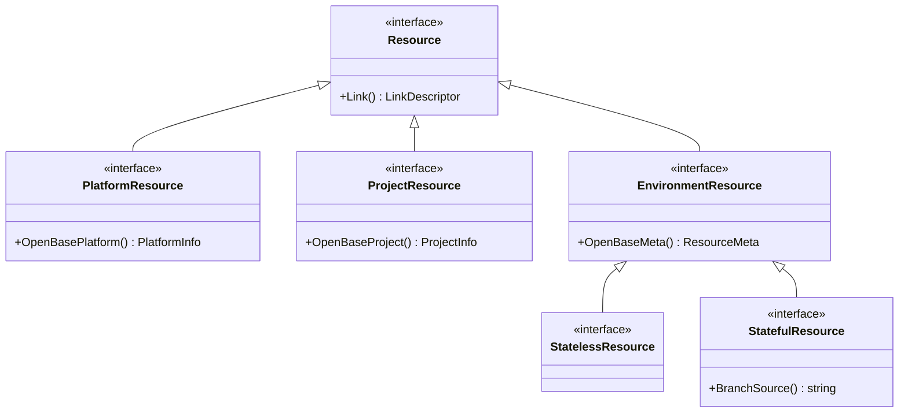
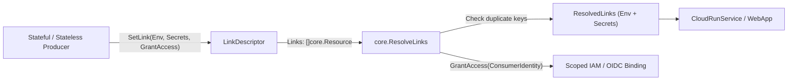

# Core resources and tier contracts - software architecture

## Overview

`libs/components/core` defines the shared interfaces, metadata builders, naming rules, domain formulas, tags, and `Links` resolver used by every OpenBase package. It separates organization `PlatformResource`, repository `ProjectResource`, and per-stack `EnvironmentResource` (`StatelessResource` and `StatefulResource`) at compile time. It does not import any cloud provider SDK.

## Requirement

### Functional

- FR1: Provide `InitPlatform`, `InitProject`, `InitStateless`, and `InitStateful` lifecycle initializers with embedded metadata structs (`PlatformMeta`, `ProjectMeta`, `StatelessMeta`, `StatefulMeta`).
- FR2: Format bounded `<project>-<env>-<name>` canonical names (`63` chars), GCP service-account IDs (`6-30` chars), GCS bucket names (`3-63` chars), and `{project}-{env}.{baseDomain}` hostnames.
- FR3: Resolve `Links` into merged environment maps, secret maps, and least-privilege `GrantAccess` callbacks while rejecting duplicate variable keys.

### Non-Functional

- NFR1: Fail fast during `pulumi preview` on malformed identifiers, unsupported environments, self-referential `BranchFrom` targets, or colliding link keys.
- NFR2: Keep every handwritten function at or below cyclomatic complexity `10`.

## Design

### Components and Responsibilities



- `tier.go` defines `PlatformResource`, `ProjectResource`, `InitPlatform`, `InitProject`, `GCPPlatformLabels`, and `GCPProjectLabels`.
- `environment.go` parses `dev`, `stage`, `prod`, and `preview-<slug>` tiers and validates `BranchFrom` parents.
- `resource.go` defines `EnvironmentResource`, `StatelessResource`, `StatefulResource`, and custom escape-hatch specs (`core.Stateless` and `core.Stateful`).
- `links.go` merges `Env` and `Secrets` outputs across linked resources and invokes `GrantAccess` callbacks.
- `naming.go` and `domain.go` enforce cloud length bounds using deterministic SHA-256 truncation suffixes.

### Data and Control Flow



A producer registers its `LinkDescriptor` with plain outputs, secret outputs, and an optional `GrantAccess` callback. When a consumer passes `Links`, `ResolveLinks` merges all keys, rejects collisions with `ErrDuplicateLinkEnvKey`, and triggers `GrantAccess` with the consumer identity.

### Interfaces and Contracts

```go
type Resource interface {
	pulumi.Resource
	Link() LinkDescriptor
}

type PlatformResource interface {
	Resource
	OpenBasePlatform() PlatformInfo
}

type ProjectResource interface {
	Resource
	OpenBaseProject() ProjectInfo
}

type EnvironmentResource interface {
	Resource
	OpenBaseMeta() ResourceMeta
}

type StatelessResource interface{ EnvironmentResource }

type StatefulResource interface {
	EnvironmentResource
	BranchSource() string
}
```

| Environment | `IsPersistent()` | `IsProtected()` | `IsEphemeral()` | Valid `BranchFrom` |
| :--- | :--- | :--- | :--- | :--- |
| `dev` | `true` | `false` | `false` | `""`, `"stage"`, `"prod"` |
| `stage` | `true` | `true` | `false` | `""`, `"dev"`, `"prod"` |
| `prod` | `true` | `true` | `false` | `""`, `"dev"`, `"stage"` |
| `preview-<slug>` | `false` | `false` | `true` | `""`, `"dev"`, `"stage"`, `"prod"` |

## Implementation

### Deterministic identifier truncation

`BoundedName(raw, maxLen)` sanitizes strings to lowercase `[a-z0-9-]` and returns `raw` unchanged when within `maxLen`. When `raw` exceeds `maxLen`, it truncates the prefix and appends an 8-character SHA-256 hex digest so long preview branch names never collide or violate GCP `30`-character service-account limits.

### Escape hatches

Teams can wrap any raw Pulumi resource in `core.Stateless` or `core.Stateful` with a `RegisterFunc` callback. The wrapper applies the same environment checks, `Protect` flags, `openbase.io/*` tags, and `Links` contract as built-in provider components.

## References

- [OpenBase Architecture Overview](./index.md)
- [GCP Provider](./providers/gcp/index.md)
- [Vercel Provider](./providers/vercel/index.md)
- [Neon Provider](./providers/neon/index.md)
- [Kinde Provider](./providers/kinde/index.md)
- [Composite Blueprints](./providers/composite/index.md)
