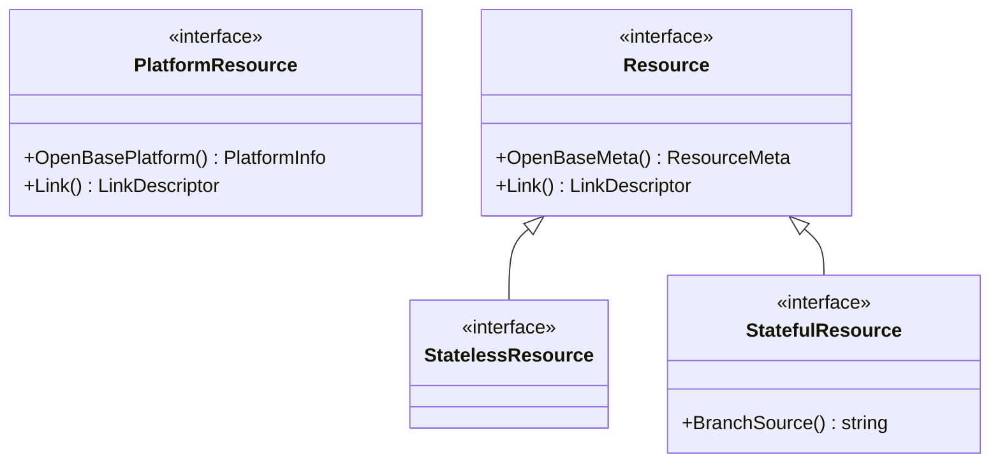
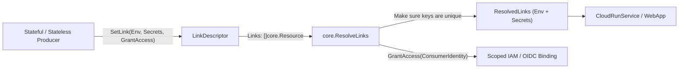

# Core resources and platform contracts - software architecture

## Overview

`libs/components/core` defines two top-level contracts: `PlatformResource` for organization foundations and `Resource` (`StatelessResource` and `StatefulResource`) for all shared and per-environment resources. It owns naming rules, domain formulas, `openbase.io/*` tags, and typed `Links`. It does not import any cloud provider SDK.

## Requirement

### Functional

- Validate resource identifiers, deployment environments (`shared`, `dev`, `stage`, `prod`, `preview-<slug>`), and stateful branch parents.
- Generate bounded, deterministic cloud resource names and hostnames that omit the environment token when a resource is `shared`.
- Merge environment variables and secrets from linked producers and grant scoped access to each consumer identity.
- Allow callers to wrap custom Pulumi resources with the same lifecycle, tagging, and linking contract as built-in components.

### Non-Functional

- Fail during `pulumi preview` before registering cloud resources when inputs violate naming, branching, or link-uniqueness rules.
- Keep secret link values encrypted in Pulumi state and output maps.
- Stay free of cloud provider SDK dependencies so `core` tests run offline in milliseconds.

## Design

### Components and Responsibilities



- `tier.go` defines `PlatformResource`, `PlatformInfo`, `PlatformMeta`, `InitPlatform`, and `GCPPlatformLabels`.
- `environment.go` parses `shared`, `dev`, `stage`, `prod`, and `preview-<slug>` stacks and validates `BranchFrom` parents.
- `resource.go` defines `Resource`, `StatelessResource`, `StatefulResource`, and custom escape-hatch specs (`core.Stateless` and `core.Stateful`).
- `links.go` merges `Env` and `Secrets` outputs across linked resources and invokes `GrantAccess` callbacks.
- `naming.go` and `domain.go` omit `env` when `Environment` is `shared` and enforce cloud length bounds with deterministic SHA-256 truncation suffixes.

### Data and Control Flow



A producer registers its `LinkDescriptor` with plain outputs, secret outputs, and an optional `GrantAccess` callback. When a consumer passes `Links`, `ResolveLinks` merges all keys, rejects collisions with `ErrDuplicateLinkEnvKey`, and triggers `GrantAccess` with the consumer identity.

### Interfaces and Contracts

```go
type PlatformResource interface {
	pulumi.Resource
	OpenBasePlatform() PlatformInfo
	Link() LinkDescriptor
}

type Resource interface {
	pulumi.Resource
	OpenBaseMeta() ResourceMeta
	Link() LinkDescriptor
}

type StatelessResource interface{ Resource }

type StatefulResource interface {
	Resource
	BranchSource() string
}
```

| Environment | Canonical Name | `IsPersistent()` | `IsProtected()` | `IsEphemeral()` | Valid `BranchFrom` |
| :--- | :--- | :--- | :--- | :--- | :--- |
| `shared` | `<project>-<name>` | `false` | `false` | `false` | `""` |
| `dev` | `<project>-dev-<name>` | `true` | `false` | `false` | `""`, `"stage"`, `"prod"` |
| `stage` | `<project>-stage-<name>` | `true` | `true` | `false` | `""`, `"dev"`, `"prod"` |
| `prod` | `<project>-prod-<name>` | `true` | `true` | `false` | `""`, `"dev"`, `"stage"` |
| `preview-<slug>` | `<project>-preview-<slug>-<name>` | `false` | `false` | `true` | `""`, `"dev"`, `"stage"`, `"prod"` |

## Implementation

### Shared naming rule

When `env == EnvShared`, `CanonicalName` returns `<project>-<name>` instead of `<project>-shared-<name>`, and `HostLabel` returns `<project>` (for `web`) or `<project>-<service>` (for named services). Any concrete resource such as `gcp.CloudLoadBalancer` or `gcp.Bucket` can therefore deploy as a `shared` project resource or as an environment resource without redundant `-shared-` tokens in cloud names.

### Escape hatches

Teams can wrap any raw Pulumi resource in `core.Stateless` or `core.Stateful` with a `RegisterFunc` callback. The wrapper applies the same environment rules, `Protect` flags, `openbase.io/*` tags, and `Links` contract as built-in provider components.

## References

- [OpenBase Architecture Overview](./index.md)
- [GCP Provider](./providers/gcp/index.md)
- [Vercel Provider](./providers/vercel/index.md)
- [Neon Provider](./providers/neon/index.md)
- [Kinde Provider](./providers/kinde/index.md)
- [Composite Blueprints](./providers/composite/index.md)
