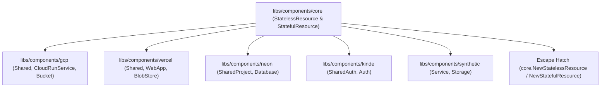
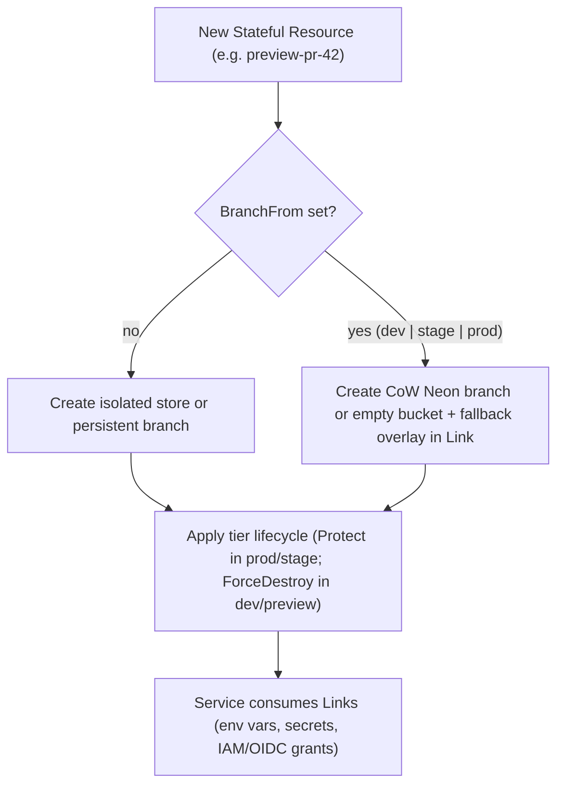

# OpenBase resources - software architecture

## Overview

OpenBase separates shared lifecycle contracts (`libs/components/core`) from provider-specific Go packages (`libs/components/gcp`, `libs/components/vercel`, `libs/components/neon`, `libs/components/kinde`, and `libs/components/synthetic`). Provider packages name resources after concrete cloud products (`gcp.CloudRunService`, `gcp.Bucket`, `vercel.WebApp`, `vercel.BlobStore`, `neon.Database`, and `kinde.Auth`) while explicitly implementing `core.StatelessResource` or `core.StatefulResource`. All implementations validate environment tiers (`shared`, `dev`, `stage`, `prod`, and `preview-<slug>`), apply canonical `openbase.io/*` tags and sanitized cloud labels, wire dependencies through typed `Links`, and support custom escape-hatch wrappers.

## Requirement

### Functional

- Provider packages expose product-specific Go components (`gcp.CloudRunService`, `gcp.Bucket`, `vercel.WebApp`, `vercel.BlobStore`, `neon.Database`, and `kinde.Auth`) that satisfy `core.StatelessResource` or `core.StatefulResource`.
- Stateful storage (`gcp.Bucket` and `vercel.BlobStore`) enforces `Protect` and retention backups in `prod` and `stage`, `ForceDestroy` in `dev` and `preview-*`, and zero-copy `BranchFrom` overlay reads from persistent environments.
- Stateful databases (`neon.Database`) provision instant copy-on-write branches (`dev` and `prod` off `main`, `stage` off `prod`, and `preview-*` off `dev`).
- Shared two-tenant authentication (`kinde.SharedAuth` and `kinde.Auth`) routes `dev` and `preview-*` stacks to the `dev` Kinde tenant and `stage` and `prod` stacks to the `prod` Kinde tenant.
- Teams can wrap any raw Pulumi resource using `core.NewStatelessResource` or `core.NewStatefulResource` to inherit environment validation, lifecycle protection, and `Links`.
- Workloads on `Vercel` authenticate to private `GCP Cloud Run` services and `GCP Cloud Storage` buckets through keyless OIDC federation.

### Non-Functional

- Invalid `Environment` strings or invalid `BranchFrom` sources fail immediately during `pulumi preview` before registering resources.
- Offline unit tests (`pulumi.WithMocks` and `synthetic`) execute in under two seconds without cloud credentials or network calls.

## Design

### Components and Responsibilities



- `libs/components/core` defines `Resource`, `StatelessResource`, and `StatefulResource`, validates `shared | dev | stage | prod | preview-<slug>`, generates deterministic `<project>-<env>-<name>` and `6–30` char service-account names, builds `openbase.io/*` tags and GCP-safe labels, and resolves `Links`.
- `libs/components/gcp` implements `gcp.Shared`, `gcp.CloudRunService` (`StatelessResource`), and `gcp.Bucket` (`StatefulResource` with zero-copy `BranchFrom` overlay and `gcp/overlayfs`).
- `libs/components/vercel` implements `vercel.Shared`, `vercel.WebApp` (`StatelessResource`), and `vercel.BlobStore` (`StatefulResource` with custom-env token propagation and prefix overlay).
- `libs/components/neon` implements `neon.SharedProject` and `neon.Database` (`StatefulResource` over bridged `kislerdm/neon`).
- `libs/components/kinde` implements `kinde.SharedAuth` and `kinde.Auth` (`StatelessResource` over bridged `kinde-oss/kinde`).
- `libs/components/synthetic` provides deterministic offline doubles (`synthetic.Service` and `synthetic.Storage`).

### How Branching, Backups, and Migrations Are Implemented

- **Backups**: `gcp.Bucket` enables native GCS `Versioning` and `SoftDeletePolicy` in `prod` and `stage` alongside `pulumi.Protect(true)`.
- **Zero-Copy Storage Overlays (`BranchFrom`)**:
  - `gcp.Bucket` creates an empty isolated preview bucket (`ForceDestroy: true`) and exports both primary and fallback bucket env vars inside its `LinkDescriptor`, granting `roles/storage.objectAdmin` on primary and `roles/storage.objectViewer` on fallback.
  - `vercel.BlobStore` exports `BLOB_PREFIX=<env>/` and `BLOB_FALLBACK_PREFIX=<branchFrom>/` alongside `BLOB_BASE_URL` and `BLOB_READ_WRITE_TOKEN`.
- **Copy-on-Write Database Branching (`neon.Database`)**: Creates instant copy-on-write Neon branches parented off the `BranchFrom` branch (`stage` off `prod`; `preview-*` off `dev`) and deletes ephemeral preview branches on `pulumi destroy`.
- **Data Migrations**: Forward-only schema and data migrations run in Premise (`pm migrate` / Mise tasks) outside Pulumi state.

### Data and Control Flow



### Interfaces and Contracts

```go
// Package core (libs/components/core)
type Resource interface {
	pulumi.Resource
	OpenBaseMeta() ResourceMeta
	Link() LinkDescriptor
}

type StatelessResource interface{ Resource }

type StatefulResource interface {
	Resource
	BranchSource() string
}

type StatelessResourceArgs struct {
	Project     string
	Repo        string
	Environment string // Defaults from premise:stack / ctx.Stack()
	Kind        string
	Links       []Resource
	Env         map[string]pulumi.StringInput
	Secrets     map[string]pulumi.StringInput
}

type StatefulResourceArgs struct {
	Project     string
	Repo        string
	Environment string
	Kind        string
	BranchFrom  string // "dev" | "stage" | "prod"
	Backup      *bool
	Links       []Resource
	Env         map[string]pulumi.StringInput
	Secrets     map[string]pulumi.StringInput
}
```

```go
// Example: one shared infra/main.go across dev, stage, prod, and preview-* stacks
package main

import (
	"github.com/cloudvoyant/openbase/libs/components/core"
	"github.com/cloudvoyant/openbase/libs/components/gcp"
	"github.com/cloudvoyant/openbase/libs/components/kinde"
	"github.com/cloudvoyant/openbase/libs/components/neon"
	"github.com/cloudvoyant/openbase/libs/components/vercel"
	"github.com/pulumi/pulumi/sdk/v3/go/pulumi"
)

func main() {
	pulumi.Run(func(ctx *pulumi.Context) error {
		env, err := core.ResolveEnvironment(ctx, "")
		if err != nil {
			return err
		}
		branchFrom := ""
		if env.IsPreview() {
			branchFrom = "dev"
		}
		dbBranch := branchFrom
		if env == core.EnvStage {
			dbBranch = "prod"
		}

		uploads, err := gcp.NewBucket(ctx, "uploads", gcp.BucketArgs{
			StatefulResourceArgs: core.StatefulResourceArgs{
				Project:    "storefront",
				BranchFrom: branchFrom,
			},
		})
		if err != nil {
			return err
		}

		db, err := neon.NewDatabase(ctx, "db", neon.DatabaseArgs{
			StatefulResourceArgs: core.StatefulResourceArgs{
				Project:    "storefront",
				BranchFrom: dbBranch,
			},
			SharedStackRef: "org/storefront/shared",
		})
		if err != nil {
			return err
		}

		auth, err := kinde.NewAuth(ctx, "auth", kinde.AuthArgs{
			StatelessResourceArgs: core.StatelessResourceArgs{Project: "storefront"},
			SharedStackRef:        "org/storefront/shared",
		})
		if err != nil {
			return err
		}

		api, err := gcp.NewCloudRunService(ctx, "orders-api", gcp.CloudRunServiceArgs{
			StatelessResourceArgs: core.StatelessResourceArgs{
				Project: "storefront",
				Links:   []core.Resource{uploads, db, auth},
			},
			Visibility: "internal",
			Image:      pulumi.String("us-docker.pkg.dev/acme/storefront/orders-api:latest"),
		})
		if err != nil {
			return err
		}

		_, err = vercel.NewWebApp(ctx, "web", vercel.WebAppArgs{
			StatelessResourceArgs: core.StatelessResourceArgs{
				Project: "storefront",
				Links:   []core.Resource{api, auth},
			},
			SharedStackRef: "org/storefront/shared",
			RootDirectory:  "apps/web",
			Framework:      "sveltekit",
		})
		return err
	})
}
```

## Implementation

- Published as a single Go module package (`github.com/cloudvoyant/openbase/libs/components/...`, `package.public: true` in `premise.yaml`) distributed via repository Git tags (`vX.Y.Z`).

## References

- [OpenBase Architecture Overview](./index.md)
- [GCP Provider](./providers/gcp.md)
- [Vercel Provider](./providers/vercel.md)
- [Neon Provider](./providers/neon.md)
- [Kinde Provider](./providers/kinde.md)
