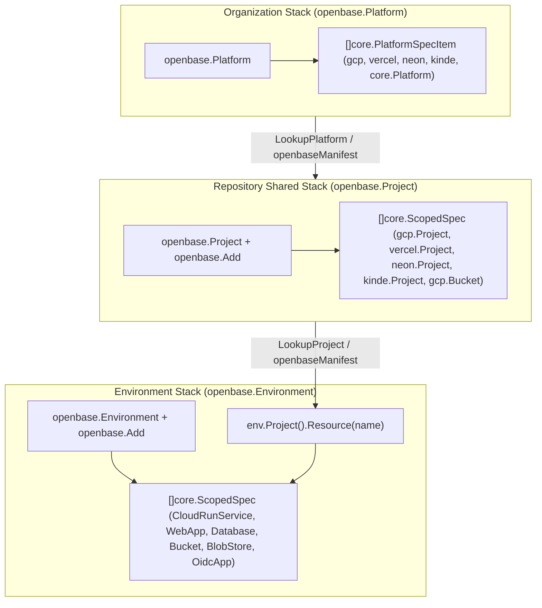
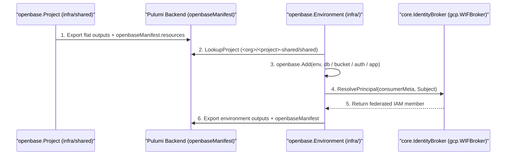

# Unified scopes and manifests - software architecture

## Overview

The root `libs/components` package (`openbase`) provides three generic composition scopes: `openbase.Platform`, `openbase.Project`, and `openbase.Environment`. Each scope accepts any provider spec without hardcoded database, auth, storage, or compute slots, exports flat stack outputs alongside a structured `openbaseManifest` map, and connects parent stacks through `LookupPlatform` and `LookupProject`.

## Requirement

### Functional

- Compose any combination of GCP, Vercel, Neon, Kinde, or custom `core` resources inside one organization `Platform`, one repository `Project`, or one deployable `Environment`.
- Inherit organization, project, environment, stack references, and default copy-on-write `BranchFrom` lineages without repeating fields on every child resource.
- Export structured resource metadata (`openbaseManifest`) so downstream stacks can look up and link shared resources by name.
- Translate cross-cloud workload OIDC identities into target-cloud IAM principals at the `Links` boundary through `core.IdentityBroker`.

### Non-Functional

- Reject `openbase.Project` on non-`shared` stacks and `openbase.Environment` on `shared` stacks during `pulumi preview` before cloud mutations occur.
- Preserve typed Go resource pointers (`*neon.DatabaseResource`, `*vercel.WebAppResource`, `*gcp.CloudRunServiceResource`) when registering resources with `openbase.Add`.
- Keep provider packages decoupled from unrelated cloud SDKs (`vercel` imports zero `pulumi-gcp` packages).

## Design

### Components and Responsibilities



- `platform.go` implements `openbase.Platform`, `PlatformResource`, and `LookupPlatform`.
- `project.go` implements `openbase.Project`, `NewProject`, `ProjectResource`, and `LookupProject`.
- `environment.go` implements `openbase.Environment`, `NewEnvironment`, and `EnvironmentResource`.
- `component.go` implements generic `Add[S, R]`, `FindPlatform[R]`, and `FindResource[R]`.

### Data and Control Flow



Each registered resource returns a `core.LinkDescriptor` containing `Attributes`, `StackExports`, and an optional `GrantAccess` hook. The enclosing scope writes every entry in `StackExports` to the top-level Pulumi stack and serializes all descriptors under `openbaseManifest`. When an environment workload links a remote resource via `env.Project().Resource(...)` or crosses cloud boundaries, `core.ResolveLinks` runs registered `IdentityBroker` instances and invokes `GrantAccess`.

### Interfaces and Contracts

```go
proj, err := openbase.NewProject(ctx, openbase.Project{
	Project:          "storefront",
	PlatformStackRef: "acme/platform/platform",
})
_, err = openbase.Add(proj, neon.Project{})

env, err := openbase.NewEnvironment(ctx, openbase.Environment{
	Project: "storefront",
})
db, err := openbase.Add(env, neon.Database{Name: "db", APIKey: cfg.RequireSecret("neonApiKey")})
```

| Scope | Program Convention | Allowed Stack(s) | Default Parent Lookup | Default `Database` `BranchFrom` | Default Storage `BranchFrom` |
| :--- | :--- | :--- | :--- | :--- | :--- |
| `openbase.Platform` | Dedicated platform repo (`platform/main.go`) | `platform` | None | None | None |
| `openbase.Project` | `infra/shared/main.go` | `shared` | `<org>/platform/platform` (when `LookupPlatform` used) | `""` | `""` |
| `openbase.Environment` | `infra/main.go` | `dev`, `stage`, `prod`, `preview-<slug>` | `<org>/<project>-shared/shared` | `"prod"` on `stage`, `"dev"` on `preview-*`, `""` on `dev`/`prod` | `"dev"` on `preview-*`, `""` on `dev`/`stage`/`prod` |

## Implementation

### Incremental `openbase.Add` and manifest updates

`NewProject` and `NewEnvironment` return `*ProjectResource` and `*EnvironmentResource`, both of which satisfy `ScopedAdder`. Each call to `openbase.Add(scope, spec)` parents the child component under the scope, exports its `StackExports`, and updates `ctx.Export("openbaseManifest", ...)` in place. Callers get concrete typed handles without calling a separate finalize method.

### Remote resource grants

Provider packages register remote access handlers with `core.RegisterRemoteGrantHandler` (for example `"gcp-bucket"` in `libs/components/gcp`). When a workload links `env.Project().Resource("assets", core.WithRemoteKind("gcp-bucket"))`, `GrantAccess` runs synchronously during resource registration and binds `storage.BucketIAMMember` against the remote bucket name from `openbaseManifest`.

## References

- [OpenBase Architecture Overview](./index.md)
- [Core Resources and Tier Contracts](./resources.md)
- [User Guide](../user-guide.md)
