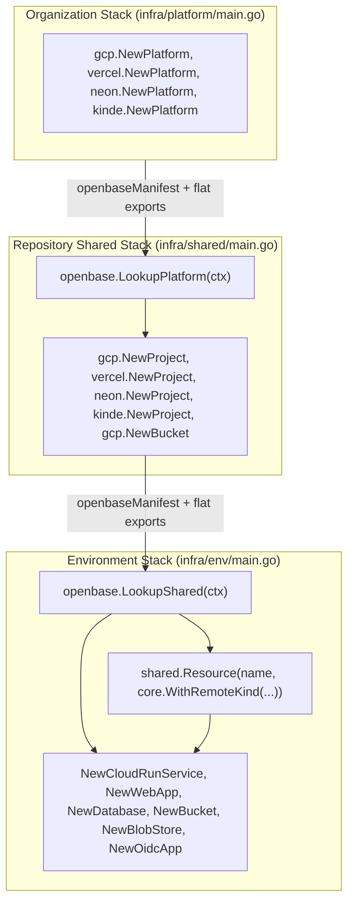
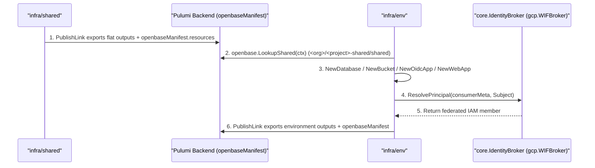

# Cross-stack lookups and manifests - software architecture

## Overview

The root `libs/components` package (`openbase`) provides cross-stack `StackReference` helpers (`openbase.LookupPlatform` and `openbase.LookupShared`), while `libs/components/core` records flat stack exports alongside a structured `openbaseManifest` map whenever any component calls `PublishLink(ctx, desc)`. Every component registers directly on `*pulumi.Context` using standard Pulumi Go constructors (`New<Resource>(ctx, name, &<Resource>Args{...}, opts...)`) without wrapper container objects.

## Requirement

### Functional

- Compose any combination of GCP, Vercel, Neon, Kinde, custom `core`, or native Pulumi resources directly on `*pulumi.Context` across `infra/platform`, `infra/shared`, and `infra/env`.
- Infer project names from `ctx.Project()` (stripping `-shared` on `infra/shared`), environment tiers from `ctx.Stack()`, and default copy-on-write `BranchFrom` lineages (`stage` from `prod`, `preview-*` from `dev`).
- Export structured resource metadata (`openbaseManifest`) automatically so downstream stacks can look up and link shared resources by name.
- Translate cross-cloud workload OIDC identities into target-cloud IAM principals at the `Links` boundary through `core.IdentityBroker`.

### Non-Functional

- Reject `<provider>.NewProject` constructors on non-`shared` stacks and reject unrecognized environment names during `pulumi preview` before cloud mutations occur.
- Return concrete typed Go component pointers (`*neon.Database`, `*vercel.WebApp`, `*gcp.CloudRunService`) directly from `New<Resource>`.
- Keep provider packages decoupled from unrelated cloud SDKs (`vercel` imports zero `pulumi-gcp` packages).

## Design

### Components and Responsibilities



- `libs/components/component.go` implements `LookupPlatform(ctx, stackRef...)`, `LookupShared(ctx, stackRef...)`, and `SupportedEnvironments()`.
- `libs/components/core/scope.go` implements `ScopeRef`, `RemoteResource`, `RecordStackExports`, `DefaultBranchFrom`, and `DefaultBranchStackRef`.
- `PlatformMeta.PublishLink`, `StatelessMeta.PublishLink`, and `StatefulMeta.PublishLink` publish each component's `LinkDescriptor` and update `openbaseManifest` on `ctx`.

### Data and Control Flow



Each `New<Resource>` constructor builds a `core.LinkDescriptor` containing `Attributes`, `StackExports`, and an optional `GrantAccess` hook, then calls `res.PublishLink(ctx, desc)`. `core.RecordStackExports` writes non-colliding entries from `StackExports` to the top-level Pulumi stack (`first-writer-wins`) and updates `ctx.Export("openbaseManifest", ...)` on `ctx`. When an environment workload links a remote resource via `shared.Resource(...)` or crosses cloud boundaries, `core.ResolveLinks` runs registered `IdentityBroker` instances and invokes `GrantAccess`.

### Interfaces and Contracts

```go
// infra/shared/main.go
plat, err := openbase.LookupPlatform(ctx, "acme/platform/platform")
_, err = neon.NewProject(ctx, "neon-project", &neon.ProjectArgs{PlatformStack: plat})

// infra/env/main.go
shared, err := openbase.LookupShared(ctx)
db, err := neon.NewDatabase(ctx, "db", &neon.DatabaseArgs{
	Shared: shared,
	APIKey: cfg.RequireSecret("neonApiKey"),
})
```

| Program | Stack(s) | Lookup Helper | Default Parent Stack | Default `Database` `BranchFrom` | Default Storage `BranchFrom` |
| :--- | :--- | :--- | :--- | :--- | :--- |
| `infra/platform/main.go` | `platform` | None | None | None | None |
| `infra/shared/main.go` | `shared` | `openbase.LookupPlatform(ctx)` | `<org>/platform/platform` | `""` | `""` |
| `infra/env/main.go` | `dev`, `stage`, `prod`, `preview-<slug>` | `openbase.LookupShared(ctx)` | `<org>/<project>-shared/shared` | `"prod"` on `stage`, `"dev"` on `preview-*`, `""` on `dev`/`prod` | `"dev"` on `preview-*`, `""` on `dev`/`stage`/`prod` |

## Implementation

### Automatic manifest exports on `*pulumi.Context`

`core.RecordStackExports` tracks exported keys and `LinkDescriptor` slices per `*pulumi.Context`. Each component call updates `openbaseManifest` in place without requiring a wrapper container or finalize call.

### Remote resource grants

Provider packages register remote access handlers with `core.RegisterRemoteGrantHandler` (for example `"gcp-bucket"` in `libs/components/gcp`). When a workload links `shared.Resource("assets", core.WithRemoteKind("gcp-bucket"))`, `GrantAccess` runs synchronously during resource registration and binds `storage.BucketIAMMember` against the remote bucket name from `openbaseManifest`.

### Multi-account, multi-project, and raw Pulumi composition

1. **Multiple cloud accounts and projects**: Every `New<Resource>` constructor accepts variadic `opts ...pulumi.ResourceOption` (including explicit `pulumi.Provider(p)` instances for secondary GCP or AWS accounts). When multiple resources of the same kind register in one stack (for example `gcp-core` and `gcp-analytics`), the first claims unprefixed convenience stack outputs while every resource exports collision-free attributes under `openbaseManifest.resources[<name>].attributes` (selected via `PlatformResource` or `ScopeRef.Resource(name)`).
2. **Raw Pulumi interoperability**: Components register directly on `*pulumi.Context` and return concrete typed structs (for example `svc.ServiceAccountEmail`, `svc.Service`, `bucket.BucketName`). Callers construct native Pulumi resources before or after OpenBase constructors and pass outputs in either direction within the same stack.

## References

- [OpenBase Architecture Overview](./index.md)
- [Core Resources and Tier Contracts](./resources.md)
- [User Guide](../user-guide.md)
