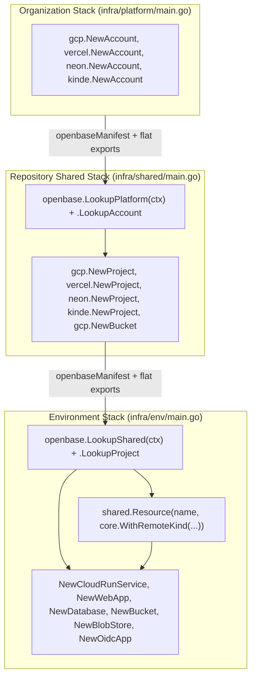

# Cross-stack lookups and manifests - software architecture

## Overview

The root `libs/components` package (`openbase`) provides cross-stack `StackReference` helpers (`openbase.LookupPlatform` and `openbase.LookupShared`), while each provider package exposes typed `<pkg>.LookupAccount(plat, name...)` and `<pkg>.LookupProject(shared, name...)` lookups over `openbaseManifest`. Every component registers directly on `*pulumi.Context` using standard Pulumi Go constructors (`New<Resource>(ctx, name, &<Resource>Args{...}, opts...)`) without wrapper container objects.

## Requirement

### Functional

- Compose any combination of GCP, Vercel, Neon, Kinde, custom `core`, or native Pulumi resources directly on `*pulumi.Context` across `infra/platform`, `infra/shared`, and `infra/env`.
- Infer project names from `ctx.Project()` (stripping `-shared` on `infra/shared`), environment tiers from `ctx.Stack()`, and default copy-on-write `BranchFrom` lineages (`stage` from `prod`, `preview-*` from `dev`).
- Export structured resource metadata (`openbaseManifest`) automatically so downstream stacks resolve single or multi-account `<pkg>.LookupAccount(plat, name...)` and `<pkg>.LookupProject(shared, name...)` handles without magic output strings.
- Translate cross-cloud workload OIDC identities into target-cloud IAM principals at the `Links` boundary through `core.IdentityBroker`.

### Non-Functional

- Reject `<provider>.NewProject` constructors on non-`shared` stacks, reject unrecognized environment names, and reject unnamed `<pkg>.LookupAccount` or `<pkg>.LookupProject` calls when multiple entries of that kind exist (`core.ErrAmbiguousResource`).
- Return concrete typed Go component pointers (`*neon.Database`, `*vercel.WebApp`, `*gcp.CloudRunService`) directly from `New<Resource>`.
- Keep provider packages decoupled from unrelated cloud SDKs (`vercel` imports zero `pulumi-gcp` packages).

## Design

### Components and Responsibilities



- `libs/components/component.go` implements `LookupPlatform(ctx, stackRef...)`, `LookupShared(ctx, stackRef...)`, and `SupportedEnvironments()`.
- `libs/components/core/scope.go` implements `ScopeRef`, `ManifestAttr`, `ErrAmbiguousResource`, `RemoteResource`, `RecordStackExports`, `DefaultBranchFrom`, and `DefaultBranchStackRef`.
- `AccountMeta.PublishLink`, `StatelessMeta.PublishLink`, and `StatefulMeta.PublishLink` publish each component's `LinkDescriptor` and update `openbaseManifest` on `ctx`.

### Data and Control Flow


Each `New<Resource>` constructor builds a `core.LinkDescriptor` containing `Attributes`, `StackExports`, and an optional `GrantAccess` hook, then calls `res.PublishLink(ctx, desc)`. `core.RecordStackExports` writes non-colliding entries from `StackExports` to the top-level Pulumi stack (`first-writer-wins`) and updates `ctx.Export("openbaseManifest", ...)` on `ctx`.

### Interfaces and Contracts

```go
// infra/shared/main.go
plat, err := openbase.LookupPlatform(ctx)
_, err = neon.NewProject(ctx, "db", &neon.ProjectArgs{Account: neon.LookupAccount(plat)})

// infra/env/main.go
shared, err := openbase.LookupShared(ctx)
db, err := neon.NewDatabase(ctx, "db", &neon.DatabaseArgs{
	Project: neon.LookupProject(shared),
	APIKey:  cfg.RequireSecret("neonApiKey"),
})
```

| Program | Stack(s) | Lookup Helpers | Default Parent Stack | Default `Database` `BranchFrom` | Default Storage `BranchFrom` |
| :--- | :--- | :--- | :--- | :--- | :--- |
| `infra/platform/main.go` | `platform` | None | None | None | None |
| `infra/shared/main.go` | `shared` | `openbase.LookupPlatform` + `<pkg>.LookupAccount` | `<org>/platform/platform` | `""` | `""` |
| `infra/env/main.go` | `dev`, `stage`, `prod`, `preview-<slug>` | `openbase.LookupShared` + `<pkg>.LookupProject` | `<org>/<project>-shared/shared` | `"prod"` on `stage`, `"dev"` on `preview-*`, `""` on `dev`/`prod` | `"dev"` on `preview-*`, `""` on `dev`/`stage`/`prod` |

## Implementation

### SaaS single-account vs cloud IaaS multi-account

1. **SaaS accounts** (`vercel`, `neon`, `kinde`) register one `NewAccount` in `infra/platform` that isolates environments internally (`kinde.AccountArgs` holds `NonProd` and `Prod` `EnvironmentCredentials`). Downstream stacks call `kinde.LookupAccount(plat)` without a name.
2. **Cloud IaaS accounts** (`gcp`, future `aws`) register one or more `NewAccount` entries (`"gcp-nonprod"`, `"gcp-prod"`, or `"gcp-analytics"`) paired with explicit `pulumi.Provider(p)` options. Calling `gcp.LookupAccount(plat, "gcp-prod")` selects `openbaseManifest.resources["gcp-prod"]`, while calling `gcp.LookupAccount(plat)` without a name when multiple `gcp-account` entries exist fails with `core.ErrAmbiguousResource`.
3. **Raw Pulumi interoperability**: Components register directly on `*pulumi.Context` and return concrete typed structs (for example `svc.ServiceAccountEmail`, `svc.Service`, `bucket.BucketName`). Callers construct native Pulumi resources before or after OpenBase constructors and pass outputs in either direction within the same stack.

## References

- [OpenBase Architecture Overview](./index.md)
- [Core Resources and Tier Contracts](./resources.md)
- [User Guide](../user-guide.md)
