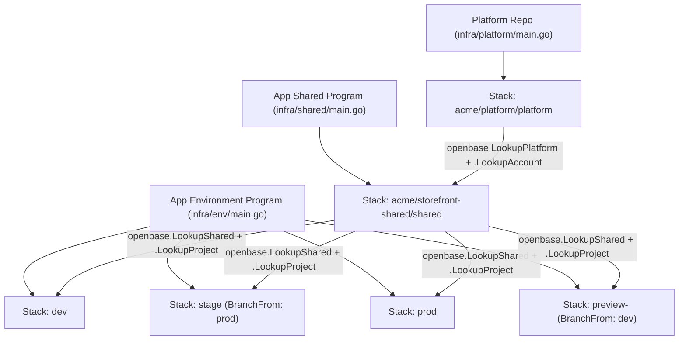

# OpenBase user guide

OpenBase components use standard Pulumi Go constructors (`New<Resource>(ctx, name, &<Resource>Args{...}, opts...)`) and typed cross-stack lookups (`<pkg>.LookupAccount` and `<pkg>.LookupProject`) across three Premise root programs:

1. `infra/platform/main.go` runs once per organization on stack `platform` (`gcp.NewAccount`, `vercel.NewAccount`, `neon.NewAccount`, `kinde.NewAccount`) to bootstrap cloud and SaaS accounts.
2. `infra/shared/main.go` runs once per application repository on stack `shared` (`pm infra apply --shared`) to provision cross-environment resources (`gcp.NewProject`, `vercel.NewProject`, `neon.NewProject`, `kinde.NewProject`, or shared `gcp.NewBucket` stores).
3. `infra/env/main.go` runs on `dev`, `stage`, `prod`, and `preview-<slug>` stacks (`pm infra apply --env ...`) to provision isolated compute, copy-on-write Neon branches, storage overlays, OIDC bindings, and any native Pulumi resources directly on `ctx`.

## Stack topology



## 1. Install OpenBase

```sh
go get github.com/cloudvoyant/openbase/libs/components@latest
```

## 2. Organization accounts (`infra/platform/main.go`)

Deploy one organization platform stack into your shared Pulumi backend (`gs://<org>-pulumi-state`). SaaS providers (`vercel`, `neon`, `kinde`) register one `NewAccount` that isolates environments internally, while cloud IaaS providers (`gcp`) register one `NewAccount` per cloud account:

```go
package main

import (
	"github.com/cloudvoyant/openbase/libs/components/core"
	"github.com/cloudvoyant/openbase/libs/components/gcp"
	"github.com/cloudvoyant/openbase/libs/components/kinde"
	"github.com/cloudvoyant/openbase/libs/components/neon"
	"github.com/cloudvoyant/openbase/libs/components/vercel"
	"github.com/pulumi/pulumi/sdk/v3/go/pulumi"
	"github.com/pulumi/pulumi/sdk/v3/go/pulumi/config"
)

func main() {
	pulumi.Run(func(ctx *pulumi.Context) error {
		cfg := config.New(ctx, "")
		vercelAcc, err := vercel.NewAccount(ctx, "vercel", &vercel.AccountArgs{
			Org:        "acme",
			TeamID:     "team_123",
			TeamSlug:   "acme",
			BaseDomain: "vercel.acme.io",
		})
		if err != nil {
			return err
		}
		if _, err := gcp.NewAccount(ctx, "gcp", &gcp.AccountArgs{
			Org:                "acme",
			GCPProject:         pulumi.String("acme-cloud"),
			GCPProjectNumber:   "123456789012",
			Links:              []core.OIDCProviderSource{vercelAcc, core.GitHubActionsOIDC("acme")},
			BaseDomain:         "gcp.acme.io",
			EnableLoadBalancer: true,
		}); err != nil {
			return err
		}
		if _, err := neon.NewAccount(ctx, "neon", &neon.AccountArgs{
			Org:             "acme",
			OrgID:           "org-acme",
			DefaultRegionID: "aws-us-east-1",
		}); err != nil {
			return err
		}
		_, err = kinde.NewAccount(ctx, "kinde", &kinde.AccountArgs{
			Org: "acme",
			Environments: map[string]kinde.EnvironmentCredentials{
				"non-prod": {
					Domain:       "acme-nonprod.kinde.com",
					ClientID:     cfg.Require("kindeNonProdClientId"),
					ClientSecret: cfg.RequireSecret("kindeNonProdClientSecret"),
				},
				"prod": {
					Domain:       "acme.kinde.com",
					ClientID:     cfg.Require("kindeProdClientId"),
					ClientSecret: cfg.RequireSecret("kindeProdClientSecret"),
				},
			},
		})
		return err
	})
}
```

## 3. Shared repository project (`infra/shared/main.go`)

Set `workspace.infra.directory: infra/env` and `workspace.infra.shared_directory: infra/shared` in `premise.yaml`. Call `openbase.LookupPlatform(ctx)` once and pass `<provider>.LookupAccount(plat, "<alias>")` into each `<provider>.NewProject` constructor:

```go
package main

import (
	openbase "github.com/cloudvoyant/openbase/libs/components"
	"github.com/cloudvoyant/openbase/libs/components/kinde"
	"github.com/cloudvoyant/openbase/libs/components/neon"
	"github.com/cloudvoyant/openbase/libs/components/vercel"
	"github.com/pulumi/pulumi/sdk/v3/go/pulumi"
)

func main() {
	pulumi.Run(func(ctx *pulumi.Context) error {
		plat, err := openbase.LookupPlatform(ctx, "acme/platform/platform")
		if err != nil {
			return err
		}
		authProj, err := kinde.NewProject(ctx, "auth", &kinde.ProjectArgs{
			Account:        kinde.LookupAccount(plat, "kinde"),
			VercelTeamSlug: "acme",
			BaseDomain:     "vercel.acme.io",
		})
		if err != nil {
			return err
		}
		if _, err := neon.NewProject(ctx, "db", &neon.ProjectArgs{
			Account: neon.LookupAccount(plat, "neon"),
		}); err != nil {
			return err
		}
		_, err = vercel.NewProject(ctx, "web", &vercel.ProjectArgs{
			Account:         vercel.LookupAccount(plat, "vercel"),
			EnableBlobStore: true,
			PreviewEnv: map[string]pulumi.StringInput{
				"KINDE_ISSUER_URL": authProj.NonProdIssuerURL,
				"KINDE_CLIENT_ID":  authProj.NonProdClientID,
			},
			PreviewSecrets: map[string]pulumi.StringInput{
				"KINDE_CLIENT_SECRET": authProj.NonProdClientSecret,
			},
		})
		return err
	})
}
```

## 4. Per-environment stack (`infra/env/main.go`)

`openbase.LookupShared(ctx)` resolves `<org>/<project>-shared/shared`, and `<provider>.LookupProject(shared, "<alias>")` returns typed shared project handles. Stateful constructors set default branching (`stage` from `prod`, `preview-*` from `dev`), `Links` grants IAM and OIDC access, and callers wire their own `Env` and `Secrets` keys directly from typed resource outputs:

```go
package main

import (
	openbase "github.com/cloudvoyant/openbase/libs/components"
	"github.com/cloudvoyant/openbase/libs/components/core"
	"github.com/cloudvoyant/openbase/libs/components/kinde"
	"github.com/cloudvoyant/openbase/libs/components/neon"
	"github.com/cloudvoyant/openbase/libs/components/vercel"
	"github.com/pulumi/pulumi/sdk/v3/go/pulumi"
	"github.com/pulumi/pulumi/sdk/v3/go/pulumi/config"
)

func main() {
	pulumi.Run(func(ctx *pulumi.Context) error {
		cfg := config.New(ctx, "")
		shared, err := openbase.LookupShared(ctx)
		if err != nil {
			return err
		}
		webProj := vercel.LookupProject(shared, "web")
		db, err := neon.NewDatabase(ctx, "db", &neon.DatabaseArgs{
			Project: neon.LookupProject(shared, "db"),
			APIKey:  cfg.RequireSecret("neonApiKey"),
		})
		if err != nil {
			return err
		}
		uploads, err := vercel.NewBlobStore(ctx, "uploads", &vercel.BlobStoreArgs{
			Project:            webProj,
			TeamID:             "team_123",
			BlobReadWriteToken: cfg.RequireSecret("blobReadWriteToken"),
		})
		if err != nil {
			return err
		}
		auth, err := kinde.NewOidcApp(ctx, "auth", &kinde.OidcAppArgs{
			Project: kinde.LookupProject(shared, "auth"),
		})
		if err != nil {
			return err
		}
		_, err = vercel.NewWebApp(ctx, "web", &vercel.WebAppArgs{
			Project:   webProj,
			TeamID:    "team_123",
			SourceDir: "../../apps/web",
			Links:     []core.Resource{uploads},
			Env: map[string]pulumi.StringInput{
				"BLOB_BASE_URL":        uploads.BlobBaseURL,
				"BLOB_PREFIX":          pulumi.String(uploads.BlobPrefix),
				"BLOB_FALLBACK_PREFIX": pulumi.String(uploads.BlobFallbackPrefix),
				"KINDE_ISSUER_URL":     auth.IssuerURL,
				"KINDE_CLIENT_ID":      auth.ClientID,
				"KINDE_REDIRECT_URL":   auth.RedirectURL,
			},
			Secrets: map[string]pulumi.StringInput{
				"DATABASE_URL":          db.DatabaseURL,
				"DIRECT_URL":            db.DirectURL,
				"BLOB_READ_WRITE_TOKEN": cfg.RequireSecret("blobReadWriteToken"),
				"KINDE_CLIENT_SECRET":   auth.ClientSecret,
			},
		})
		return err
	})
}
```

## 5. Hybrid multi-app and cross-cloud WIF

An `infra/env/main.go` program can deploy multiple apps and services (such as a `vercel.NewWebApp` frontend and an internal `gcp.NewCloudRunService` API) and link shared resources from `infra/shared`. Pass `Account: gcpAcc` and `ClaimValue: webProj.ProjectID` to `gcp.NewFederatedIdentity` so external OIDC callers receive federated Google Cloud service accounts without magic output strings:

```go
plat, err := openbase.LookupPlatform(ctx, "acme/platform/platform")
if err != nil {
	return err
}
shared, err := openbase.LookupShared(ctx)
if err != nil {
	return err
}
gcpAcc := gcp.LookupAccount(plat, "gcp")
webProj := vercel.LookupProject(shared, "web")
sharedAssets := shared.Resource(
	"shared-assets",
	core.WithRemoteKind("gcp-bucket"),
)
fed, err := gcp.NewFederatedIdentity(ctx, "web-wif", &gcp.FederatedIdentityArgs{
	Account:        gcpAcc,
	SourceProvider: "vercel",
	ClaimKey:       "project_id",
	ClaimValue:     webProj.ProjectID,
})
if err != nil {
	return err
}
ordersAPI, err := gcp.NewCloudRunService(ctx, "orders", &gcp.CloudRunServiceArgs{
	Account:    gcpAcc,
	Project:    gcp.LookupProject(shared, "gcp"),
	Visibility: gcp.VisibilityInternal,
	Image:      pulumi.String("us-central1-docker.pkg.dev/acme-cloud/storefront-gcp/orders:latest"),
	Links:      []core.Resource{sharedAssets},
	Env: map[string]pulumi.StringInput{
		"ASSETS_BUCKET": sharedAssets.Attr("bucketName"),
	},
	Secrets: map[string]pulumi.StringInput{
		"DATABASE_URL": db.DatabaseURL,
	},
})
if err != nil {
	return err
}
_, err = vercel.NewWebApp(ctx, "web", &vercel.WebAppArgs{
	Project:   webProj,
	SourceDir: "../../apps/web",
	Links:     []core.Resource{ordersAPI, sharedAssets},
	Brokers:   []core.IdentityBroker{fed},
	Env: map[string]pulumi.StringInput{
		"GCP_SERVICE_ACCOUNT_EMAIL":      fed.ServiceAccountEmail,
		"GCP_WORKLOAD_IDENTITY_PROVIDER": fed.ProviderAudience,
		"ORDERS_URL":                     ordersAPI.URL,
		"ASSETS_BUCKET":                  sharedAssets.Attr("bucketName"),
	},
})
```

## 6. Mixing raw Pulumi resources and multiple cloud accounts

OpenBase components register directly on `*pulumi.Context` with the same `New<Resource>(ctx, name, &<Resource>Args{...}, opts...)` signature as native Pulumi SDK resources. You can declare native Pulumi resources alongside OpenBase components and wire outputs in both directions:

```go
rawSecret, err := secretmanager.NewSecret(ctx, "raw-partner-key", &secretmanager.SecretArgs{
	Project:     gcpAcc.GCPProject,
	SecretId:    pulumi.String("storefront-" + ctx.Stack() + "-partner-key"),
	Replication: &secretmanager.SecretReplicationArgs{Auto: &secretmanager.SecretReplicationAutoArgs{}},
})
if err != nil {
	return err
}
rawSecretVer, err := secretmanager.NewSecretVersion(ctx, "raw-partner-key-v1", &secretmanager.SecretVersionArgs{
	Secret:     rawSecret.ID(),
	SecretData: cfg.RequireSecret("partnerApiKey"),
})
if err != nil {
	return err
}

api, err := gcp.NewCloudRunService(ctx, "orders", &gcp.CloudRunServiceArgs{
	Account: gcpAcc,
	Project: gcp.LookupProject(shared, "gcp"),
	Image:   pulumi.String("us-central1-docker.pkg.dev/acme-cloud/storefront-gcp/orders:latest"),
	Env: map[string]pulumi.StringInput{
		"RAW_SECRET_VERSION": rawSecretVer.Name,
	},
})
if err != nil {
	return err
}

_, err = secretmanager.NewSecretIamMember(ctx, "raw-partner-key-accessor", &secretmanager.SecretIamMemberArgs{
	Project:  gcpAcc.GCPProject,
	SecretId: rawSecret.SecretId,
	Role:     pulumi.String("roles/secretmanager.secretAccessor"),
	Member:   pulumi.Sprintf("serviceAccount:%s", api.ServiceAccountEmail),
})
```

When an organization spans multiple cloud accounts (such as `nonprod` versus `prod` or `core` versus `analytics`), register named `NewAccount` resources with explicit `pulumi.Provider(...)` options and select them by name via `gcp.LookupAccount(plat, "<name>")`:

```go
// infra/platform/main.go: multiple GCP accounts
prodGCP, err := gcpprov.NewProvider(ctx, "gcp-prod-provider", &gcpprov.ProviderArgs{
	Project: pulumi.String("acme-prod"),
})
_, err = gcp.NewAccount(ctx, "gcp-nonprod", &gcp.AccountArgs{
	Org:        "acme",
	GCPProject: pulumi.String("acme-nonprod"),
})
_, err = gcp.NewAccount(ctx, "gcp-prod", &gcp.AccountArgs{
	Org:        "acme",
	GCPProject: pulumi.String("acme-prod"),
}, pulumi.Provider(prodGCP))

// infra/shared/main.go: select a named account explicitly
_, err = gcp.NewProject(ctx, "registry", &gcp.ProjectArgs{
	Account: gcp.LookupAccount(plat, "gcp-prod"),
}, pulumi.Provider(prodGCP))

// infra/env/main.go: route nonprod vs prod stacks by ctx.Stack()
gcpAccName := "gcp-nonprod"
if ctx.Stack() == "stage" || ctx.Stack() == "prod" {
	gcpAccName = "gcp-prod"
}
_, err = gcp.NewBucket(ctx, "uploads", &gcp.BucketArgs{
	Account: gcp.LookupAccount(plat, gcpAccName),
}, pulumi.Provider(envGCP))
```

## 7. Zero-copy storage reads in Go

1. For Google Cloud Storage (`libs/components/gcp/overlayfs`), call `overlayfs.NewStore(storageClient, primaryBucket, fallbackBucket)` so `preview-*` reads fall back to `dev` on `storage.ErrObjectNotExist` while writes stay isolated in the preview bucket.
2. For Vercel Blob (`libs/components/vercel`), call `vercel.NewBlobOverlayClient(baseURL, token, primaryPrefix, fallbackPrefix)` for prefix-isolated writes and fallback reads.

## Further reading

- [Architecture Overview](./architecture/index.md)
- [Cross-Stack Lookups and Manifests](./architecture/scopes.md)
- [Core Resources and Account Contracts](./architecture/resources.md)
- [GCP Provider](./architecture/providers/gcp/index.md)
- [Vercel Provider](./architecture/providers/vercel/index.md)
- [Neon Provider](./architecture/providers/neon/index.md)
- [Kinde Provider](./architecture/providers/kinde/index.md)
