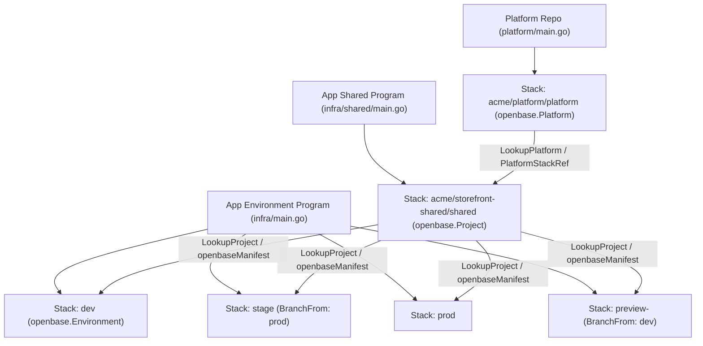

# OpenBase user guide

OpenBase organizes cloud infrastructure into three scopes in the root `github.com/cloudvoyant/openbase/libs/components` package:

1. `openbase.Platform` runs once per organization in a dedicated platform repository (`platform/main.go` on stack `platform`) to enable GCP APIs, create one Workload Identity Pool and wildcard HTTPS Load Balancer, export Vercel team and Neon organization defaults, and connect `NonProd` and `Prod` Kinde tenants.
2. `openbase.Project` runs once per application repository in `infra/shared/main.go` (`shared` stack via `pm infra apply --shared`) to provision shared assets such as `gcp.Project`, `vercel.Project`, `neon.Project`, `kinde.Project`, or shared `gcp.Bucket` stores.
3. `openbase.Environment` runs per `dev`, `stage`, `prod`, and `preview-<slug>` stack in `infra/main.go` (`pm infra apply --env ...`) to provision isolated compute, copy-on-write Neon branches, storage overlays, and OIDC bindings.

## Stack topology



## 1. Install OpenBase

```sh
go get github.com/cloudvoyant/openbase/libs/components@latest
```

## 2. Organization platform (`openbase.Platform`)

Deploy one organization platform stack into your shared Pulumi backend (`gs://<org>-pulumi-state`):

```go
package main

import (
	openbase "github.com/cloudvoyant/openbase/libs/components"
	"github.com/cloudvoyant/openbase/libs/components/core"
	"github.com/cloudvoyant/openbase/libs/components/gcp"
	"github.com/cloudvoyant/openbase/libs/components/kinde"
	"github.com/cloudvoyant/openbase/libs/components/neon"
	"github.com/cloudvoyant/openbase/libs/components/vercel"
	"github.com/pulumi/pulumi/sdk/v3/go/pulumi"
	"github.com/pulumi/pulumi/sdk/v3/go/pulumi/config"
)

func main() {
	pulumi.Run(func(ctx *pulumi.Context) error {
		cfg := config.New(ctx, "")
		vercelPlat := vercel.Platform{
			TeamID:     "team_123",
			TeamSlug:   "acme",
			BaseDomain: "vercel.acme.io",
		}
		_, err := openbase.Platform{
			Org: "acme",
			Resources: []core.PlatformSpecItem{
				vercelPlat,
				gcp.Platform{
					GCPProject:         pulumi.String("acme-cloud"),
					GCPProjectNumber:   "123456789012",
					Links:              []core.OIDCProviderSource{vercelPlat, core.GitHubActionsOIDC("acme")},
					BaseDomain:         "gcp.acme.io",
					EnableLoadBalancer: true,
				},
				neon.Platform{
					OrgID:    "org-acme",
					RegionID: "aws-us-east-1",
				},
				kinde.Platform{
					NonProd: kinde.TenantCredentials{
						Domain:       "acme-nonprod.kinde.com",
						ClientID:     cfg.Require("kindeNonProdClientId"),
						ClientSecret: cfg.RequireSecret("kindeNonProdClientSecret"),
					},
					Prod: kinde.TenantCredentials{
						Domain:       "acme.kinde.com",
						ClientID:     cfg.Require("kindeProdClientId"),
						ClientSecret: cfg.RequireSecret("kindeProdClientSecret"),
					},
				},
			},
		}.Register(ctx)
		return err
	})
}
```

## 3. Shared repository project (`infra/shared/main.go`)

Set `workspace.infra.directory: infra` and `workspace.infra.shared_directory: infra/shared` in `premise.yaml`. Register any combination of shared project resources with `openbase.NewProject` and `openbase.Add` (inheriting organization settings and Kinde tenant connections from `PlatformStackRef`):

```go
package main

import (
	openbase "github.com/cloudvoyant/openbase/libs/components"
	"github.com/cloudvoyant/openbase/libs/components/kinde"
	"github.com/cloudvoyant/openbase/libs/components/neon"
	"github.com/cloudvoyant/openbase/libs/components/vercel"
	"github.com/pulumi/pulumi/sdk/v3/go/pulumi"
)

func main() {
	pulumi.Run(func(ctx *pulumi.Context) error {
		proj, err := openbase.NewProject(ctx, openbase.Project{
			Project:          "storefront",
			PlatformStackRef: "acme/platform/platform",
		})
		if err != nil {
			return err
		}
		authProj, err := openbase.Add(proj, kinde.Project{
			VercelTeamSlug: "acme",
			BaseDomain:     "vercel.acme.io",
		})
		if err != nil {
			return err
		}
		if _, err := openbase.Add(proj, neon.Project{}); err != nil {
			return err
		}
		_, err = openbase.Add(proj, vercel.Project{
			EnableBlobStore: true,
			PreviewEnv: map[string]pulumi.StringInput{
				"KINDE_ISSUER_URL": authProj.NonProdIssuerURL,
				"KINDE_CLIENT_ID":  authProj.NonProdClientID,
			},
			PreviewSecrets: map[string]pulumi.StringInput{
				"KINDE_CLIENT_SECRET": authProj.NonProdClientSecret,
			},
		})
		return err
	})
}
```

## 4. Per-environment stack (`infra/main.go`)

`openbase.NewEnvironment` resolves `<org>/<project>-shared/shared` automatically and sets default stateful branching (`stage` from `prod`, `preview-*` from `dev`). `Links` grants IAM and OIDC access, while callers wire their own `Env` and `Secrets` keys directly from typed resource outputs:

```go
package main

import (
	openbase "github.com/cloudvoyant/openbase/libs/components"
	"github.com/cloudvoyant/openbase/libs/components/core"
	"github.com/cloudvoyant/openbase/libs/components/kinde"
	"github.com/cloudvoyant/openbase/libs/components/neon"
	"github.com/cloudvoyant/openbase/libs/components/vercel"
	"github.com/pulumi/pulumi/sdk/v3/go/pulumi"
	"github.com/pulumi/pulumi/sdk/v3/go/pulumi/config"
)

func main() {
	pulumi.Run(func(ctx *pulumi.Context) error {
		cfg := config.New(ctx, "")
		env, err := openbase.NewEnvironment(ctx, openbase.Environment{
			Project: "storefront",
		})
		if err != nil {
			return err
		}
		db, err := openbase.Add(env, neon.Database{
			Name:   "db",
			APIKey: cfg.RequireSecret("neonApiKey"),
		})
		if err != nil {
			return err
		}
		uploads, err := openbase.Add(env, vercel.BlobStore{
			Name:               "uploads",
			TeamID:             "team_123",
			BlobReadWriteToken: cfg.RequireSecret("blobReadWriteToken"),
		})
		if err != nil {
			return err
		}
		auth, err := openbase.Add(env, kinde.OidcApp{
			Name:           "auth",
			VercelTeamSlug: "acme",
			BaseDomain:     "vercel.acme.io",
		})
		if err != nil {
			return err
		}
		_, err = openbase.Add(env, vercel.WebApp{
			Name:       "web",
			TeamID:     "team_123",
			TeamSlug:   "acme",
			BaseDomain: "vercel.acme.io",
			SourceDir:  "../apps/web",
			Links:      []core.Resource{uploads},
			Env: map[string]pulumi.StringInput{
				"BLOB_BASE_URL":        uploads.BlobBaseURL,
				"BLOB_PREFIX":          pulumi.String(uploads.BlobPrefix),
				"BLOB_FALLBACK_PREFIX": pulumi.String(uploads.BlobFallbackPrefix),
				"KINDE_ISSUER_URL":     auth.IssuerURL,
				"KINDE_CLIENT_ID":      auth.ClientID,
				"KINDE_REDIRECT_URL":   auth.RedirectURL,
			},
			Secrets: map[string]pulumi.StringInput{
				"DATABASE_URL":          db.DatabaseURL,
				"DIRECT_URL":            db.DirectURL,
				"BLOB_READ_WRITE_TOKEN": cfg.RequireSecret("blobReadWriteToken"),
				"KINDE_CLIENT_SECRET":   auth.ClientSecret,
			},
		})
		return err
	})
}
```

## 5. Hybrid multi-app and cross-cloud WIF

An `openbase.Environment` can host multiple apps and services (such as a `vercel.WebApp` frontend and an internal `gcp.CloudRunService` API) and link shared resources from `infra/shared`. Register `gcp.FederatedIdentity` (or `gcp.WIFBroker`) so external OIDC callers receive federated Google Cloud service accounts at the `Links` boundary while exposing typed service-account and WIF audience outputs:

```go
platRef, err := openbase.LookupPlatform(ctx, "acme/platform/platform")
if err != nil {
	return err
}
env, err := openbase.NewEnvironment(ctx, openbase.Environment{
	Project:  "storefront",
	Platform: platRef,
})
if err != nil {
	return err
}
sharedAssets := env.Project().Resource(
	"shared-assets",
	core.WithRemoteKind("gcp-bucket"),
)
fed, err := openbase.Add(env, gcp.FederatedIdentity{
	Name:           "web-wif",
	GCPProject:     pulumi.String("acme-cloud"),
	PoolName:       platRef.Output("workloadIdentityPoolName"),
	OIDCProvider:   platRef.Output("vercelOidcProviderName"),
	SourceProvider: "vercel",
	ClaimKey:       "project_id",
	ClaimValue:     env.Project().Output("vercelProjectId"),
})
if err != nil {
	return err
}
ordersAPI, err := openbase.Add(env, gcp.CloudRunService{
	Name:       "orders",
	GCPProject: pulumi.String("acme-cloud"),
	Visibility: gcp.VisibilityInternal,
	Image:      pulumi.String("us-central1-docker.pkg.dev/acme-cloud/storefront-gcp/orders:latest"),
	Links:      []core.Resource{sharedAssets},
	Env: map[string]pulumi.StringInput{
		"ASSETS_BUCKET": sharedAssets.Attr("bucketName"),
	},
	Secrets: map[string]pulumi.StringInput{
		"DATABASE_URL": db.DatabaseURL,
	},
})
if err != nil {
	return err
}
_, err = openbase.Add(env, vercel.WebApp{
	Name:      "web",
	SourceDir: "../apps/web",
	Links:     []core.Resource{ordersAPI, sharedAssets},
	Brokers:   []core.IdentityBroker{fed},
	Env: map[string]pulumi.StringInput{
		"GCP_SERVICE_ACCOUNT_EMAIL":      fed.ServiceAccountEmail,
		"GCP_WORKLOAD_IDENTITY_PROVIDER": fed.ProviderAudience,
		"ORDERS_URL":                     ordersAPI.URL,
		"ASSETS_BUCKET":                  sharedAssets.Attr("bucketName"),
	},
})
```

## 6. Zero-copy storage reads in Go

1. For Google Cloud Storage (`libs/components/gcp/overlayfs`), call `overlayfs.NewStore(storageClient, primaryBucket, fallbackBucket)` so `preview-*` reads fall back to `dev` on `storage.ErrObjectNotExist` while writes stay isolated in the preview bucket.
2. For Vercel Blob (`libs/components/vercel`), call `vercel.NewBlobOverlayClient(baseURL, token, primaryPrefix, fallbackPrefix)` for prefix-isolated writes and fallback reads.

## Further reading

- [Architecture Overview](./architecture/index.md)
- [Unified Scopes and Manifests](./architecture/scopes.md)
- [Core Resources and Tier Contracts](./architecture/resources.md)
- [GCP Provider](./architecture/providers/gcp/index.md)
- [Vercel Provider](./architecture/providers/vercel/index.md)
- [Neon Provider](./architecture/providers/neon/index.md)
- [Kinde Provider](./architecture/providers/kinde/index.md)
