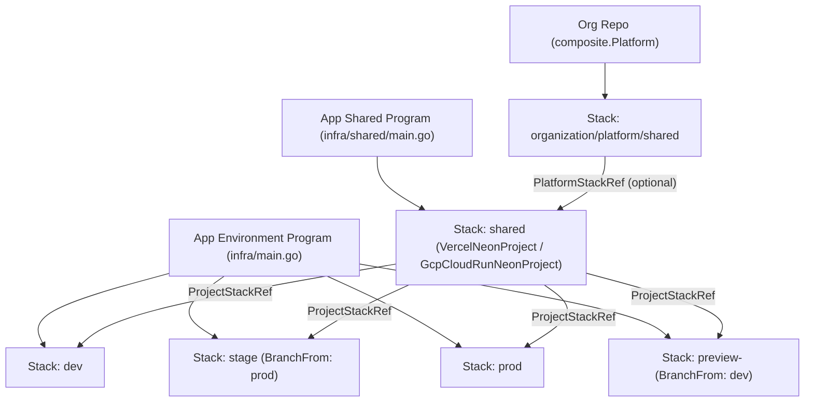

# OpenBase user guide

OpenBase organizes cloud infrastructure into three clean tiers using declarative Go specs (`<pkg>.<Spec>{...}.Register(ctx)`):

1. **`Platform` (once per organization, e.g. a central `platform` repo)**: Enables GCP APIs, provisions one org-wide Workload Identity Pool, optional KMS KeyRing, and wildcard HTTPS Load Balancer (`*.gcp.acme.io`), sets Vercel team/domain defaults (`*.vercel.acme.io`) and team-shared env vars, sets Neon org/region defaults, and validates `dev` & `prod` Kinde tenants (`composite.Platform` or `<provider>.Platform`).
2. **`Project` (once per application repo in `infra/shared/main.go`, deployed via `pm infra apply --shared`)**: Provisions the app's Artifact Registry repository, Vercel Project (`staging` CustomEnvironment, `prod` & `staging` domains, automation bypass, shared Blob store), Neon Project cluster, and `dev` & `prod` Kinde OIDC `Application`s (`composite.VercelNeonProject` / `composite.GcpCloudRunNeonProject` or `<provider>.Project`).
3. **`Environment` (per `dev`, `stage`, `prod`, and `preview-<slug>` stack in `infra/main.go`, deployed via `pm infra apply --env ...`)**: Deploys isolated compute, copy-on-write Neon branches, storage overlays, and Kinde callbacks wired from `ProjectStackRef` (`composite.VercelNeonApp` / `composite.GcpCloudRunNeonApp` or concrete product specs).

## Stack topology



## 1. Install OpenBase in your workspace

```sh
go get github.com/cloudvoyant/openbase/libs/components@latest
```

## 2. Organization foundation (`composite.Platform`, once per org)

```go
package main

import (
	"os"

	"github.com/cloudvoyant/openbase/libs/components/composite"
	"github.com/cloudvoyant/openbase/libs/components/gcp"
	"github.com/cloudvoyant/openbase/libs/components/kinde"
	"github.com/cloudvoyant/openbase/libs/components/neon"
	"github.com/cloudvoyant/openbase/libs/components/vercel"
	"github.com/pulumi/pulumi/sdk/v3/go/pulumi"
)

func main() {
	pulumi.Run(func(ctx *pulumi.Context) error {
		_, err := composite.Platform{
			Project: "platform",
			GCP: &gcp.Platform{
				GCPProject:         pulumi.String(os.Getenv("GCP_PROJECT")),
				GCPProjectNumber:   os.Getenv("GCP_PROJECT_NUMBER"),
				GitHubOrg:          "acme",
				VercelTeamSlug:     "acme",
				BaseDomain:         "gcp.acme.io",
				EnableLoadBalancer: true,
			},
			Vercel: &vercel.Platform{
				TeamID:     os.Getenv("VERCEL_TEAM_ID"),
				TeamSlug:   "acme",
				BaseDomain: "vercel.acme.io",
			},
			Neon: &neon.Platform{
				OrgID:    os.Getenv("NEON_ORG_ID"),
				RegionID: "aws-us-east-1",
			},
			Kinde: &kinde.Platform{
				Dev: kinde.TenantCredentials{
					Domain:       os.Getenv("KINDE_DEV_TENANT_DOMAIN"),
					ClientID:     pulumi.String(os.Getenv("KINDE_DEV_M2M_CLIENT_ID")),
					ClientSecret: pulumi.String(os.Getenv("KINDE_DEV_M2M_CLIENT_SECRET")),
				},
				Prod: kinde.TenantCredentials{
					Domain:       os.Getenv("KINDE_PROD_TENANT_DOMAIN"),
					ClientID:     pulumi.String(os.Getenv("KINDE_PROD_M2M_CLIENT_ID")),
					ClientSecret: pulumi.String(os.Getenv("KINDE_PROD_M2M_CLIENT_SECRET")),
				},
			},
		}.Register(ctx)
		return err
	})
}
```

## 3. Application quickstart with `libs/components/composite` (Premise layout)

In `premise.yaml`, configure `workspace.infra.directory: infra` and `workspace.infra.shared_directory: infra/shared`.

### `infra/shared/main.go` (`name: storefront-shared`, deployed via `pm infra apply --shared`)

```go
package main

import (
	"os"

	"github.com/cloudvoyant/openbase/libs/components/composite"
	"github.com/cloudvoyant/openbase/libs/components/kinde"
	"github.com/pulumi/pulumi/sdk/v3/go/pulumi"
)

func main() {
	pulumi.Run(func(ctx *pulumi.Context) error {
		_, err := composite.VercelNeonProject{
			Project:          "storefront",
			PlatformStackRef: "organization/platform/shared", // optional: inherits TeamID/TeamSlug/BaseDomain/NeonOrgID
			TeamSlug:         "acme",
			BaseDomain:       "vercel.acme.io",
			Auth: &composite.KindeProjectConfig{
				Dev: kinde.TenantCredentials{
					Domain:       os.Getenv("KINDE_DEV_TENANT_DOMAIN"),
					ClientID:     pulumi.String(os.Getenv("KINDE_DEV_M2M_CLIENT_ID")),
					ClientSecret: pulumi.String(os.Getenv("KINDE_DEV_M2M_CLIENT_SECRET")),
				},
				Prod: kinde.TenantCredentials{
					Domain:       os.Getenv("KINDE_PROD_TENANT_DOMAIN"),
					ClientID:     pulumi.String(os.Getenv("KINDE_PROD_M2M_CLIENT_ID")),
					ClientSecret: pulumi.String(os.Getenv("KINDE_PROD_M2M_CLIENT_SECRET")),
				},
			},
		}.Register(ctx)
		return err
	})
}
```

### `infra/main.go` (`name: storefront`, deployed via `pm infra apply --env dev|stage|prod|preview`)

```go
package main

import (
	"os"

	"github.com/cloudvoyant/openbase/libs/components/composite"
	"github.com/pulumi/pulumi/sdk/v3/go/pulumi"
)

func main() {
	pulumi.Run(func(ctx *pulumi.Context) error {
		_, err := composite.VercelNeonApp{
			Name:       "web",
			Project:    "storefront",
			TeamID:     os.Getenv("VERCEL_TEAM_ID"),
			TeamSlug:   "acme",
			BaseDomain: "vercel.acme.io",
			SourceDir:  "../apps/web",
			Auth:       &composite.KindeAppConfig{},
		}.Register(ctx)
		return err
	})
}
```

`VercelNeonApp` automatically resolves `ProjectStackRef` to `<org>/<project>-shared/shared` — no Kinde M2M admin credentials or Neon org IDs are needed in `infra/main.go`. Swap `VercelNeonProject` + `VercelNeonApp` for `GcpCloudRunNeonProject` + `GcpCloudRunNeonApp` to target Cloud Run + GCS + Neon + Kinde with the exact same Premise stack lifecycle.

## 4. Custom provider composition

```go
package main

import (
	"os"

	"github.com/cloudvoyant/openbase/libs/components/core"
	"github.com/cloudvoyant/openbase/libs/components/gcp"
	"github.com/cloudvoyant/openbase/libs/components/kinde"
	"github.com/cloudvoyant/openbase/libs/components/neon"
	"github.com/cloudvoyant/openbase/libs/components/vercel"
	"github.com/pulumi/pulumi/sdk/v3/go/pulumi"
)

func main() {
	pulumi.Run(func(ctx *pulumi.Context) error {
		env, err := core.ResolveEnvironment(ctx, "")
		if err != nil {
			return err
		}
		if env == core.EnvShared {
			return deployProject(ctx)
		}
		return deployEnvironment(ctx, env)
	})
}

func deployProject(ctx *pulumi.Context) error {
	gcpProj, err := gcp.Project{
		Name:             "gcp",
		Project:          "storefront",
		PlatformStackRef: "organization/platform/shared",
		GCPProject:       pulumi.String(os.Getenv("GCP_PROJECT")),
	}.Register(ctx)
	if err != nil {
		return err
	}
	vercelProj, err := vercel.Project{
		Name:             "vercel",
		Project:          "storefront",
		PlatformStackRef: "organization/platform/shared",
		EnableBlobStore:  true,
	}.Register(ctx)
	if err != nil {
		return err
	}
	neonProj, err := neon.Project{
		Name:             "neon",
		Project:          "storefront",
		PlatformStackRef: "organization/platform/shared",
	}.Register(ctx)
	if err != nil {
		return err
	}
	kindeProj, err := kinde.Project{
		Name:           "kinde",
		Project:        "storefront",
		VercelTeamSlug: "acme",
		Dev: kinde.TenantCredentials{
			Domain:       os.Getenv("KINDE_DEV_TENANT_DOMAIN"),
			ClientID:     pulumi.String(os.Getenv("KINDE_DEV_M2M_CLIENT_ID")),
			ClientSecret: pulumi.String(os.Getenv("KINDE_DEV_M2M_CLIENT_SECRET")),
		},
		Prod: kinde.TenantCredentials{
			Domain:       os.Getenv("KINDE_PROD_TENANT_DOMAIN"),
			ClientID:     pulumi.String(os.Getenv("KINDE_PROD_M2M_CLIENT_ID")),
			ClientSecret: pulumi.String(os.Getenv("KINDE_PROD_M2M_CLIENT_SECRET")),
		},
	}.Register(ctx)
	if err != nil {
		return err
	}
	ctx.Export("vercelProjectId", vercelProj.ProjectID)
	ctx.Export("stageCustomEnvironmentId", vercelProj.StageCustomEnvironmentID)
	ctx.Export("blobStoreId", vercelProj.BlobStoreID)
	ctx.Export("neonProjectId", neonProj.ProjectID)
	ctx.Export("neonDefaultBranchId", neonProj.DefaultBranchID)
	ctx.Export("workloadIdentityPoolName", gcpProj.WorkloadIdentityPoolName)
	ctx.Export("vercelOidcProviderName", gcpProj.VercelOIDCProviderName)
	ctx.Export("devIssuerUrl", kindeProj.DevIssuerURL)
	ctx.Export("devClientId", kindeProj.DevClientID)
	ctx.Export("devClientSecret", kindeProj.DevClientSecret)
	ctx.Export("prodIssuerUrl", kindeProj.ProdIssuerURL)
	ctx.Export("prodClientId", kindeProj.ProdClientID)
	ctx.Export("prodClientSecret", kindeProj.ProdClientSecret)
	return nil
}

func deployEnvironment(ctx *pulumi.Context, env core.Environment) error {
	branchFrom := ""
	if env.IsPreview() {
		branchFrom = "dev"
	}
	uploads, err := gcp.Bucket{
		Name:            "uploads",
		Project:         "storefront",
		BranchFrom:      branchFrom,
		BucketNamespace: os.Getenv("GCP_PROJECT"),
	}.Register(ctx)
	if err != nil {
		return err
	}
	dbBranch := branchFrom
	if env == core.EnvStage {
		dbBranch = "prod"
	}
	db, err := neon.Database{
		Name:            "db",
		Project:         "storefront",
		BranchFrom:      dbBranch,
		ProjectStackRef: "organization/storefront/shared",
	}.Register(ctx)
	if err != nil {
		return err
	}
	oidc, err := kinde.OidcApp{
		Name:            "auth",
		Project:         "storefront",
		ProjectStackRef: "organization/storefront/shared",
		VercelTeamSlug:  "acme",
	}.Register(ctx)
	if err != nil {
		return err
	}
	api, err := gcp.CloudRunService{
		Name:            "orders",
		Project:         "storefront",
		Links:           []core.Resource{uploads, db, oidc},
		ProjectStackRef: "organization/storefront/shared",
		Visibility:      gcp.VisibilityInternal,
		Image:           pulumi.String("us-central1-docker.pkg.dev/my-proj/storefront/orders:latest"),
	}.Register(ctx)
	if err != nil {
		return err
	}
	_, err = vercel.WebApp{
		Name:            "web",
		Project:         "storefront",
		Links:           []core.Resource{api, uploads, db, oidc},
		ProjectStackRef: "organization/storefront/shared",
		TeamSlug:        "acme",
		SourceDir:       "../apps/web",
	}.Register(ctx)
	return err
}
```

## 5. Zero-copy storage reads in Go

- **Google Cloud Storage (`libs/components/gcp/overlayfs`)**: Call `overlayfs.NewStoreFromEnv(storageClient, "STORAGE")` so `preview-*` reads fall back to `dev` on `storage.ErrObjectNotExist` while writes stay isolated in the preview bucket.
- **Vercel Blob (`libs/components/vercel`)**: Call `vercel.NewBlobOverlayClient(baseURL, token, os.Getenv("BLOB_PREFIX"), os.Getenv("BLOB_FALLBACK_PREFIX"))` for prefix-isolated writes and fallback reads.

## Further reading

- [Architecture Overview](./architecture/index.md)
- [Resource Contracts & Escape Hatches](./architecture/resources.md)
- [GCP Provider](./architecture/providers/gcp.md)
- [Vercel Provider](./architecture/providers/vercel.md)
- [Neon Provider](./architecture/providers/neon.md)
- [Kinde Provider](./architecture/providers/kinde.md)
