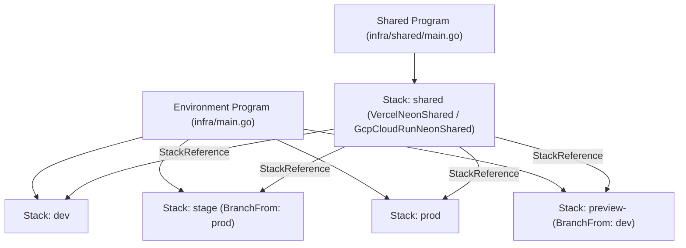

# OpenBase user guide

Write Premise-aligned Go Pulumi programs (`infra/shared/main.go` for cross-environment platform roots and `infra/main.go` for per-environment stacks) using declarative OpenBase component specs (`<pkg>.<Product>{...}.Register(ctx)`) across `shared`, `dev`, `stage`, `prod`, and `preview-<slug>` using your ambient GCP, Vercel, Neon, and Kinde credentials.

## Stack topology



## 1. Install OpenBase in your workspace

```sh
go get github.com/cloudvoyant/openbase/libs/components@latest
```

## 2. Quickstart with `libs/components/composite` (Premise layout)

In `premise.yaml`, configure `workspace.infra.directory: infra` and `workspace.infra.shared_directory: infra/shared`.

### `infra/shared/main.go` (`name: storefront-shared`, deployed via `pm infra apply --shared`)

```go
package main

import (
	"os"

	"github.com/cloudvoyant/openbase/libs/components/composite"
	"github.com/cloudvoyant/openbase/libs/components/kinde"
	"github.com/pulumi/pulumi/sdk/v3/go/pulumi"
)

func main() {
	pulumi.Run(func(ctx *pulumi.Context) error {
		_, err := composite.VercelNeonShared{
			Project:   "storefront",
			TeamID:    os.Getenv("VERCEL_TEAM_ID"),
			TeamSlug:  "acme",
			NeonOrgID: os.Getenv("NEON_ORG_ID"),
			Auth: &composite.KindeSharedConfig{
				Dev: kinde.TenantCredentials{
					Domain:       os.Getenv("KINDE_DEV_TENANT_DOMAIN"),
					ClientID:     pulumi.String(os.Getenv("KINDE_DEV_M2M_CLIENT_ID")),
					ClientSecret: pulumi.String(os.Getenv("KINDE_DEV_M2M_CLIENT_SECRET")),
				},
				Prod: kinde.TenantCredentials{
					Domain:       os.Getenv("KINDE_PROD_TENANT_DOMAIN"),
					ClientID:     pulumi.String(os.Getenv("KINDE_PROD_M2M_CLIENT_ID")),
					ClientSecret: pulumi.String(os.Getenv("KINDE_PROD_M2M_CLIENT_SECRET")),
				},
			},
		}.Register(ctx)
		return err
	})
}
```

### `infra/main.go` (`name: storefront`, deployed via `pm infra apply --env dev|stage|prod|preview`)

```go
package main

import (
	"os"

	"github.com/cloudvoyant/openbase/libs/components/composite"
	"github.com/pulumi/pulumi/sdk/v3/go/pulumi"
)

func main() {
	pulumi.Run(func(ctx *pulumi.Context) error {
		_, err := composite.VercelNeonApp{
			Name:      "web",
			Project:   "storefront",
			TeamID:    os.Getenv("VERCEL_TEAM_ID"),
			TeamSlug:  "acme",
			SourceDir: "../apps/web",
			Auth:      &composite.KindeAppConfig{},
		}.Register(ctx)
		return err
	})
}
```

`VercelNeonApp` automatically resolves `SharedStackRef` to `<org>/<project>-shared/shared` — no Kinde M2M admin credentials or Neon org IDs are needed in `infra/main.go`. Swap `VercelNeonShared` + `VercelNeonApp` for `GcpCloudRunNeonShared` + `GcpCloudRunNeonApp` to target Cloud Run + GCS + Neon + Kinde with the exact same Premise stack lifecycle.

## 3. Custom composition in `infra/main.go`

Branch on `core.ResolveEnvironment(ctx, "")`: provision shared project prerequisites when `env == core.EnvShared`, and provision per-environment stateful and stateless resources on `dev`, `stage`, `prod`, and `preview-<slug>`.

```go
package main

import (
	"os"

	"github.com/cloudvoyant/openbase/libs/components/core"
	"github.com/cloudvoyant/openbase/libs/components/gcp"
	"github.com/cloudvoyant/openbase/libs/components/kinde"
	"github.com/cloudvoyant/openbase/libs/components/neon"
	"github.com/cloudvoyant/openbase/libs/components/vercel"
	"github.com/pulumi/pulumi/sdk/v3/go/pulumi"
)

func main() {
	pulumi.Run(func(ctx *pulumi.Context) error {
		env, err := core.ResolveEnvironment(ctx, "")
		if err != nil {
			return err
		}
		if env == core.EnvShared {
			return deployShared(ctx)
		}
		return deployEnvironment(ctx, env)
	})
}

func deployShared(ctx *pulumi.Context) error {
	gcpShared, err := gcp.Shared{
		Name:           "gcp",
		Project:        "storefront",
		GCPProject:     pulumi.String(os.Getenv("GCP_PROJECT")),
		GitHubOrg:      "acme",
		VercelTeamSlug: "acme",
	}.Register(ctx)
	if err != nil {
		return err
	}
	vercelShared, err := vercel.Shared{
		Name:            "vercel",
		Project:         "storefront",
		TeamID:          os.Getenv("VERCEL_TEAM_ID"),
		TeamSlug:        "acme",
		EnableBlobStore: true,
	}.Register(ctx)
	if err != nil {
		return err
	}
	neonShared, err := neon.SharedProject{
		Name:     "neon",
		Project:  "storefront",
		RegionID: "aws-us-east-1",
	}.Register(ctx)
	if err != nil {
		return err
	}
	kindeShared, err := kinde.SharedOidcApp{
		Name:           "kinde",
		Project:        "storefront",
		VercelTeamSlug: "acme",
		Dev: kinde.TenantCredentials{
			Domain:       os.Getenv("KINDE_DEV_TENANT_DOMAIN"),
			ClientID:     pulumi.String(os.Getenv("KINDE_DEV_M2M_CLIENT_ID")),
			ClientSecret: pulumi.String(os.Getenv("KINDE_DEV_M2M_CLIENT_SECRET")),
		},
		Prod: kinde.TenantCredentials{
			Domain:       os.Getenv("KINDE_PROD_TENANT_DOMAIN"),
			ClientID:     pulumi.String(os.Getenv("KINDE_PROD_M2M_CLIENT_ID")),
			ClientSecret: pulumi.String(os.Getenv("KINDE_PROD_M2M_CLIENT_SECRET")),
		},
	}.Register(ctx)
	if err != nil {
		return err
	}
	ctx.Export("projectId", vercelShared.ProjectID)
	ctx.Export("stageCustomEnvironmentId", vercelShared.StageCustomEnvironmentID)
	ctx.Export("blobStoreId", vercelShared.BlobStoreID)
	ctx.Export("neonProjectId", neonShared.ProjectID)
	ctx.Export("neonDefaultBranchId", neonShared.DefaultBranchID)
	ctx.Export("wifPoolName", gcpShared.WorkloadIdentityPoolName)
	ctx.Export("vercelOidcProvider", gcpShared.VercelOIDCProviderName)
	ctx.Export("devIssuerUrl", kindeShared.DevIssuerURL)
	ctx.Export("devClientId", kindeShared.DevClientID)
	ctx.Export("devClientSecret", kindeShared.DevClientSecret)
	ctx.Export("prodIssuerUrl", kindeShared.ProdIssuerURL)
	ctx.Export("prodClientId", kindeShared.ProdClientID)
	ctx.Export("prodClientSecret", kindeShared.ProdClientSecret)
	return nil
}

func deployEnvironment(ctx *pulumi.Context, env core.Environment) error {
	branchFrom := ""
	if env.IsPreview() {
		branchFrom = "dev"
	}
	uploads, err := gcp.Bucket{
		Name:            "uploads",
		Project:         "storefront",
		BranchFrom:      branchFrom,
		BucketNamespace: os.Getenv("GCP_PROJECT"),
	}.Register(ctx)
	if err != nil {
		return err
	}
	dbBranch := branchFrom
	if env == core.EnvStage {
		dbBranch = "prod"
	}
	db, err := neon.Database{
		Name:           "db",
		Project:        "storefront",
		BranchFrom:     dbBranch,
		SharedStackRef: "organization/storefront/shared",
	}.Register(ctx)
	if err != nil {
		return err
	}
	oidc, err := kinde.OidcApp{
		Name:           "auth",
		Project:        "storefront",
		SharedStackRef: "organization/storefront/shared",
		VercelTeamSlug: "acme",
	}.Register(ctx)
	if err != nil {
		return err
	}
	api, err := gcp.CloudRunService{
		Name:       "orders",
		Project:    "storefront",
		Links:      []core.Resource{uploads, db, oidc},
		Visibility: gcp.VisibilityInternal,
		Image:      pulumi.String("us-central1-docker.pkg.dev/my-proj/storefront/orders:latest"),
	}.Register(ctx)
	if err != nil {
		return err
	}
	_, err = vercel.WebApp{
		Name:           "web",
		Project:        "storefront",
		Links:          []core.Resource{api, uploads, db, oidc},
		SharedStackRef: "organization/storefront/shared",
		TeamSlug:       "acme",
		SourceDir:      "../apps/web",
	}.Register(ctx)
	return err
}
```

## 4. Deploy stacks against a GCS state backend

```sh
pulumi login gs://my-org-pulumi-state/storefront

pulumi stack init shared && pulumi up --stack shared
pulumi stack init dev    && pulumi up --stack dev
pulumi stack init prod   && pulumi up --stack prod
pulumi stack init stage  && pulumi up --stack stage

# Ephemeral pull-request preview stack
pulumi stack init preview-pr-42 && pulumi up --stack preview-pr-42
pulumi destroy --stack preview-pr-42 --yes && pulumi stack rm preview-pr-42 --yes
```

## 5. Zero-copy storage reads in Go

- **Google Cloud Storage (`libs/components/gcp/overlayfs`)**: Call `overlayfs.NewStoreFromEnv(storageClient, "STORAGE")` so `preview-*` reads fall back to `dev` on `storage.ErrObjectNotExist` while writes stay isolated in the preview bucket.
- **Vercel Blob (`libs/components/vercel`)**: Call `vercel.NewBlobOverlayClient(baseURL, token, os.Getenv("BLOB_PREFIX"), os.Getenv("BLOB_FALLBACK_PREFIX"))` for prefix-isolated writes and fallback reads.

## Further reading

- [Architecture Overview](./architecture/index.md)
- [Resource Contracts & Escape Hatches](./architecture/resources.md)
- [GCP Provider](./architecture/providers/gcp.md)
- [Vercel Provider](./architecture/providers/vercel.md)
- [Neon Provider](./architecture/providers/neon.md)
- [Kinde Provider](./architecture/providers/kinde.md)
